<div align="center">

# Open Eye

### Before you build it, find out what already exists.

Give Open Eye a project brief. It finds the open-source code that already solves each requirement,<br>
**checks every claim against the code itself**, and tells you, requirement by requirement,<br>
what to **reuse**, what to **adapt** and what you still have to **build**, with a citation behind every decision.

[Quick start](#quick-start) ·
[How it works](#how-it-works) ·
[Results](#measured-not-claimed) ·
[Architecture](#architecture) ·
[User guide](docs/USER_GUIDE.md) ·
[Documentation](#documentation)


</div>

---

## Why Open Eye

Engineering teams lose weeks building things that already exist, and lose more adopting projects whose READMEs promise features the code does not have. Searching GitHub by stars does not tell you either.

Open Eye does the research a senior engineer would do before a build starts:

- **It reads the brief, not just keywords.** Requirements come out with a priority (MUST, SHOULD, NICE TO HAVE), testable acceptance criteria, stated assumptions and at most three questions back to you.
- **It searches the way an expert would.** It plans queries by kind of tool, across GitHub, npm, crates.io, deps.dev, OSV, Stack Exchange and the web, and stops when new queries stop finding anything.
- **It does not trust READMEs.** The strongest candidates are cloned and parsed. A capability counts as verified only when it is found in the code, at a file, a line range and a commit.
- **It says what it does not know.** Every claim carries an evidence grade. Unverified claims are labelled as such, never presented as facts.
- **It remembers.** Verified findings, past runs and research tactics that worked are kept and reused, so the next brief starts from what is already known.

## What you get

| | |
|---|---|
| **Briefs** | Paste or upload a project brief. Get ranked starting points and a staged engineering blueprint: recommendation, build-versus-reuse decision per requirement, architecture, integration guide, roadmap, risks and sources. |
| **Challenge and deepen** | Disagree with a decision and say why; the blueprint answers from the evidence and says whether the decision changed. Or send Open Eye back to dig deeper into one requirement. |
| **Build mode** | Pick roadmap items and authorise a build. Open Eye writes the code and its tests, runs them in an isolated sandbox, and hands you a diff or opens a draft pull request. Nothing is pushed without your approval. |
| **Studio** | Ask questions about any indexed repository. Answers stream with numbered citations to the exact file and lines; each citation opens the code it rests on. |
| **Library and Capabilities** | Everything Open Eye has read: GitHub repositories, docs sites, articles, papers, PDFs and videos, with what each solves and the capabilities found in its code. |
| **Memory** | Graded facts, past runs and learned procedures. Refute a wrong fact and every blueprint that cited it is rewritten. |
| **Evaluation and Evolution** | A labelled benchmark measures every change. Ranking only changes when a new configuration beats the current one beyond the noise between runs, and every change can be rolled back. |

## How it works

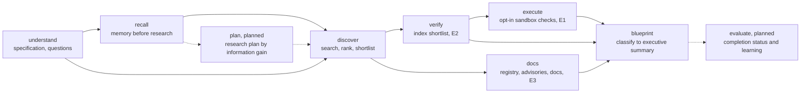

<sub>Solid boxes are built; dashed ones are on the <a href="docs/ROADMAP.md">roadmap</a>.</sub>

Each step is a task in a run graph. Steps run as soon as their inputs are ready, results appear while the rest of the run continues, and changing a constraint or answering a question re-runs only the steps it affects. Every run has a budget (AI calls, tokens, GitHub requests, source requests); when it runs out, the run stops cleanly and can be resumed.

### Evidence grades

Every claim in a blueprint, an answer or memory carries one of five grades.

| Grade | Meaning |
|:---:|---|
| **E1** | Executed: observed by running the code in a sandbox |
| **E2** | Verified in code at a file, a line range and a commit |
| **E3** | Officially documented or reported by the platform |
| **E4** | Claimed by a README or article, not yet checked |
| **E5** | Inferred by Open Eye |

### Build versus reuse

Each requirement gets exactly one class. Classes 1 to 3 need E1 to E3 evidence.

| Class | Decision |
|:---:|---|
| **1** | Available and verified |
| **2** | Available, needs configuration |
| **3** | Available, needs modification |
| **4** | Partially solved |
| **5** | Missing, must be built |
| **6** | Unresolved: verify before relying on it |

## Measured, not claimed

Open Eye is scored on a benchmark of real briefs whose expected solutions were labelled in advance, and compared with plain GitHub search.

| | Plain GitHub search | Open Eye |
|---|:---:|:---:|
| **Recall@10**: share of the expected essential solutions in the top 10 | 0.063 | **0.341** (0.305–0.365) |
| **Shortlist precision**: share of recommended starting points that are essential or acceptable | 0.033 | **0.255** (0.243–0.276) |
| Time per brief | 1 s | 58 s |
| AI calls per brief | 0 | 60 |

<sub>Mean over three runs, with the range across runs in brackets; differences inside the range are noise. Measured with `ministral-8b` on suite-v1. The suite's labels are still a draft (one labeller, checked against GitHub, not yet independently reviewed), so treat these numbers as provisional. Full report: <a href="eval/results/suite-v1/BASELINE.md">eval/results/suite-v1/BASELINE.md</a>.</sub>

## Quick start

**You need:** Node.js 20+, pnpm 9, Python 3.11+, PostgreSQL 16+ with [pgvector](https://github.com/pgvector/pgvector) (or Docker), and a [Mistral](https://console.mistral.ai) API key.

```bash
# 1. Get the code and the JavaScript dependencies
git clone https://github.com/priteshvirat24/repo-intelligence.git open-eye
cd open-eye
pnpm install

# 2. Start PostgreSQL with pgvector (or point DATABASE_URL at your own)
docker compose up -d postgres

# 3. Configure: set DATABASE_URL, DATABASE_POOLED_URL, LLM_API_KEY and EMBEDDING_API_KEY
cp .env.example .env

# 4. Create the schema
pnpm db:migrate

# 5. Set up and start the worker (keep it running)
python3.11 -m venv apps/worker/venv
apps/worker/venv/bin/pip install -r apps/worker/requirements.txt
apps/worker/venv/bin/python -m apps.worker.worker

# 6. In a second terminal, start the web app
pnpm dev
```

Open **http://localhost:3000**, click **Add repository** and paste a public GitHub URL. Then go to **Briefs** and describe something you want to build.

Check that everything is connected at **http://localhost:3000/api/health**: it reports the database, the worker's heartbeat and each provider.

### Configuration

The keys below are the ones that change what Open Eye can do. [`.env.example`](.env.example) lists the rest with defaults.

| Variable | What it enables |
|---|---|
| `DATABASE_URL`, `DATABASE_POOLED_URL` | The database. Both are required; the pooled URL is preferred when set. |
| `LLM_API_KEY`, `EMBEDDING_API_KEY` | Reasoning and embeddings (Mistral by default; OpenAI is supported). Open Eye fails loudly without them; there is no mock mode. |
| `GITHUB_TOKEN` | Higher GitHub rate limits during discovery. |
| `TAVILY_API_KEY` | Live web search: the Studio's Web and Both modes, and docs discovery. |
| `STACKEXCHANGE_KEY` | Higher Stack Exchange limits for the docs step. |
| `AUTH_GITHUB_ID`, `AUTH_GITHUB_SECRET`, `AUTH_SECRET` | GitHub sign-in and separate workspaces. Set `REQUIRE_AUTH=true` on any public deployment. |
| `SANDBOX_PROVIDER` | `docker` or `e2b` (`e2b` also needs `E2B_API_KEY`). Enables build mode and E1 sandbox checks. |
| `GITHUB_BUILD_TOKEN` | Lets build mode open draft pull requests. |
| `MAX_REPOSITORY_SIZE_MB`, `MAX_CHUNKS`, `MAX_SUBSYSTEMS` | How much of a repository is analysed. Raise them for deeper analysis of large repositories, at the cost of time and AI calls. |

## Architecture

Three parts share one database, and the database is the only contract between them. The web app never calls the worker: it writes jobs and tasks, and the worker claims them with `FOR UPDATE SKIP LOCKED`, so you can run as many workers as you need.

### High-level design (HLD)

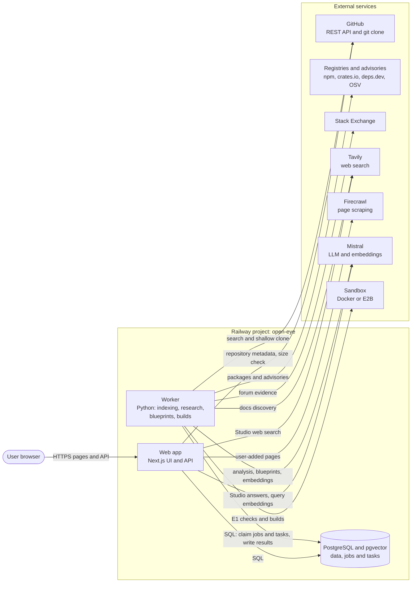

### System design: components

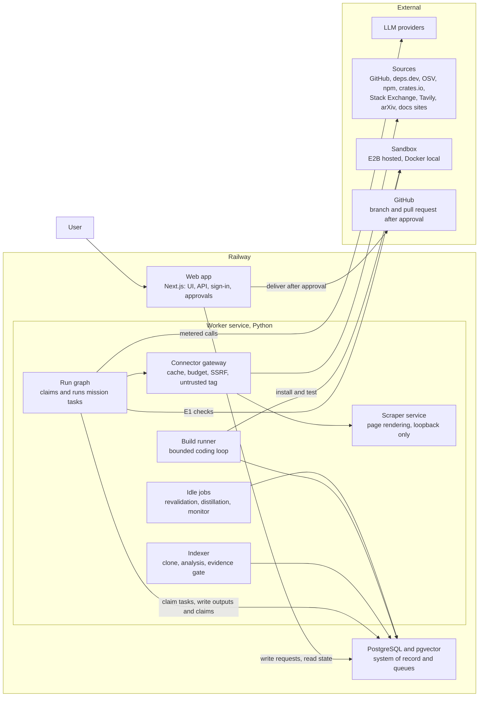

### Deployment

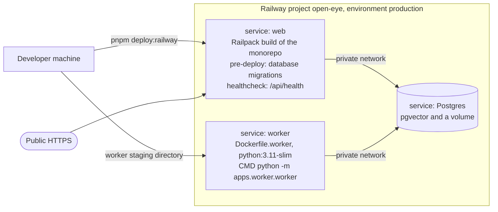

### Adding a repository

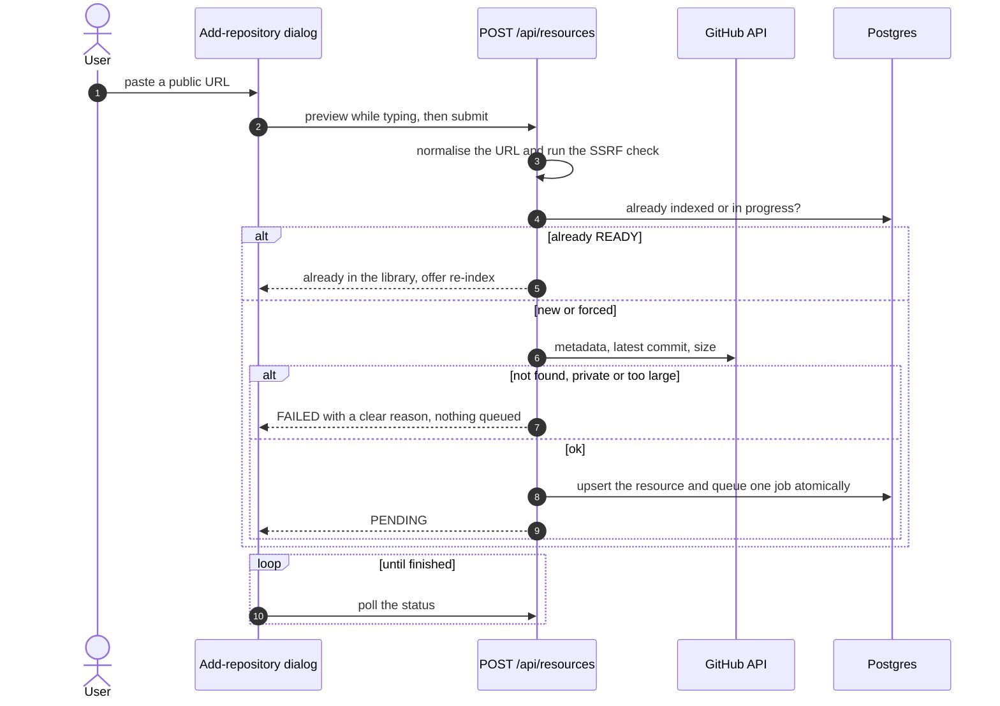

### The indexing pipeline

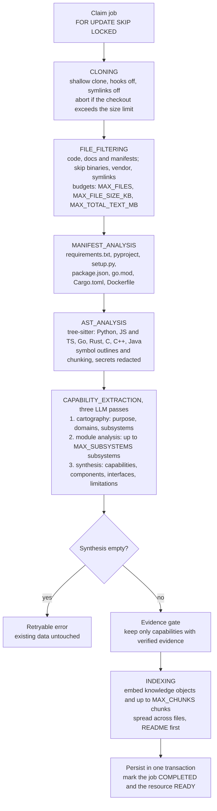

### The evidence gate

A capability is kept only if the model's claim can be found in the code.

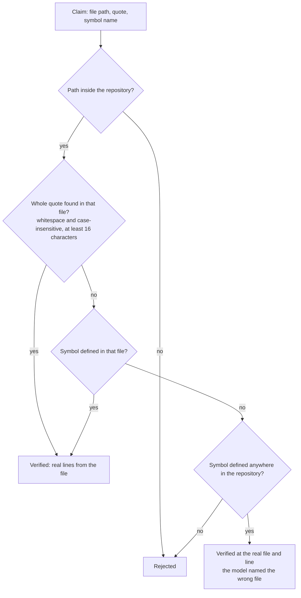

### The job queue

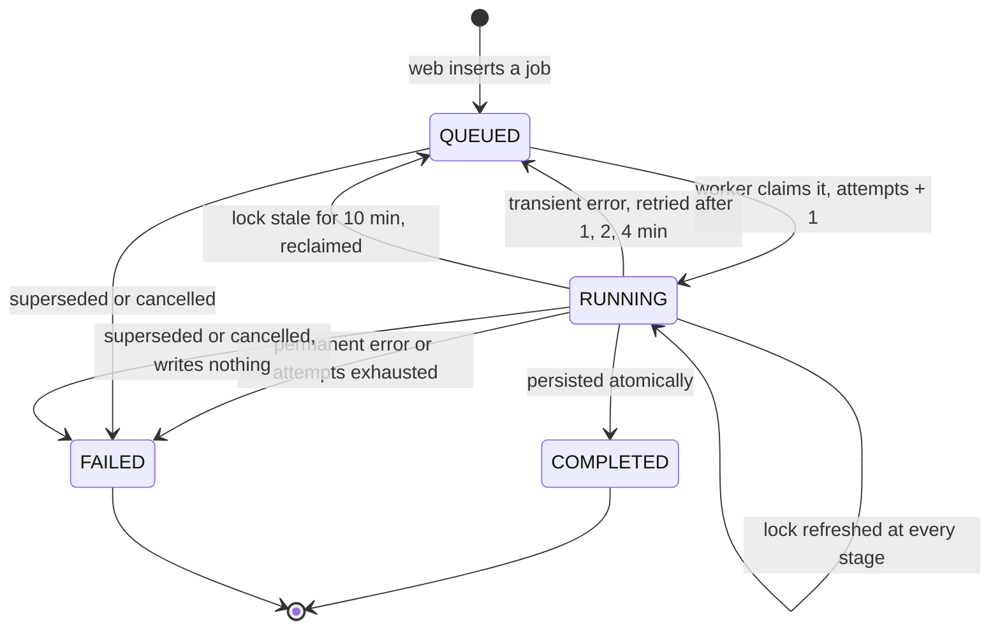

### Retrieval in one picture

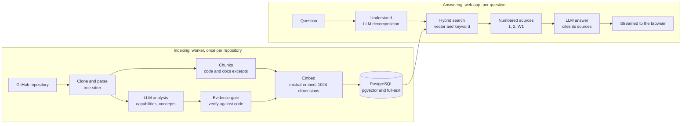

### How a file becomes chunks

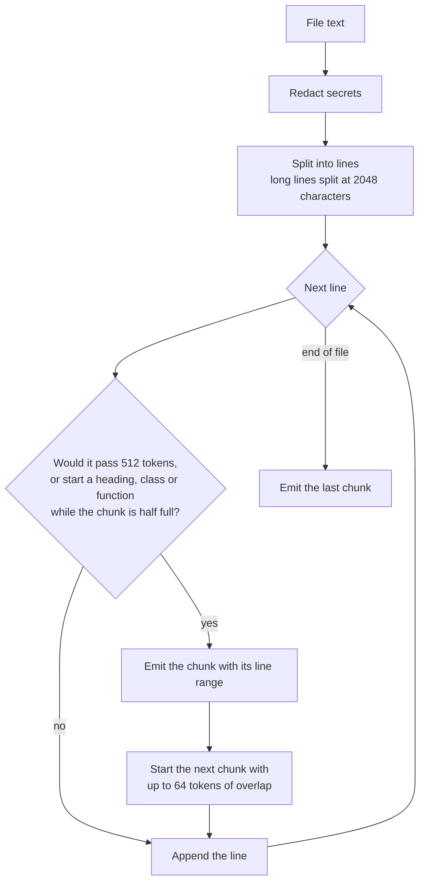

### Answering a question in the Studio

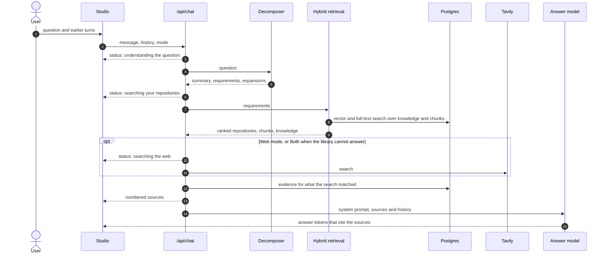

### Ranking repositories for an answer

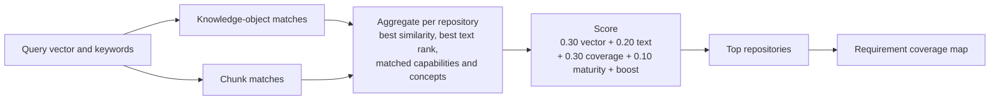

### How Open Eye reaches the web

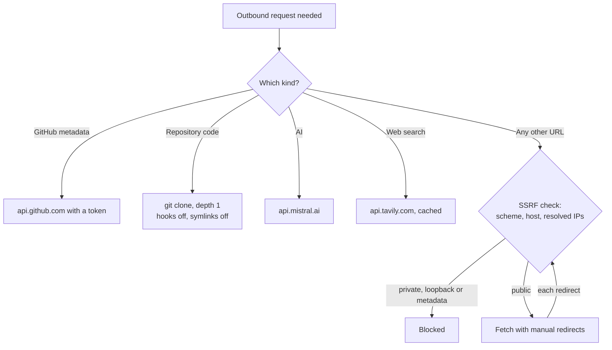

### Data model: research

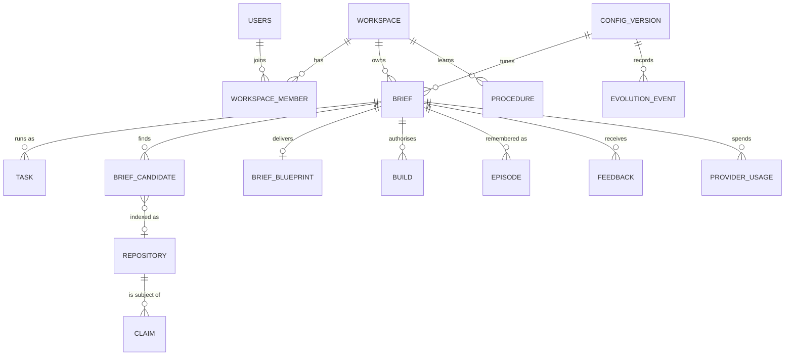

### Data model: the index

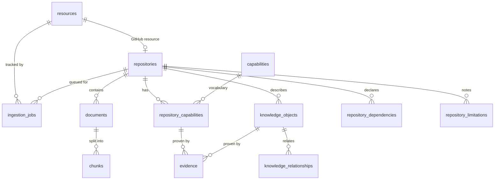

### Memory

What Open Eye remembers, and how a fact stays tied to its evidence and to the decisions that rely on it.

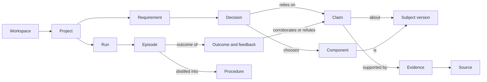

### Evolution

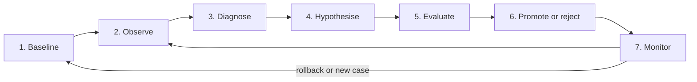

### When something fails

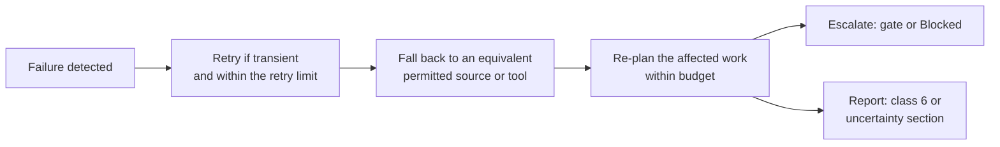

### Stack

| Layer | Built with |
|---|---|
| Web | Next.js 14 App Router, React 18, a token-based CSS design system with light and dark themes, server-sent events for streaming answers |
| Worker | Python 3.11, tree-sitter parsing for Python, JavaScript and TypeScript, Go, Rust, C and C++ and Java, a connector gateway with budget, cache and SSRF checks |
| Data | PostgreSQL with pgvector (1024-dimension embeddings) and full-text search; one transaction per indexed repository |
| AI | Mistral (`ministral-8b` for reasoning, `mistral-embed` for embeddings); OpenAI supported |
| Hosting | Railway (web, worker and database), with migrations run before each deploy |

### Repository layout

```text
apps/
  web/          Next.js app: pages, API routes, UI components
  worker/       Python worker: indexing, discovery, verification, memory, evolution, builds
packages/
  database/     SQL migrations and the database client
  shared/       Types shared by the web app and the worker
eval/           Benchmark suite, labels and committed results
docs/           Product definition, system design and specifications
tests/          Worker, web and integration tests
```

## Trust and safety

- **Fetched content is data, never instructions.** Every page, README and transcript is wrapped as untrusted input; instruction-like text inside it is logged, not followed.
- **No way around access controls.** Open Eye never signs in, solves CAPTCHAs or passes paywalls. A sign-in wall is reported as blocked, and every outbound fetch passes an SSRF check. A stealth browser reads public pages that turn away automated clients, within the limits set in [decision 14](docs/PRODUCT_DEFINITION.md).
- **Third-party code runs only in a sandbox**, only after you opt in, with no secrets and no network while tests run.
- **It never changes itself.** Ranking weights change only on benchmark evidence; prompts and strategies need a maintainer's approval; code and security changes always go through a reviewed pull request.

## Testing and evaluation

```bash
# Worker tests
apps/worker/venv/bin/python -m pytest tests/worker -q

# Web tests and type checks
cd apps/web && npx tsx --test ../../tests/web/*.ts && npx tsc --noEmit && cd ../..

# Run the benchmark (see eval/README.md for the protocol)
apps/worker/venv/bin/python -m apps.worker.eval.run --suite eval/suite-v1 --system b1 --mode record
```

## Documentation

| Start here | |
|---|---|
| [User guide](docs/USER_GUIDE.md) | Every screen and control, and how to run Open Eye |
| [Product definition](docs/PRODUCT_DEFINITION.md) | What the finished product is, who it is for and how it behaves |
| [System design](docs/SYSTEM_DESIGN.md) | Components, data flows and where the build stands |

| Specifications | |
|---|---|
| [Autonomy](docs/AUTONOMY_SPEC.md) · [Memory](docs/MEMORY_SPEC.md) · [Evolution](docs/EVOLUTION_SPEC.md) | How Open Eye runs on its own, what it remembers, how it improves |
| [Research strategy](docs/RESEARCH_STRATEGY.md) | Sources, retrieval layers and access rules |
| [Evaluation plan](docs/EVALUATION_PLAN.md) · [Acceptance](docs/ACCEPTANCE.md) | How quality is measured, and the checklist for done |
| [Technology decisions](docs/TECHNOLOGY_DECISIONS.md) · [Roadmap](docs/ROADMAP.md) | What was chosen and why, and what comes next |
| [Architecture](docs/ARCHITECTURE.md) · [Retrieval](docs/RAG.md) | Diagrams, the data model, chunking, retrieval and answer generation |

## Status

Open Eye is pre-release. The full research pipeline, blueprint, memory, evolution and build mode are implemented and tested; the [roadmap](docs/ROADMAP.md) and the [acceptance checklist](docs/ACCEPTANCE.md) list what is left, including enforced sign-in for public deployments, pause and resume for missions, and an independently reviewed benchmark.

## Contributing

Issues and pull requests are welcome. Before opening a pull request:

1. Run the worker tests, the web tests and the type check (see [Testing and evaluation](#testing-and-evaluation)).
2. If the change can affect ranking or research quality, run the benchmark and include the before-and-after numbers.
3. Keep claims honest: a feature that is not verified in the product does not go in the docs as done.
