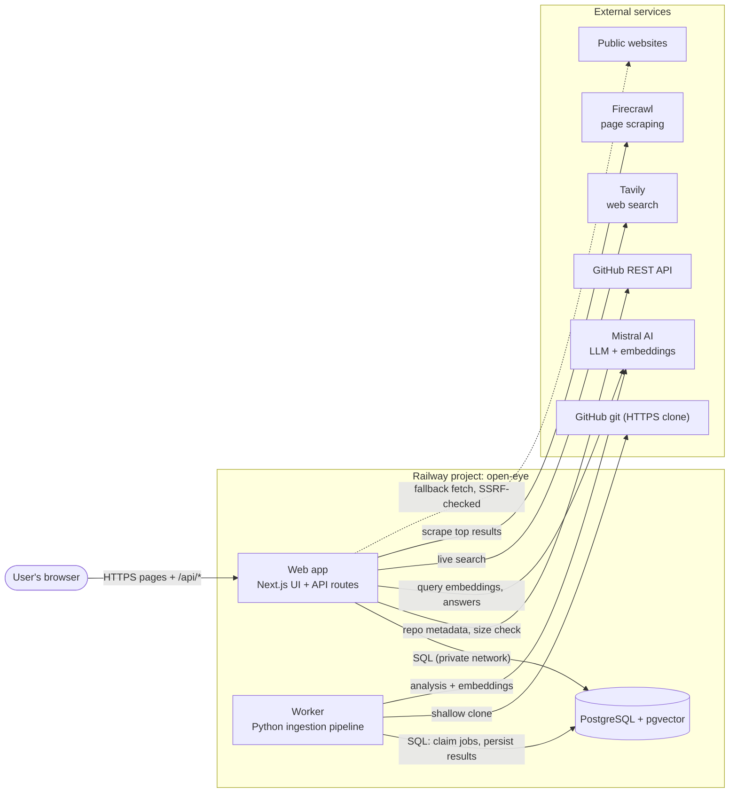
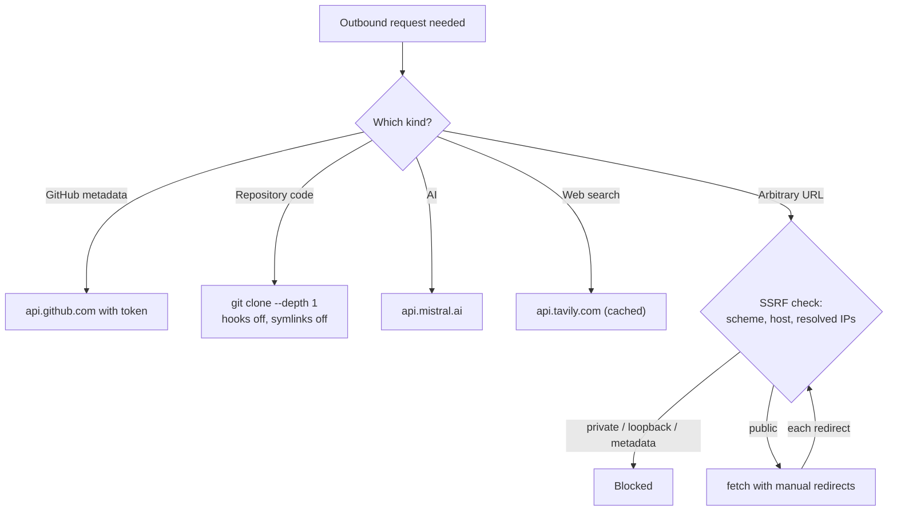
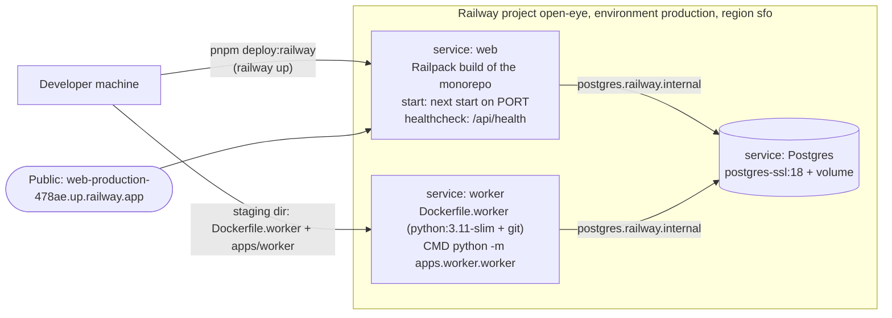
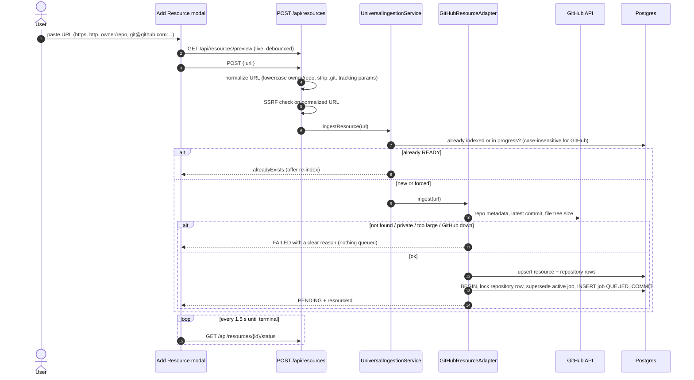
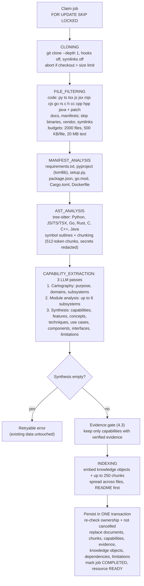
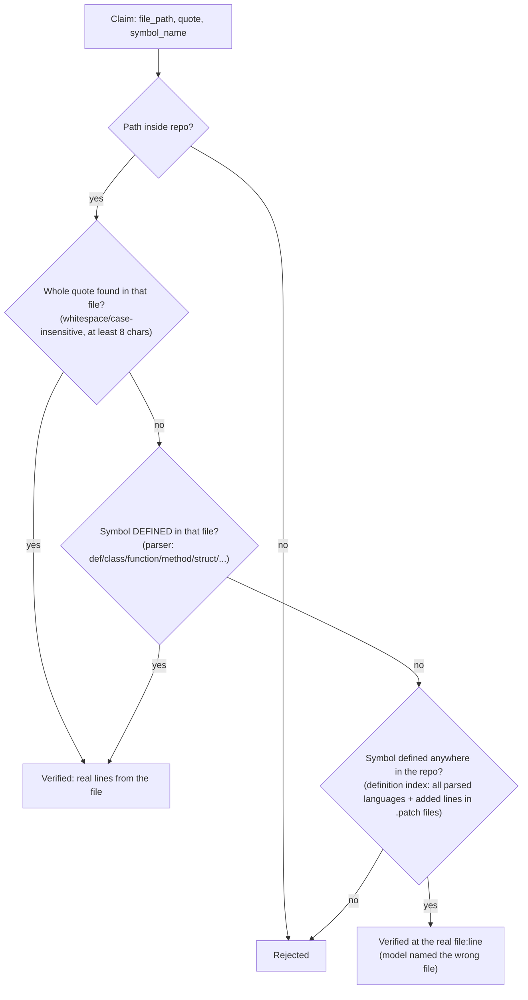
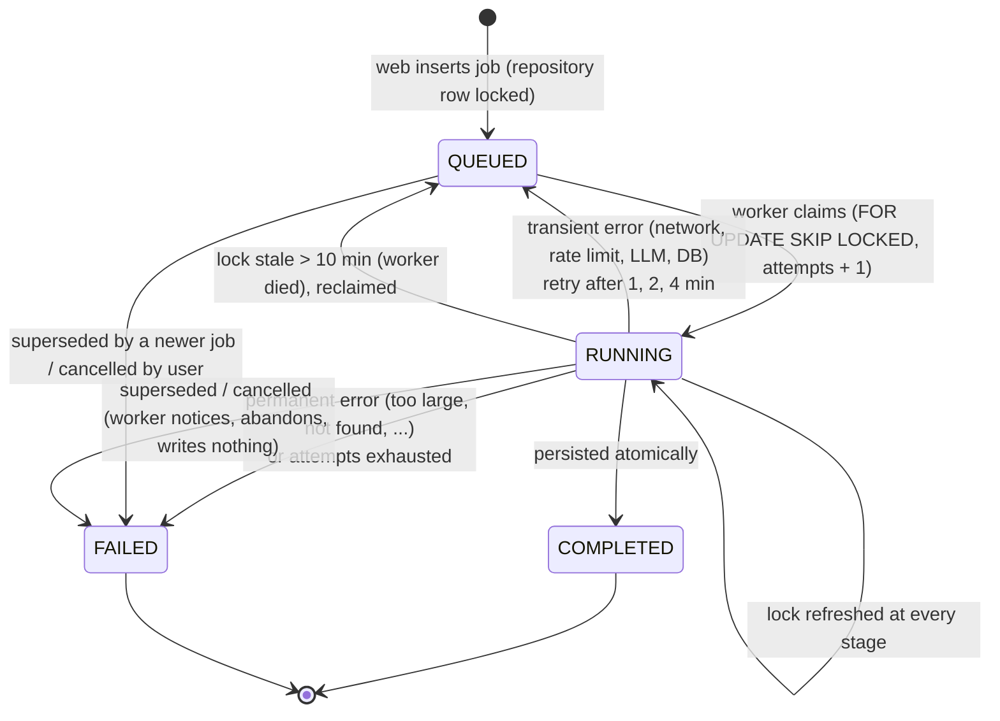
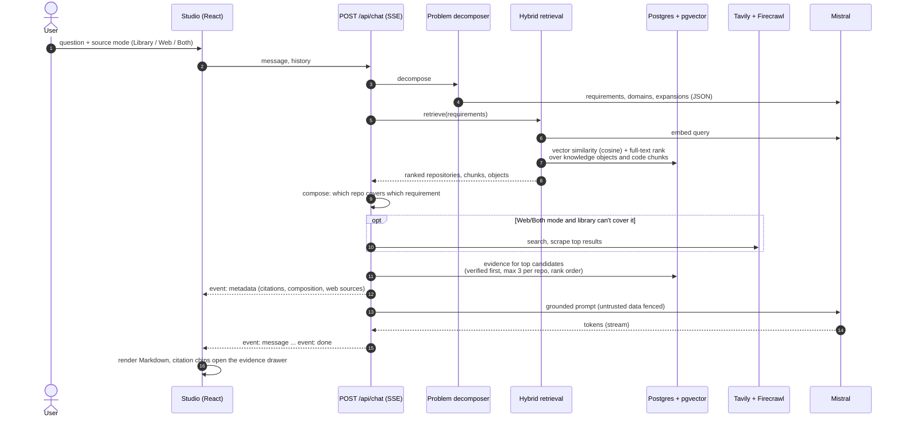
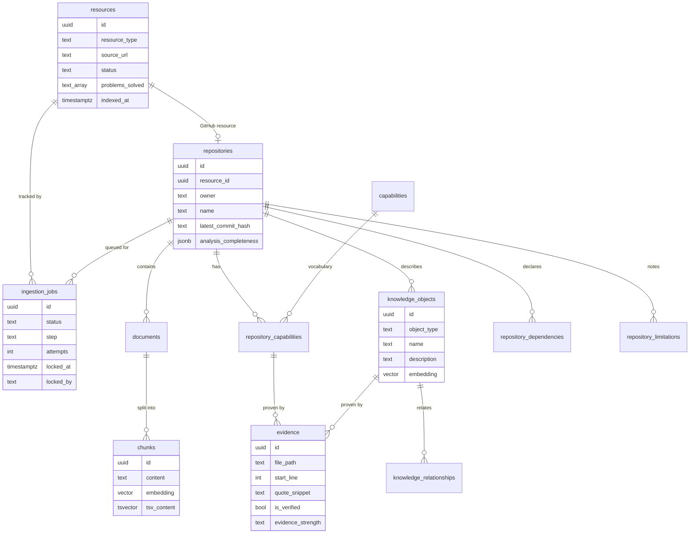

# Open Eye — Architecture

Open Eye indexes public GitHub repositories, works out what each one can do, and answers questions about them. Every capability it stores is tied to a real definition in the code (file + line); anything it cannot verify is labelled *inferred*, never presented as fact.

This document covers:

1. [High-level design (HLD)](#1-high-level-design-hld)
2. [How Open Eye reaches the web](#2-how-open-eye-reaches-the-web)
3. [Deployment on Railway](#3-deployment-on-railway)
4. [Low-level design (LLD)](#4-low-level-design-lld)
   - 4.1 Adding a repository
   - 4.2 The indexing pipeline (worker)
   - 4.3 The evidence gate
   - 4.4 The job queue
   - 4.5 Answering a question (Studio chat)
5. [Data model](#5-data-model)
6. [Repository layout](#6-repository-layout)
7. [Safety guarantees](#7-safety-guarantees)
8. [Configuration](#8-configuration)
9. [Build, test, deploy](#9-build-test-deploy)

> Diagrams are written in Mermaid. They render on GitHub, in VS Code (with a Mermaid extension) and most Markdown viewers.

---

## 1. High-level design (HLD)

Three running parts, one database:

| Part | Tech | Job |
|---|---|---|
| **Web app** | Next.js 14 (React UI + API routes), TypeScript | UI, accepts repositories, answers questions, live web search |
| **Worker** | Python 3.11, tree-sitter, psycopg2 | Clones and analyses repositories in the background |
| **Database** | PostgreSQL 18 + pgvector | Everything: resources, jobs (the queue), code chunks, embeddings, knowledge, evidence |

The web app and the worker never call each other. **The database is the only contract between them**: the web app writes a job row, the worker claims it, and both read/write the same tables.



**Two flows drive everything:**

- **Indexing (write path):** user adds a repo → web validates it and queues a job → worker clones, parses, asks the LLM to describe it, verifies every claim against the code, embeds text, and saves it all in one transaction.
- **Asking (read path):** user asks a question → web turns it into requirements → hybrid search (vectors + full-text) over indexed knowledge → optional live web search → LLM writes the answer, streamed back with verified citations.

---

## 2. How Open Eye reaches the web

Open Eye does **not** browse freely. Every outbound connection is listed here; there are no others.

| From | Destination | When | What it fetches | Safeguards |
|---|---|---|---|---|
| Web | `api.github.com/repos/{o}/{r}` | Adding / re-indexing a repo | Name, default branch, stars, licence, private flag | Authenticated with `GITHUB_TOKEN` (5,000 req/h); fails clearly if GitHub is down — never invents metadata |
| Web | `api.github.com/.../commits/{branch}` | Same | Latest commit SHA (skip re-index if unchanged) | — |
| Web | `api.github.com/.../git/trees/{branch}?recursive=1` | Same | Size of the files at the latest commit | Enforces `MAX_REPOSITORY_SIZE_MB` on what is actually downloaded, not git history |
| Worker | `github.com/{o}/{r}.git` (git over HTTPS) | Indexing | The latest snapshot only (`--depth 1`) | Hooks disabled, symlinks checked out as plain files, 120 s timeout, post-clone size check, deleted after the job |
| Web + Worker | `api.mistral.ai/v1/chat/completions` | Indexing (4 passes) and answering | LLM analysis / answers | JSON mode; truncated or empty output is rejected and retried; no mock fallback |
| Web + Worker | `api.mistral.ai/v1/embeddings` | Indexing and every question | 1024-d vectors (`mistral-embed`) | Same provider on both sides so vectors are comparable |
| Web | `api.tavily.com/search` | Chat in *Web* or *Both* mode when the library can't cover the question | Top 4 web results | Results cached in `web_search_cache`; 20 s timeout |
| Web | `api.firecrawl.dev/v1/scrape` | Top 1–2 web results with thin snippets | Clean Markdown of the page | Page status checked (404/500 pages are not used) |
| Web | Any public URL (native `fetch`) | Firecrawl unavailable, or adding a web/PDF resource | Raw HTML / PDF | **SSRF guard** before every request and every redirect hop: http(s) only, no localhost/private/link-local/metadata IPs (DNS-resolved), 20 MB streamed cap for PDFs |
| Web | `youtube.com` (oEmbed, captions) | Adding a YouTube video (de-emphasised) | Title, channel, public transcript | Missing/private video → fails; no transcript → not analysed |

The user's browser only ever talks to the web app. External API keys live in Railway variables, never in the browser.



---

## 3. Deployment on Railway



- **Deploys are uploads, not git-triggered.** `scripts/deploy-railway.sh` (`pnpm deploy:railway [web|worker|all]`) uploads code. The worker is uploaded from a staging folder so the web build config never applies to it.
- **Health check:** Railway routes traffic to a new web deploy only after `GET /api/health` returns 200 (it returns 503 if the database is unreachable). Defined as code in `.railway/railway.ts` (`railway config plan` / `apply`).
- **Database is private:** reachable only on Railway's internal network.
- **Variables** (API keys, `DATABASE_URL`) are managed in Railway, not in code. The web service's `GITHUB_TOKEN` is a reference to the worker's.

---

## 4. Low-level design (LLD)

### 4.1 Adding a repository



### 4.2 The indexing pipeline (worker)

The worker polls the `ingestion_jobs` table every 2 s. Each stage updates the job's `step` (shown live in the UI) and refreshes its lock.



**Completeness** is recorded honestly: `full`, `partial` (with the reason: file budget hit, N of M excerpts indexed, N of M subsystems studied) or `limited` (fewer than 5 analysable files).

### 4.3 The evidence gate

The LLM proposes evidence for each capability; the gate accepts it only if it can be proven from the code. The stored snippet is always the **real source line**, never the model's text.



Rules that prevent fabricated evidence:

- a mention is not a definition (`import os` never proves anything);
- filenames (`policies.json`) and hyphenated phrases (`font-hijacker`) are not symbols;
- macros (`NS_SUCCEEDED(...)`) and calls are not definitions;
- capabilities with **no** verified evidence are dropped, not stored with placeholders.

### 4.4 The job queue

A plain Postgres table (`ingestion_jobs`) is the queue — no Redis or broker.



Ownership is checked on every write (`locked_by = this worker AND status = 'RUNNING'`), so a cancelled or superseded job can never overwrite newer state. Web/PDF/YouTube jobs (no `repository_id`) are processed inside the web app and are never claimed by the worker.

### 4.5 Answering a question (Studio chat)



---

## 5. Data model

Core tables (see `packages/database/migrations/*.sql`):



Other tables: `worker_heartbeats` (worker liveness for `/api/health`), `web_search_cache`, `provider_usage`, `resource_versions`, `chat_sessions`, `chat_messages`.

---

## 6. Repository layout

```
open-eye/
├── apps/
│   ├── web/                         Next.js app (UI + API)
│   │   ├── app/                     pages: / (Studio), /resources (Library), /capabilities, /repositories/[id]
│   │   │   └── api/                 resources, repositories, chat (SSE), capabilities, health, search/live
│   │   ├── components/              Navbar, AddResourceModal, EvidenceDrawer, ArchitectureGraph, Primitives
│   │   ├── lib/
│   │   │   ├── adapters/            URL detection + per-source adapters (github, web, pdf, youtube), error mapping
│   │   │   ├── ai/                  chat orchestrator, decomposition, hybrid retrieval, composition, providers, web ingestion
│   │   │   ├── github/              GitHub API client (size check), transactional job queue
│   │   │   ├── providers/           Tavily, Firecrawl (+ SSRF-safe native fetch)
│   │   │   ├── security/            SSRF guard, rate limiting
│   │   │   └── validation/          GitHub URL validation
│   │   └── styles/globals.css       design tokens (colour, type, spacing), light + dark
│   └── worker/                      Python ingestion worker
│       ├── worker.py                job loop, pipeline orchestration, retries
│       ├── db/repository.py         queue SQL, ownership checks, atomic persistence
│       ├── github/clone.py          hardened shallow clone, path safety
│       ├── analyzer/                file_filter, metadata (manifests), ast_parser (tree-sitter),
│       │                            chunker (+ secret redaction), cartography, module_analyzer,
│       │                            synthesis, evidence (verification gate), capability (slugs)
│       └── providers/               Mistral/OpenAI LLM + embeddings (no mock fallback)
├── packages/
│   ├── database/                    pg pool + query helper, migrations (001–005), migrate/seed scripts
│   └── shared/                      shared TypeScript types and taxonomy
├── tests/
│   ├── worker/                      pytest: parsers, evidence gate, queue, hardening regressions
│   ├── integration/                 API-level scripts
│   └── fixtures/                    small sample repositories used by tests
├── .railway/railway.ts              Railway infrastructure as code (health check)
├── scripts/deploy-railway.sh        deploy web and/or worker
├── Dockerfile.worker                worker image
└── docs/ARCHITECTURE.md             this document
```

**Monorepo tooling:** pnpm workspaces + Turborepo. The web app consumes `@repo/database` and `@repo/shared` as TypeScript source (no compiled output is committed).

---

## 7. Safety guarantees

| Concern | How it is handled |
|---|---|
| Fabricated knowledge | No mock providers; empty/truncated AI output is retried, never saved; capabilities need verified evidence; UI marks inferred items amber |
| Overwriting good data | One transaction per index; ownership re-checked inside it; empty analyses rejected before persistence |
| SSRF (fetching internal addresses) | Scheme/host/IP checks with DNS resolution on every request and redirect; size-capped streaming |
| Malicious repositories | Git hooks disabled, symlinks not followed, path traversal blocked, clone deleted after use, prompt-injection fenced as untrusted data |
| Secrets in repos | API keys, tokens and private keys redacted before chunks are embedded or evidence is stored |
| Duplicate / racing jobs | Repository row lock when queuing; `SKIP LOCKED` claiming; stale-lock recovery; attempt limits |
| Abuse / cost | Per-IP token-bucket rate limits on write and AI endpoints; debug endpoint disabled in production |
| Broken deploys | Railway health check on `/api/health` |

**Known limitations:** DNS rebinding is not fully closed (the safety check and the fetch resolve DNS separately); very large repositories are analysed partially (budgets above).

---

## 8. Configuration

Set as Railway variables (and `.env` locally):

| Variable | Used by | Purpose |
|---|---|---|
| `DATABASE_URL` | both | Postgres connection |
| `LLM_PROVIDER`, `LLM_API_KEY`, `LLM_MODEL` | both | Mistral (default) or OpenAI |
| `EMBEDDING_PROVIDER`, `EMBEDDING_API_KEY`, `EMBEDDING_MODEL`, `EMBEDDING_DIMENSIONS` | both | Must match on both sides and the DB vector column (1024) |
| `GITHUB_TOKEN` | both | GitHub API rate limit |
| `TAVILY_API_KEY`, `FIRECRAWL_API_KEY` | web | Live web search / scraping (optional) |
| `MAX_REPOSITORY_SIZE_MB`, `MAX_FILE_SIZE_KB`, `MAX_TOTAL_TEXT_MB`, `MAX_FILES` | web + worker | Size budgets |
| `MAX_CHUNKS`, `MAX_SUBSYSTEMS` | worker | Analysis depth (defaults 250, 6) |
| `MAX_JOB_ATTEMPTS`, `JOB_LOCK_TIMEOUT_MINUTES`, `WORKER_POLL_INTERVAL_SECONDS` | worker | Queue behaviour |

---

## 9. Build, test, deploy

```bash
pnpm install                     # workspace dependencies
pnpm build                       # turbo: typecheck packages, build web
apps/worker/venv/bin/python -m pytest tests/worker -q   # worker tests (queue tests need Postgres)
pnpm db:migrate                  # apply SQL migrations
pnpm deploy:railway web          # or: worker | all
railway config plan              # preview infrastructure changes in .railway/railway.ts
```
