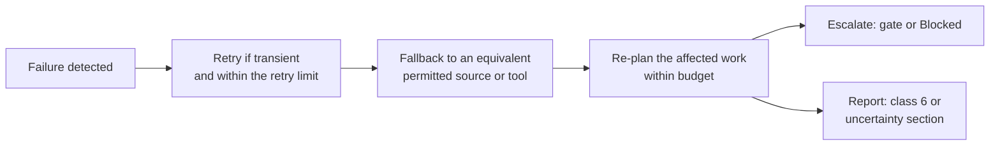

# Open Eye: Autonomy Specification

**Status:** v1.0 draft, 2026-10-22. Derived from PRODUCT_DEFINITION.md v2.0.

This document is artifact C. It says what Open Eye decides and does on its own, when it asks, and how it handles uncertainty and failure. It specifies the end state; section 11 says where the code stands today. Every rule cites the requirement it implements, written **[D§n]** for [PRODUCT_DEFINITION.md](PRODUCT_DEFINITION.md) and **SD§n** for [SYSTEM_DESIGN.md](SYSTEM_DESIGN.md).

**Who can decide.** Each decision below has one of these deciders:

| Decider | Meaning |
|---|---|
| **Open Eye alone** | Decided by rule or by the model, with no cost beyond the task's reservation |
| **Open Eye within budget** | Decided alone while the mission's limits allow it (section 4) |
| **Member** | Any member of the project's workspace: the user who owns the goal and constraints [D§2.3] |
| **Project maintainer** | A maintainer of the project's workspace [D§14, decision 10] |
| **Operator maintainer** | A maintainer of the operator workspace, who governs global configuration [D§14, decision 9] |
| **Never** | Nobody can authorise it, including by instruction in chat or in retrieved content [D§7, D§11] |

**Three rules hold everywhere.**
1. Open Eye asks only when a decision is consequential and genuinely a person's to make [D§7].
2. Nothing found in retrieved content is an instruction, an approval or an authority [D§2.3, D§11].
3. No party, Open Eye included, may report a status or a grade better than the evidence supports [D§4, D§6.1].

---

## 1. Decision rights

| Decision | Stage | Who decides | Condition | Recorded |
|---|---|---|---|---|
| Interpret the brief: requirements, MUST/SHOULD/NICE-TO-HAVE, stated or inferred, acceptance criteria | 1 | Open Eye alone | Always; a member can correct any line later [D§5.1] | Specification version; each line marked stated or inferred; assumptions |
| Ask clarifying questions, and mark one blocking | 1 | Open Eye alone | Section 5.3 | Question, why it matters, blocking flag, the assumption used meanwhile |
| Answer a question, confirm or correct an assumption, change a constraint | Any | Member | Any time [D§3.3] | Answer, author, time; what it re-ran |
| Select the workflow profile | 1–2 | Open Eye alone | Section 9 | Profile, the signals, stages skipped and why |
| Research plan and its order | 2 | Open Eye within budget | Expected cost within the mission budget [D§5.2] | Plan version, questions, ordering scores, expected cost |
| Plan or re-plan above the mission budget | 2 | Member | Gate G2 [D§5.2, D§7] | The approval and the new limits |
| Re-plan, or return to an earlier stage | 2–9 | Open Eye within budget | A trigger in section 7 | Trigger, evidence, plan diff, cost |
| Choose source types and tools | 2–3 | Open Eye alone | From the tool registry; permitted sources only [D§8] | Tool, version, reason for selection |
| Fetch public pages; call search providers, APIs, registries | 3–4 | Open Eye within budget | Site terms, robots directives and rate limits respected [D§8] | Ledger entry per request; blocked sources |
| Use a member's credentials for a source | 3–4 | Member | Gate G3, per source [D§7] | Source, scope of use, approver |
| Stop discovery | 3 | Open Eye alone | Diminishing returns [D§5.3, D§7] | The last searches and why they added nothing |
| Shortlist, and choose what to inspect | 3–4 | Open Eye within budget | Ranking and the inspection limit (section 4) | Ranked list; reasons for inclusion and rejection |
| Clone and statically inspect a public repository | 4 | Open Eye within budget | In isolation, no code run [D§7, D§11] | Repository, commit, passes run |
| Inspect a member's private repository (UC2) | 4 | Member | Gate G3 when it needs credentials | Repository, commit, approver |
| Opt a project into third-party code execution | 4, 8 | Project maintainer | Gate G4 [D§14, decision 4 and 10] | Opt-in, approver, time |
| Execute third-party code in a sandbox (E1 checks) | 4 | Open Eye within budget | The project opted in; sandbox only [D§5.4] | Command, output, environment, outcome |
| Execute any code outside isolation | Any | Never | [D§7, D§11] | Attempts are logged as policy violations |
| Comparison criteria and weights | 5 | Open Eye alone | Fitted to the brief and shown; a member may change them [D§5.5] | Criteria, weights, trade-offs, who changed them |
| Recommend a commercial service | 5–7 | Open Eye alone | Always with the best open alternative and its cost [D§14, decision 13] | Both options and the reason |
| Classify each requirement (classes 1–6) | 6 | Open Eye alone | The evidence rules of [D§5.6]; classes 1–4 never on E4 or E5 alone | Class, claims relied on, reasoning |
| Apply the licence policy | 5–7 | Open Eye alone | Policy default: copyleft allowed and flagged; a member overrides it per project [D§14, decision 5] | Policy version; each flagged conflict |
| Architecture and roadmap | 7 | Open Eye alone | Every class 2–5 requirement gets a task [D§5.7] | Design decisions with claims and rejected alternatives |
| Start a build, and its scope | 8 | Project maintainer | Gate G5; completed blueprint [D§7] | Scope, approver, blueprint version |
| Fix code, dependencies, environment or tests during a build | 8 | Open Eye within budget | Iteration and sandbox limits; the diagnosis of section 6.2 | Each iteration: change, diagnosis, test result |
| Deliver a change set (branch, pull request) | 8 | Project maintainer | Gate G6; never a push to a default branch [D§6.3] | Target, approver, the change set delivered |
| Any other external action (issue, publish, message) | Any | Project maintainer | Gate G6, per action [D§7] | Action, target, approver |
| Set the completion status | 9 | Open Eye alone | The rules of section 8; nobody may raise it above the evidence [D§4] | Status, stopping condition, checks passed |
| Record memory (L0) | 9 | Open Eye alone | Admission rules [D§9.2, D§10.1] | Record, provenance, grade, scope, revalidation rule |
| Share private project content with the team | 9 | Project maintainer | Gate G7 [D§14, decision 11] | What was shared, with whom |
| Correct or delete a memory record | Any | Member, for records in their scope | [D§9.2] | Correction and the projects it reached |
| Adopt an L1 configuration change | 9 | Open Eye alone | Beats the baseline beyond noise, no guard regression [D§10.1] | Version, evaluation, rollback point |
| Roll back an L1 change | 9 | Open Eye alone | It stops helping or causes harm [D§10.2] | Evidence of harm, version restored |
| Promote an L2 or L3 change; roll one back | 9 | Operator maintainer | Gate G8; benchmark win including the held-out set [D§10.1, D§14, decision 12] | Proposal, evaluation, decision, approver |
| Change Open Eye's code, permissions or security boundaries (L4) | Any | Never by Open Eye | Proposed as a reviewable change for humans [D§10.1] | The proposal |
| Bypass access controls; follow instructions in content; misuse secrets; fabricate | Any | Never | [D§2.4, D§7, D§11] | Detected instructions are logged |

## 2. Approval gates

Every gate shows the approver four things: **the decision** in one sentence; **the evidence** behind it, one click from each item; **the cost**, against each limit; and **the default**, which is what happens if nobody acts (always the safe option: nothing consequential happens).

| Gate | Trigger | Approver | What continues while waiting | What pauses | On refusal |
|---|---|---|---|---|---|
| **G1** Blocking question | A stage 1 question marked blocking (section 5.3) | Member | Nothing that depends on the answer; non-blocking work, such as memory recall | Research | Proceeds on the stated assumption, marked unconfirmed |
| **G2** Budget | The plan's expected cost exceeds the mission budget, or a limit is reached | Member | Tasks within the current budget | Tasks that need the extra budget | The plan is cut to fit; at a limit, the mission ends Partial |
| **G3** Credentials | A source needs a member's credentials, including a private repository | Member | All other sources | That source | The source is recorded as not searched; dependent requirements may become class 6 |
| **G4** Execution opt-in | A plan or build would run third-party code and the project has not opted in | Project maintainer | Static inspection (E2, E3) | E1 checks | No code runs; claims keep their static grade |
| **G5** Build start | A member asks to build a scope of an approved blueprint | Project maintainer | The research mission (it is finished) | The build | No build; the blueprint stands |
| **G6** Delivery or external action | A change set is ready to hand over, or any action outside Open Eye | Project maintainer | Nothing in the build | Delivery | The change set stays available for download; the build keeps its status |
| **G7** Team sharing | Private project content, an episode or a procedure is proposed for the team | Project maintainer | Everything | Sharing only | It stays in the project |
| **G8** L2 or L3 promotion | A proposal has a benchmark result | Operator maintainer | Missions run on the current configuration | Promotion | The proposal is rejected and its evidence kept [D§10.2] |

**Rules for every gate:**
- **No approval by timeout.** A gate never resolves to "yes" on its own. An open gate does not expire.
- **Blocked, not idle.** When an open gate is the only thing holding progress, the mission shows **Blocked** with what is needed [D§4]. Time spent waiting does not count against the wall-clock limit.
- **Resources released.** A sandbox or reservation held for a pending gate is released after one hour; it is reacquired on approval.
- **Approvals bind a version.** An approval applies to the blueprint, plan or change set version it was given for. If that version changes, the gate opens again.
- **One approval, one action.** Approving one build, delivery or credential use never approves the next [D§7].
- **Approval from a person only.** An approval comes from the approver's own action in the product, never from content, a model or another role.

## 3. Task contracts

### 3.1 The schema

Every task in the run graph [SD§4] carries this contract [D§5.10]. A task whose contract is incomplete does not start.

| Field | Content |
|---|---|
| **Objective** | One sentence: the question the task answers or the artifact it produces |
| **Inputs** | The artifact versions and configuration version it reads; their hash is the inputs fingerprint (SD§4.1) |
| **Output schema** | The artifact type and its fields; output that fails validation is rejected, never accepted in part as success |
| **Evidence requirements** | The minimum grade for each kind of claim it may emit, and the locator each grade needs [D§6.1] |
| **Budget** | A reservation per limit, estimated from measured cost of the same task type; refused if the mission cannot cover it |
| **Completion condition** | A checkable test on the output, taken from the stage's "finished when" [D§5] |
| **Failure and escalation policy** | Retries allowed, fallbacks, the re-plan trigger, and what is escalated to whom (section 6) |

### 3.2 Contracts per stage

| Task | Objective | Inputs | Output | Evidence required | Complete when | On failure |
|---|---|---|---|---|---|---|
| **understand** [D§5.1] | Turn the brief into a structured specification | Brief, constraints, answers, existing assets | Specification, acceptance criteria, ≤3 questions, assumptions, exclusions | Each line marked stated or inferred | Every requirement has acceptance criteria; every assumption stated or confirmed | One repair of invalid output; then a labelled fallback, or Failed if no requirement can be extracted |
| **recall** [D§5.2, D§9] | Find what is already known and still current | Specification, memory | Reusable findings with verification dates; stale findings to revalidate | Grades as stored; applicability context checked | Every MUST requirement checked against memory | Proceed without memory; record that recall failed |
| **plan** [D§5.2] | Order the questions to answer and allocate the budget | Specification, recall, workflow profile | Research plan with expected cost | Not applicable (a plan is not a claim) | Every MUST requirement has a planned line of investigation within budget | Above budget: gate G2 |
| **discover** [D§5.3] | Find candidate solutions | Plan, recall | Candidates with source links, retrieval time, relevance | Each candidate traced to the search that found it | Diminishing returns, or the plan's searches done | Blocked or failing sources: section 6; too few candidates: another independent strategy |
| **inspect** [D§5.4] | Grade each shortlisted candidate's capabilities against requirements | Shortlist, requirements | Graded claims: capability, licence, maintenance, vulnerabilities, dependencies | E2 with file, lines, commit; E3 with quote and URL | Every shortlisted candidate graded against the requirements it should cover | Candidate unreadable: graded from what was reached, marked incomplete |
| **execute-check** [D§5.4] | Raise or refute a critical claim by running it | Selected E2 or E3 claims, opt-in | Check outcome: passed, failed, inconclusive, not run | E1: command, output, environment | Each selected claim has an outcome | Install failure or timeout: inconclusive, grade unchanged |
| **compare** [D§5.5] | Find the strongest viable combination | Graded candidates, constraints | Criteria, weights, written trade-offs, rejected candidates with reasons | Only graded claims; E4 and E5 labelled | Every MUST requirement covered by a ranked option or marked uncovered | Ties within noise are reported as ties, not broken silently |
| **classify** [D§5.6] | Give each requirement one class | Comparison, claims | Six-class table with evidence and reasoning | The evidence column of [D§5.6] | Every requirement classified | A claim-only match becomes class 6 or goes back to inspect |
| **design** [D§5.7] | Produce the architecture and roadmap | Classes, chosen components | Architecture, roadmap, integration map, test plan | Versions verified; estimates labelled | Every class 2–5 requirement has a task | Invalid output: one repair; then the task fails and the mission is Partial or Failed |
| **build** [D§5.8] | Implement an approved scope and test it | Blueprint version, scope, existing code | Change set, tests, test report | E1 for every test result | All acceptance tests pass, or a limit is reached | Section 6.2 |
| **evaluate** [D§5.9] | Set the status, assemble the report, record memory | All artifacts | Status, 16-section report, machine-readable form, memory records | Every factual claim resolves to a numbered source and grade | Status set by section 8; every report section present or saying why it is empty | Report assembly fails: retry; memory write fails: never fails the mission |

## 4. Budgets and limits

Every mission is bounded [D§11]. The end-state defaults are set from measured cost on the benchmark [D§14, decision 3]; the interim defaults below are what the code uses today, or are proposed where the code has none.

| Limit | Scope | Interim default | Who can change it | At the limit |
|---|---|---|---|---|
| AI tokens | Mission | 400,000 | Member, for their mission (gate G2) | Mission stops Partial |
| AI calls | Mission | 60 | Member (G2) | Mission stops Partial |
| Code host API requests | Mission | 250 | Member (G2) | Mission stops Partial |
| Other source requests (search, registry, documentation, crawl) | Mission | 300 | Member (G2) | Mission stops Partial |
| Repositories inspected | Mission | 3 cloned and analysed | Member (G2) | Further candidates graded from static metadata and documents only, and labelled so |
| E1 checks | Mission | 2 candidates × 2 claims | Project maintainer | Remaining claims keep their static grade |
| Sandbox compute, research | Per check | 300 s install, 60 s test | Operator maintainer | Check is inconclusive |
| Sandbox compute, build | Build | 1,800 s total | Operator maintainer | Build stops; status from section 8 |
| Build iterations | Build | 4 | Project maintainer, up to the operator ceiling | Build stops; status from section 8 |
| Build scope | Build | 5 roadmap items or requirements | Operator maintainer | Request refused; split the build |
| Wall-clock time, active | Mission | Proposed: 2 hours, excluding time waiting at a gate | Member (G2) | Mission stops Partial |
| Wait for repository analysis | Task | 60 minutes | Operator maintainer | Proceeds with what was analysed; the rest is marked not inspected |
| Retries per step | Task | 3 attempts, backoff 1, 2, 4 minutes, transient failures only | Operator maintainer (L3) | Task fails; section 6 |
| Repairs of invalid model output | Call | 1 | Operator maintainer (L2) | Fallback or task failure; section 6 |
| Delegation depth | Mission | 2: orchestrator to task, task to one bounded loop; no task spawns a task of its own type for the same input (SD§4.1) | Operator maintainer (L3) | Refused; recorded |
| Concurrency | Mission | Proposed: 4 parallel tasks; one active build per mission; per-source rate limits | Operator maintainer (L1 for rates, L3 for structure) | Tasks queue; no failure |
| Open questions | Mission | 3 | Never raised (a product rule) | Further ambiguity becomes stated assumptions |

**Rules:**
- **Reserve, then meter.** A task reserves its estimate before it starts; every metered call is checked against the mission's limits before it is made (SD§4.1, SD§11). A refused call stops the task. Nothing falls back to a cheaper path that would hide the stop.
- **Stopping at a limit leaves a resumable state.** Finished artifacts are kept, the stopped task and its dependants are marked, and the deliverable lists what was reached and what was not [D§4]. Raising the limit resumes from the stopped task; finished tasks are not re-run.
- **The budget is visible.** The Mission workspace shows use against every limit at all times [D§3.2].
- **Memory saves budget.** Work avoided through memory is recorded as research avoided [D§12].

## 5. Uncertainty handling

### 5.1 How uncertainty is represented

| Unit | Representation | Rule |
|---|---|---|
| **Claim** | Grade E1–E5, confidence, version or commit, retrieval time, revalidation rule [D§6.1, D§9.2] | The highest grade actually achieved; a role never accepts another's claim above its grade [D§5.10] |
| **Requirement** | Class 1–6; class 6 states what evidence would resolve it and which decision waits on it [D§5.6] | Classes 1–4 never rest on E4 or E5 alone |
| **Decision** | The claims relied on, the weakest grade among them, the alternatives and how close they came, and what evidence would reverse it | A decision resting on E4 or E5 is labelled as such in the report |
| **Assumption** | Text, the stage that relies on it, confirmed or not [D§5.1] | Never shown as a fact [D§6.1] |
| **Estimate** | Value, its basis and its assumptions [D§5.7, D§6.2 section 15] | Always labelled as an estimate |

### 5.2 Proceed or ask

Open Eye does not guess silently and does not stall for certainty that research could provide [D§7].

| Situation | Response |
|---|---|
| Research can settle it | Research it; no question |
| A reasonable default exists and is cheap to reverse | Proceed on a stated assumption |
| It affects only SHOULD or NICE-TO-HAVE requirements | Proceed on a stated assumption |
| It changes what is built or reused for a MUST requirement, and neither research nor an assumption can settle it | Ask (stage 1), or open a gate (later stages) |
| Evidence stays insufficient or conflicting after the plan's strategies | Class 6 with what would resolve it; no question unless only the user can resolve it |

### 5.3 Questions

- **At most three** open questions at any time, each saying why it matters [D§5.1].
- **Blocking** only when research would be wasted without the answer. Only a blocking question holds research back; every other question proceeds on its stated assumption.
- After stage 1, a new decision that only a person can make is raised as a gate, never as further questions.
- An answer re-runs only what depends on it [D§3.3].

## 6. Failure handling

No failure may become a success in the report [D§7, D§11]. A check that did not run is "not run", never "passed".

### 6.1 Taxonomy

| Failure | Retry | Fallback | Then | Reported as |
|---|---|---|---|---|
| **Source blocked** (sign-in wall, paywall, CAPTCHA, robots directive, 401, 403, 451) | Never | Another permitted source of the same kind (official API, registry, the project's own docs) | Requirements relying only on it become class 6 | "Blocked", in uncertainty [D§8] |
| **Service unavailable** (timeout, 5xx, 429) | Up to 3 attempts with backoff, honouring the service's retry hint | An equivalent provider from the tool registry | If the service is essential and has no alternative (for example the AI model), the mission is Blocked with a resumable state | "Unavailable", with time and attempts |
| **Budget exhausted** | Never | None | Gate G2, else Partial | The limit reached and the work not done |
| **Evidence insufficient** | Not applicable | Another independent strategy [D§5.3] | Class 6 with what would resolve it | Uncertainty section [D§6.2 section 14] |
| **Conflicting evidence** | Not applicable | Seek a deciding source at E1 or E2 for the same version | If unresolved, class 6 | Both sides with their grades |
| **Tool failure** (connector, parser, analyser) | Once, if transient | An alternative tool from the registry | Recorded against the tool's reliability [D§8] | "Tool failed", with what was not reached |
| **Sandbox failure** (cannot start, install fails, times out) | Once for a failed start | None | E1 check is inconclusive, grade unchanged; a build stops (section 8) | "Not run" or "inconclusive", never passed |
| **Test failure** | Within the iteration limit | Not applicable | Section 6.2 | Each failing test with its diagnosis |
| **Model output invalid** (fails the output schema) | One repair with a stricter instruction | A deterministic method where one exists, labelled as a fallback | If none, the task fails; re-plan or mission Failed | "Fallback used" on every affected line |
| **Worker interrupted** | The task's lock expires and it is claimed again; an attempt is counted | Not applicable | After the retry limit, the task fails | Only if it changed the outcome |
| **Embedded instruction in content** | Not applicable | Not applicable | Ignored; the content is still used as data | Logged [D§11] |

### 6.2 Test failures in build mode

Before acting on a failing test, Open Eye records which of the five causes applies, with the evidence [D§5.8].

| Cause | Typical evidence | Response |
|---|---|---|
| 1. Implementation is wrong | Assertion fails in Open Eye's own code | Fix within the iteration limit |
| 2. Dependency incompatible | Install or import error, version conflict, API differs from the graded claim | Try another verified version within the limit; if none fits, the classification was wrong: return to stage 6 |
| 3. Environment at fault | Sandbox error, missing system package, resource cap hit | Fix the environment once; if the sandbox itself fails, stop and report an environment fault, not a code fault |
| 4. Test inadequate | The test contradicts the acceptance criterion, or is flaky across reruns | Fix the test, show the change in the test report; never weaken the acceptance criterion |
| 5. An original assumption was wrong | The behaviour required conflicts with a stated assumption or a graded claim | Stop iterating; return to research or design (section 7) |
| Undiagnosed | None of the above can be shown | Stop; the build is Needs review with the diagnosis "undiagnosed" |

## 7. Re-planning rules

Re-planning happens only on new evidence or a member's change. Re-delegating or re-running without new information is not allowed [D§5.10].

| Trigger | Returns to | What re-runs |
|---|---|---|
| A member changes a requirement, constraint or answer | Stage 1 | Only tasks whose inputs fingerprint changes [D§3.3] |
| A member challenges a decision or excludes a source | The stage that made the decision | That decision and its dependants |
| A member asks for deeper investigation of a requirement | Stage 3 for that requirement | Discovery, inspection and what follows, for it |
| A finding from memory fails revalidation | The earliest stage that relied on it | Every decision that cited it [D§9.2] |
| A category proves dominated by one project | Stage 2 | Remaining discovery in that category is cut |
| A candidate is abandoned, or fails inspection | Stage 5 | Comparison and what follows |
| A requirement proves harder than expected | Stage 2 | The budget is reallocated towards it |
| A verified licence conflict or vulnerability | Stage 5 | Comparison, classes, design for the affected requirements |
| An E1 check refutes a claim a class relied on | Stage 6 | That class and the design that uses it |
| Conflicting evidence on a MUST requirement | Stage 4 | A targeted inspection for that requirement |
| A failing test of cause 2 with no compatible version | Stage 6 | Classification and design |
| A failing test of cause 5 | Stage 3 or 7, whichever produced the assumption | That stage onwards; the build stops |

**Rules:**
- **Recorded as a reversal.** Each re-plan records the trigger, the evidence, the plan before and after, and its cost. The deliverable lists every reversal [D§5].
- **Counted against the budget.** A re-plan that needs more than remains opens gate G2.
- **Bounded.** The same trigger may send work back to the same stage at most twice. After that the affected requirement becomes class 6 and the loop is reported.
- **Scope does not grow by stealth.** A re-plan never displaces a MUST requirement to pursue an optional one [D§13].

## 8. Stopping conditions and completion status

The orchestrator evaluates the stopping conditions after every task [D§7, SD§4.1]. A mission stops on the first that applies and states it with the status [D§4].

| Stopping condition | Mission status |
|---|---|
| Acceptance criteria met; every requirement in classes 1–5 with its evidence | **Complete** |
| Deliverable finished (acceptance criteria met, or diminishing returns), with one or more class 6 requirements | **Complete with gaps** |
| Diminishing returns, every requirement in classes 1–5 and the acceptance criteria met | **Complete** |
| A budget or wall-clock limit reached | **Partial** |
| A member stops the mission | **Partial** (resumable) |
| An open gate, or a blocking question, is the only thing holding progress | **Blocked** |
| An essential external dependency is unavailable after retries and fallbacks | **Blocked** |
| No usable deliverable can be produced (no requirement could be extracted, or an essential task failed after retries and re-planning) | **Failed** |

**Before any status is set, Open Eye checks:** every requirement has one class whose evidence meets [D§5.6]; every claim shows the grade it achieved; every report section is present or says why it is empty [D§6.2]; every fallback, skip and "not run" is labelled. If a check fails, the status drops to the best one the evidence supports. When two conditions apply at once, the worse status wins.

**Build statuses** [D§4]:

| Build outcome | Build status |
|---|---|
| Every acceptance test passes and no required behaviour is untested | **Succeeded** |
| A change set exists, but some tests fail or required behaviour is untested (including stops at the iteration, sandbox or budget limit) | **Needs review** |
| No usable change set (no sandbox, no approved blueprint, nothing generated) | **Failed** |
| A change set handed over through gate G6 | **Delivered** |

A build that returns work to research (causes 2 and 5) reopens the mission, whose status is set again when it next stops.

## 9. Simplest-workflow selection

Open Eye selects the lightest workflow that can satisfy the brief [D§5]. The selection is a recorded decision.

| Profile | Signal | Shortened or skipped |
|---|---|---|
| **Narrow question** | One capability, few requirements, a stated stack ("a library for X in Y") | Plan is implicit; discovery limited to that capability; inspection of the top few; design reduced to an integration note |
| **Choose between options** (UC3) | The brief names candidates, or asks "X or Y?" | Discovery limited to the named candidates plus a check for one stronger alternative; full comparison and classes |
| **Revisit** (UC5) | An earlier mission of the same project | Starts from memory; revalidates stale findings; re-runs only what changed |
| **Extend a system** (UC2) | A member's repository is attached | Inspects that repository first; discovery limited to the gaps it leaves |
| **New product** (UC1) | Several capabilities, no fixed candidates | Full workflow |
| **Build** (UC4) | An approved blueprint and a scope | Stage 8 only, then stage 9 |

**Rules:**
- **Never skipped:** acceptance criteria, evidence grading, classification of every requirement, the completion status, and learning.
- **Escalate, never silently downgrade.** When evidence shows the brief is broader than its profile, Open Eye re-plans to a fuller profile (section 7). It never drops below what the MUST requirements need.
- **Skips are visible.** A skipped stage appears in the report as not run, with the reason [D§6.2].

## 10. Audit

Every mission keeps an append-only audit log and a reproducible execution record [D§11].

**Every autonomous decision records:**
- what was decided, at which stage and task, and the rule or policy applied;
- the decider: Open Eye with its configuration version, or the person;
- the input artifact versions and the claims relied on, with their grades;
- the alternatives considered and why each was rejected;
- the budget spent and the time;
- what it supersedes, and later what superseded it [D§9.2];
- whether it is **actual**, **planned** or **example** [D§3.2].

**Every gate also records:** the decision, evidence, cost and default as shown; the response; the approver; and the version approved.

**Also logged:** every metered call (the ledger); every blocked source; every embedded instruction detected; every memory read and write that affects a decision [D§9.2]; every fallback, retry and re-plan; and the checks behind the final status.

A reviewer can open any recommendation and walk back to the evidence and the decisions that produced it in one click per step [D§3.3].

## 11. Current state

As of 2026-10-22. "Enforced" means the code prevents the alternative.

| Area | Specified here | In the code today |
|---|---|---|
| Run graph and re-runs | Contracts per task; incremental re-runs | Fixed seven-task graph with inputs fingerprints; changes mark dependants stale (`apps/worker/orchestrator/graph.py`, `store.py`). No explicit task contracts; no plan or compare tasks |
| Budgets | All limits of section 4 | Enforced for AI calls, tokens, code host and source requests before every call (`providers/ledger.py`; defaults in `orchestrator/store.py`). No wall-clock, repository or concurrency limit per mission |
| Budget stop | Partial, resumable | Run marked STOPPED; raising the budget resumes from the stopped task (`orchestrator/store.py`, `apps/web/app/api/briefs/[id]/route.ts`). Any member can raise it |
| Questions | ≤3, blocking flag, proceed on assumptions | Enforced (`apps/worker/understanding.py`, `orchestrator/handlers.py`) |
| Invalid model output | One repair, labelled fallback | One compact retry, then a keyword fallback labelled "heuristic" (`understanding.py`); build loop skips an invalid iteration (`builder/loop.py`) |
| Retries | Transient only, 3 attempts with backoff | Enforced (`apps/worker/worker.py`, `orchestrator/store.py`) |
| Execution opt-in | Project maintainer (G4) | A brief constraint (`execution.py`) that any member can set; caps of 2 candidates × 2 claims; failed or inconclusive checks never raise a grade |
| Build start and delivery | Project maintainer (G5, G6) | Enforced, with explicit confirmation, scope ≤5, one active build, protected branches refused (`apps/web/lib/builds/policy.ts`, `app/api/briefs/[id]/build/`) |
| Roles | Member, project maintainer, operator maintainer | Member and maintainer (`apps/web/lib/auth/context.ts`); without sign-in configured every caller is a maintainer |
| L2 and L3 promotion | Operator maintainer (G8) | Enforced (`apps/web/lib/evolution/rules.ts`) |
| Test-failure diagnosis | Five causes | Not classified; failures are fed back to the model (`builder/loop.py`) |
| Build status | Succeeded, Needs review, Failed, Delivered | Same, with Needs review named `awaiting_approval` (`builder/runner.py`) |
| Mission status | Five statuses with stopping conditions | QUEUED, RUNNING, AWAITING_INPUT, COMPLETED, STOPPED, FAILED (`orchestrator/store.py`) |
| Re-planning on findings | Section 7 | Only on member changes and "investigate deeper"; diminishing returns in discovery (`discovery/runner.py`) |
| Workflow selection | Section 9 | One workflow for every brief |
| Embedded instructions | Ignored and logged | Flagged by the connector gateway (`connectors/base.py`) |
| Audit | Decision and gate log | Ledger per call and task outputs; no unified decision log |

## 12. Points to settle in the definition

Resolved in PRODUCT_DEFINITION.md v2.0 (2026-10-22), as this specification proposed:
- Every stopping condition maps to a status, including Blocked for an unavailable dependency and Failed for no usable deliverable [D§7].
- A mission the user stops is Partial [D§4].
- Approval rests with the user or with a maintainer where decisions 9 and 10 say so [D§7].
- A plan that would exceed the mission budget needs approval [D§5.2].
- A test failure that cannot be fixed within the iteration budget is reported and, if it changes the plan, goes back to design [D§5.8].
- Defaults for approval timeouts, wall-clock time and concurrency are the ones in sections 2 and 4 [D§7].
