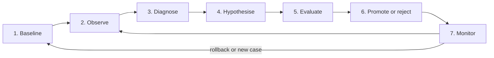

# Open Eye: Evolution Specification

**Status:** v1.0 draft, 2026-10-22. Derived from PRODUCT_DEFINITION.md v2.0.

This is artifact E. Self-evolution means measured improvement in Open Eye's ability to research, decide, plan and verify, not unbounded self-modification [D§10]. This document specifies how performance is measured, how improvement hypotheses are generated, how changes are tested, and how regressions are prevented. Every rule traces to the product definition, cited as **[D§n]**. The architecture is in [SYSTEM_DESIGN.md](SYSTEM_DESIGN.md) §9; the benchmark and its thresholds are in [EVALUATION_PLAN.md](EVALUATION_PLAN.md); the measured history is in [eval/results/suite-v1/DECISIONS.md](../eval/results/suite-v1/DECISIONS.md).

## 1. Terms

| Term | Meaning |
|---|---|
| **Configuration version** | Every tunable value (weights, thresholds, prompts, model routing, strategies, workflow rules), identified by a hash of its full content. A changed value is always a new version |
| **Promoted version** | The one version that live missions use. Every mission records it |
| **Candidate** | A version under evaluation, with its parent |
| **Run** | One execution of the benchmark under one version: the macro average over its briefs |
| **Design set** | Benchmark briefs that may be read, mined and tuned on |
| **Held-out set** | Benchmark briefs never used to design or tune a change [D§14, decision 12] |
| **Primary metric** | The metric a hypothesis promises to improve |
| **Guard metric** | A metric that must not regress beyond tolerance |

## 2. Levels of adaptation

Each level has its own bar [D§10.1]. A change belongs to the highest level of any key it touches; a key with no declared level is treated as L3.

| Level | What can change | Who proposes | Evidence needed | Who approves | Rollout | Rollback |
|---|---|---|---|---|---|---|
| **L0: Memory** | Facts, episodes, procedures, source reliability | Memory curation, as missions run | The admission and validation rules of MEMORY_SPEC.md | Automatic. A workspace procedure activates after measured success; a global one follows L2 | Immediate, in its scope | Retirement, refutation or supersession of the record |
| **L1: Adaptive configuration** | Ranking weights, thresholds, shortlist rules, freshness limits, source priors, learned preferences | The L1 tuner; weakness mining; a maintainer | Gate win on the design set (paired where possible), the held-out check (section 5.5), no guard regression | Automatic [D§10.1] | Immediate for all new missions | Automatic on live regression; a maintainer at any time |
| **L2: Prompts and strategies** | Prompts, query strategies, model routing, tool-selection and routing rules, global procedures | Weakness mining; a maintainer | Unpaired gate win on the design set, the held-out check, no guard regression | A maintainer of the operator workspace [D§14, decisions 7 and 9] | Immediate after approval, then a monitoring window | Automatic on live regression; a maintainer at any time |
| **L3: Workflow** | Stage order, roles, stopping rules, memory policies, default budgets | A maintainer, or weakness mining as a draft | As L2, plus a build-task check where build mode is affected | A maintainer of the operator workspace | Staged (section 7.2) | As L2, at any stage |
| **L4: Software, permissions and security** | Open Eye's code, permissions, security boundaries, sandbox policy, the gate, the metrics, the benchmark | Anyone | A reviewable change with tests | Humans, through code review | Normal release process | Normal release process |

L4 is never self-applied [D§10.1]. A proposal at L4 becomes an issue or a draft pull request.

## 3. The loop

| Step [D§10.2] | Inputs | Outputs | Artifact left |
|---|---|---|---|
| 1. Baseline | Promoted version; suite version; recorded snapshot; model | At least the minimum runs of section 5.4; an updated noise pool | Evaluation runs; the baseline report |
| 2. Observe | Live missions and their feedback | Per mission: useful sources and searches, recommendations later judged right or wrong, integration and test results, spend against value | Episodes, feedback with the version that produced each target, ledger entries, label proposals |
| 3. Diagnose | Design-set runs, episodes, feedback | Recurring weaknesses, each present in at least half the runs, with the lowest level that could address it (table below) | A weakness report |
| 4. Hypothesise | A weakness | A hypothesis record (section 4) and a candidate version | The hypothesis record; the candidate configuration file |
| 5. Evaluate | Candidate and baseline | Candidate runs; the gate result with every metric, band and reason | Evaluation runs; gate evidence on the candidate version |
| 6. Promote or reject | Gate result; approval where the level needs it | Promotion or rejection, both versioned | An evolution event; the decision record, with the evidence for a rejection kept too [D§10.2] |
| 7. Monitor | Live feedback and operating signals per version | Keep, alert, or roll back | An evolution event for each rollback; a regression case for each harm found [D§12] |

**From weakness to level:**

| Weakness | Typical lowest level |
|---|---|
| Essential solution never retrieved | L2: queries |
| Essential solution retrieved but ranked low | L1: weights |
| Trap recommended as a starting point | L1 freshness rule, or L2 assessment prompt |
| Brief with zero recall in every run | L2, or L3 when a stage is missing |
| Duplicated research or unnecessary tool calls | L0 or L1; L3 for stopping rules |

## 4. The hypothesis record

No change is evaluated without one [D§10.2].

| Field | Content |
|---|---|
| `id`, `title`, `level` | Identity; the level from section 2 |
| `failure_addressed` | The weakness findings it targets, with their recurrence |
| `change` | Changed keys with old and new values; for L4, a description |
| `base_version`, `candidate_version` | Parent and candidate hashes |
| `expected_benefit` | Primary metric, direction and the smallest gain worth having |
| `guards_at_risk` | The guard metrics this change could plausibly move |
| `rejection_conditions` | Written before evaluation. At least: no primary gain beyond the noise band; any guard regression; held-out set worse beyond its band |
| `runs_planned` | Runs per side, chosen so the noise band is smaller than the expected benefit (section 5.4) |
| `evidence` | Run ids for both sides, the gate result, recurring traps |
| `proposer`, `decided_by`, `decision`, `decision_note`, dates | Who and when |

If the expected benefit is smaller than the noise band at the largest affordable number of runs, the comparison is not run: the result could not decide it.

## 5. The gate

### 5.1 Benchmark and sets

- The benchmark is fixed and versioned per suite version, with a recorded snapshot of external responses so both sides see the same world [D§10.2].
- **Held-out set** [D§14, decision 12]: at least 5 briefs, growing to a quarter of the suite, drawn at random within each domain when a suite version is created. It is sealed: weakness mining, per-brief reports and tuners never read its labels or results. A held-out brief that is ever inspected for design moves to the design set and is replaced. New cases are split three to one.
- Cases are added, never removed to improve the numbers [D§12].

### 5.2 Primary metric

Recall@10 by default. Shortlist precision is the primary metric only when recall@10 does not move. A hypothesis may name another primary metric from D§12 (for example classification accuracy for a gap-analysis change), and then the usual primary metrics become guards.

### 5.3 Guard metrics and tolerances

| Guard | Tolerance (absolute) | Why |
|---|---|---|
| Shortlist precision, when recall@10 is the target | 0.01 | More retrieval can add noise to the shortlist |
| Recall@10, when precision is the target | 0, and no paired run may lose | Precision can be bought by finding less |
| Shortlist recall (essential solutions recommended) | 0, and no paired run may lose | Precision rises when the shortlist shrinks |
| Trap rejection among surfaced traps | 0 paired; pooled over runs unpaired, allowing one-sided 95% sampling noise | Finding more of the right category also finds its traps |
| Traps shortlisted, summed over runs | No increase (paired) | A rate can hide a new trap |
| Recurring trap (shortlisted in every candidate run, in no baseline run) | None for L1; shown to the maintainer for L2–L3 | One consistent bad recommendation outweighs an average |
| Model calls, input and output tokens | +10% | Cost [D§10.2] |
| Mean time per brief | +10% | Latency |
| Briefs with errors | No increase | A failing brief scores as a gap, not a gain |
| Evidence correctness and grade honesty | −0.02 on the human audits of EVALUATION_PLAN.md §6 | Required for any change to inspection, assessment or grading |

Unpaired comparisons add the noise band of section 5.4 to each tolerance, since both sides carry run-to-run noise.

### 5.4 Noise estimation

- **Paired comparisons** (L1 keys that act after every search and model call): candidate and baseline are the same stored runs re-ranked offline, so they saw the same searches and assessments. Minimum three runs. The gain must exceed the baseline's half-range (at least 0.005) and be positive in every run. Cost and latency are unchanged by construction.
- **Unpaired comparisons** (everything else): separate replay runs of each version. Minimum **five runs per side**.
- **Pooled noise:** run-to-run spread is estimated from all runs of versions known to behave identically on the metric (repeated baseline runs, and versions that differ only in keys that cannot reach the metric) on the same suite, snapshot and model. The pooled within-version standard deviation σ needs at least eight runs; until then the larger of the pool and the baseline's own spread is used.
- **Band for an unpaired difference of means:** max(0.005, 2σ·√(1/n₁ + 1/n₂)). The candidate's mean must beat the baseline's by more than the band, its worst run must beat the baseline's mean, and the 95% bootstrap interval of the per-brief difference, over briefs and runs, must exclude zero ([EVALUATION_PLAN.md](EVALUATION_PLAN.md) §5.3).
- **Calibration:** an A/A comparison (two versions with no effective difference) at every release. The gate may accept at most 5% of at least 20 A/A comparisons (M23).

### 5.5 Held-out check

After a design-set win, the candidate runs on the held-out set with the same number of runs. On a held-out set of at least 10 cases it must also beat the baseline on the primary metric beyond the held-out band, with no guard regression. While the set is smaller it can support only a non-inferiority check (no worse beyond the band), and the promotion is marked provisional. Required for every level that promotes a configuration: L2 and L3 by decision 12, and L1 because D§10.2 step 5 asks for held-out tasks for every change.

### 5.6 Undecidable comparisons

A comparison is undecidable, and nothing is promoted, when any of these holds. It is logged with the reason and is not counted as a rejection.

| Condition |
|---|
| Fewer runs than the minimum on either side |
| Sides differ in suite version, labels, snapshot or model (unless the model is the change) |
| A run was not made with exactly the candidate's content hash |
| A paired comparison changes a key that the stored features cannot decide |
| A stored run does not reproduce its own ranking under its own version |
| A brief errored on one side only |
| A guard is undefined on a side even when pooled (for example, no traps surfaced) |
| Fewer than two runs exist to estimate noise |

## 6. Anti-gaming rules

Every metric that a change can improve without real benefit has a guard [D§10.2].

| Metric | How it can be gamed | Guard |
|---|---|---|
| Shortlist precision | Shorten the shortlist | Shortlist recall |
| Recall@10 | Retrieve more of a category, traps included | Trap rejection among surfaced traps; traps shortlisted |
| Trap rejection over all traps | Find nothing | Measured only over traps the system surfaced |
| Cost and latency | Search less | Recall@10 and shortlist recall |
| Research avoided by memory | Reuse stale records | Stale-memory error rate (MEMORY_SPEC.md §9) |
| Live negative-feedback rate | Show fewer items | Rate per item shown, with counts of items shown |
| Benchmark score | Tune on the cases | Held-out set; cases never removed |
| Labels | Change the ground truth | Label proposals are never applied automatically; label changes are L4-reviewed and rescore both sides |

**Worked examples from suite-v1:**

1. **Shortened shortlist (L1 tuner, 2026-10-21).** The first offline pass accepted a change that raised shortlist precision by +0.08 in every run. Most of the gain came from cutting the shortlist from six to four (0.243 to 0.286 from that alone), which dropped essential solutions. Shortlist recall was added as a guard. The second pass rejected every candidate: the best gained +0.004 recall@10, inside the band, and lost 0.046 shortlist recall.
2. **Null change passed the unpaired gate.** `cfg-66b9cecdb37a` changed nothing that the suite exercises, yet showed +0.046 recall@10 against `cfg-d88eb2047d1a`, outside the baseline's half-range band (±0.042), and its worst run (0.305) beat the baseline mean (0.295). Pooling the nine runs of three versions that behave identically on recall@10 gives σ ≈ 0.038. The band is then 0.062 at three runs per side, which rejects the null change, and 0.048 at five. Five runs is the minimum, not a margin: gains below about 0.05 need eight or more runs per side.
3. **Trap metric that rewarded finding nothing.** The default scored 0.98 on trap rejection over all traps mostly because it surfaced at most one trap. The metric was replaced by trap rejection among the traps found, and every stored run was re-scored.
4. **A guard that blocked a real gain.** `category-queries` raised recall@10 from 0.111 to 0.322 but shortlisted an abandoned trap in every run. It was rejected; the follow-up with a freshness rule was promoted.

## 7. Monitoring and rollback

### 7.1 Live monitoring

| Signal | Rule |
|---|---|
| Negative-feedback rate ("not useful" or "wrong", per item shown) | Compared between the promoted version and its predecessor |
| Minimum feedback | 30 verdicts on each version before any automatic action |
| Rollback threshold | The rate is worse by more than 0.10 and a one-sided two-proportion test gives z ≥ 1.64 |
| Comparable windows | Both rates come from comparable brief classes and periods; otherwise the monitor alerts maintainers instead of acting |
| Operating signals | Cost per mission +10%, error rate, and escaped stale-memory errors raise an alert to maintainers |
| Cadence | At least every six hours while idle |

Below the minimum feedback, the monitor does nothing automatically and says so in workspace F [D§3.2].

### 7.2 Rollout

- **L1, L2:** all new missions after promotion; running missions keep the version they started with.
- **L3:** staged. First to missions in workspaces that opted in, until 30 verdicts are collected; then to all. Each stage is an evolution event.

### 7.3 Rollback

- Automatic on the live threshold, for L1–L3; manual by a maintainer at any time.
- Restores the version that the rolled-back one replaced, through the same database rule as promotion.
- A rolled-back or rejected version is never re-proposed automatically; only a maintainer's new proposal can bring it back.
- Every rollback records its evidence, and the harm becomes a benchmark regression case [D§12].

## 8. Boundaries

- **L4 is never self-applied** [D§10.1]. The database refuses to apply an L4 proposal.
- **No self-change to permissions or security boundaries** [D§7]: sandbox policy, network rules, secret handling, access control, approval rules, budget ceilings set by users, and the evolution rules themselves (gate, tolerances, metrics, held-out set) are L4.
- **No promotion without benchmark evidence:** a version is promoted only with run ids attached. One promoted version at a time.
- **Governance:** only maintainers of the operator workspace approve, reject or roll back; personal workspaces never govern global configuration [D§14, decision 9].
- **Logged:** every candidate decided (the best candidate of each tuner pass, with the number searched), every gate result with its metrics and bands, every approval, rejection, promotion, rollback and monitor check, with actor, time, versions before and after, and reasons. Users can see the history [D§3.2].

## 9. Evolution metrics

Defined in full in EVALUATION_PLAN.md §2.

| Metric | Definition |
|---|---|
| Measured improvement (M22) [D§12] | Primary metrics of the promoted version against the frozen baseline, on the same suite version |
| Regression rate after changes (M21) [D§12] | Share of promotions later rolled back, or found to regress a guard on the held-out set or a later periodic run |
| Gate false acceptance (M23) | Share of A/A comparisons the gate accepts; the check that "beyond noise" [D§10.1] is real |

## 10. Current state against this specification (2026-10-22)

| Area | State | Where |
|---|---|---|
| Configuration versions | Built: content hash, parent, status, evidence | `apps/worker/tuning.py`, `packages/database/migrations/008_tuning_and_ledger.sql`, `013_evolution.sql` |
| Level per key | Partial: prompts and models are L2, everything else L1; no L3 keys, L3 only when forced | `apps/worker/tuning.py`, `apps/worker/evolution/propose.py` |
| Baseline | Built: B0, B0s, B1; record and replay | `eval/results/suite-v1/BASELINE.md` |
| Observe | Built: episodes, feedback per version, ledger, label proposals | `apps/worker/memory/episodic.py`, `013_evolution.sql` |
| Diagnose | Built as a CLI; reads every brief, since there is no held-out set | `apps/worker/evolution/weakness.py` |
| Hypothesis record | Partial: title, rationale, evidence; no expected benefit, rejection conditions or planned runs | `013_evolution.sql` (`evolution_proposals`) |
| Paired gate | Built, with the shortlist-recall guard | `apps/worker/evolution/gate.py`, `tune.py`, `offline.py` |
| Unpaired gate | **Too permissive:** three runs per side and a band from the baseline's own half-range; it passed a change that did nothing (example 2). Replay-only L1 changes are promoted automatically on this gate | `apps/worker/evolution/gate.py` (`MIN_RUNS = 3`, `noise_band`), `propose.py` |
| Pooled noise | Missing | `apps/worker/evolution/gate.py` |
| Held-out set | Missing | `eval/suite-v1/` |
| Guards | Partial: precision, recall, shortlist recall, traps, cost, latency; evidence correctness and grade honesty not gated (no audit yet); errors not gated | `apps/worker/evolution/gate.py` |
| Promotion rules | Built as database functions: evidence required, L4 refused, rolled-back versions not re-promoted automatically, one promoted version | `013_evolution.sql` |
| Governance | Built: operator-workspace maintainers only | `apps/web/lib/evolution/rules.ts`, `decide.ts` |
| Monitoring | Built: 30 verdicts each, margin 0.10, z 1.64, every six hours; no per-item normalisation or window matching; little live feedback yet | `apps/worker/evolution/monitor.py` |
| Staged rollout | Missing | — |
| Regression cases from failures | Manual | `eval/results/suite-v1/DECISIONS.md` |
| Labels | Draft by one labeller; absolute values provisional | `eval/README.md` |

## 11. Open points for the product definition

Resolved in PRODUCT_DEFINITION.md v2.0 (2026-10-22):
- The held-out set confirms every promotion from L1 to L3 [D§10.2, decision 12], as section 5.5 and EVALUATION_PLAN.md §3.7 already require.
- The held-out set starts at no fewer than 5 briefs and grows to a quarter of the suite; until it is large enough to show a gain it can only veto [decision 12].
- Still open: code comments cite v1.0 section numbers (memory as §8, evolution as §9); ROADMAP.md Q1 updates them.
