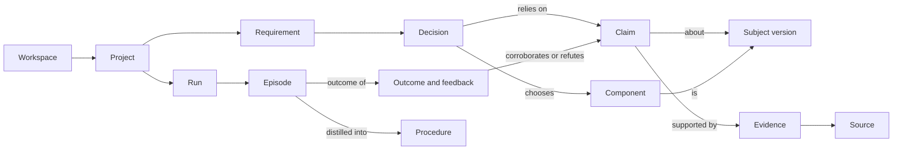

# Open Eye: Memory Specification

**Status:** v1.0 draft, 2026-10-22. Derived from PRODUCT_DEFINITION.md v2.0.

This is artifact D. Memory is a core capability, not conversation history [D§9]: it lets later missions skip research that still holds without ever presenting an old or out-of-context record as current. This document specifies what Open Eye remembers, how memory is retrieved, how knowledge is validated, how it is shared across a team, and how stale or wrong records are corrected. Every rule traces to the product definition, cited as **[D§n]**. The architecture that implements it is in [SYSTEM_DESIGN.md](SYSTEM_DESIGN.md) §8; how memory changes are measured is in [EVOLUTION_SPEC.md](EVOLUTION_SPEC.md).

## 1. Terms

A **subject** is the thing a finding is about, by canonical id (`github:owner/name`, `npm:name`, a documentation URL); its **subject version** is the exact state observed (commit, release, package version or content hash). A record is **current** while its status is current and its revalidation date has not passed; anything else is shown as "last verified on …" [D§9.2]. A **dependant** is a decision, artifact, episode or procedure that cites a record.

## 2. The common envelope

Every record in every layer carries these fields [D§9.2]. A write without them is refused.

| Field | Content |
|---|---|
| `id`, `layer`, `kind` | Identity and type |
| `provenance` | Who or what wrote it (task, role, user, evaluation run), from which mission, with which configuration version |
| `created_at`, `updated_at`, `observed_at` | When it was written, changed, and when the underlying fact was observed |
| `grade` or `confidence` | E1–E5 for findings [D§6.1]; a measured confidence for episodes, procedures and lessons |
| `scope`, `workspace_id`, `project_id` | Visibility (section 8) |
| `revalidation_rule` | A named rule from section 7.3, with its due date where it has one |
| `status` | current, needs_revalidation, superseded, refuted, retired, deleted (tombstone) |
| `version`, `supersedes`, `superseded_by` | Version chain (section 7.2) |

## 3. The seven layers

The layers are those of D§9.1. Each has one store, one write path and one read path behind one memory API, which the web application also uses for the audit view.

### 3.1 Project

| Field | Content |
|---|---|
| Project | Brief, constraints, licence policy, budget, members, linked repository |
| Requirement | Text; MUST, SHOULD or NICE-TO-HAVE; stated or inferred; acceptance criteria; class 1–6 with reason [D§5.6] |
| Decision | The choice, its reasons, the claims relied on (id and version), alternatives rejected with reasons, status, `superseded_by` |
| Artifact | Versioned stage output (specification, plan, candidate set, comparison, architecture, report), with the versions of its inputs |
| Progress | Runs with status, stopping condition, budget used; open problems |

| Aspect | Rule |
|---|---|
| Write | The stage tasks of D§5 as they finish; the user when they edit a requirement, answer a question or challenge a decision. Always admitted: it is the mission itself. |
| Read | Every role within the project, by structured query (by requirement, decision, artifact kind); the audit view by full text; the revisit flow (UC5). |
| Freshness | An artifact is marked stale when any input it was built from changes, and only what depends on the change is re-run [D§3.3]. A decision is re-opened when a claim it relied on is refuted, superseded or fails revalidation. |
| Scope | The project's members. Never leaves the project except through a maintainer's share (section 8.3). |

### 3.2 Technical knowledge (semantic)

| Field | Content |
|---|---|
| `subject`, `subject_version` | What and at which state |
| `kind` | capability, limitation, licence, maintenance, version, compatibility, vulnerability, known issue, licence conflict, readme summary, coverage |
| `statement`, `statement_key` | The finding, and a hash of its normalised text for de-duplication |
| `grade`, `confidence` | Highest grade achieved, never the one hoped for [D§6.1] |
| `evidence[]` | Links to source and evidence records (3.5) |
| `context` | Applicability context (section 6), when the finding depends on one (compatibility, performance, installation) |
| `requirement_id` | Only for requirement-relative findings such as coverage; these are project-scoped |
| `revalidate_after`, `revalidated_at` | Freshness |

| Aspect | Rule |
|---|---|
| Write | Discovery, inspection and verification tasks, under the admission rules of section 5. A repeat finding adds evidence to the existing record and keeps the best grade. User confirmation adds evidence but never raises the grade: a person's word is not code evidence. |
| Read | The recall task before planning [D§5.2], by structured query (subject, kind, grade, status) and by semantic search over statements matched to requirements; the evidence gate and comparison by subject and version; the audit view by full text. |
| Freshness | Maximum age per kind (section 7.3) and whenever the subject version changes. Not current means shown as "last verified on …" and revalidated before a decision depends on it [D§9.2]. |
| Scope | Global for requirement-independent findings about public resources; workspace for findings about private resources; project for requirement-relative findings [D§14, decision 11]. |

### 3.3 Episodic

| Field | Content |
|---|---|
| Run episode | Project, outcome (completed, stopped, failed), problem summary, requirements, queries with their result counts and new candidates, shortlist, rejections with reasons, decisions, budget used, what memory contributed, procedures used, configuration version |
| Event episode | A later correction, confirmation or feedback on a run, with actor and reason |
| Experience | A build or test outcome: kind (integration, compatibility, debugging, test result), worked or failed, the subjects and versions involved, the linked test run, the measured result |

| Aspect | Rule |
|---|---|
| Write | One run episode when a run ends, idempotent per run state; event episodes when something later proves right or wrong; experiences from build mode, only with a test run id and versions [D§5.9]. |
| Read | The recall task: similar past runs of the workspace, by full text and semantic similarity over problem and requirements ("a similar brief on <date> chose X; feedback said Y"); weakness mining [D§10.2]; the audit view. |
| Freshness | History is never rewritten, only annotated. An experience is flagged needs_revalidation when a subject version it depends on changes. |
| Scope | The workspace [D§9.1], with project details visible only to project members (section 8.1). |

### 3.4 Procedural

| Field | Content |
|---|---|
| `kind` | query pattern, research strategy, implementation recipe, debugging procedure, avoidance rule |
| `trigger` | Requirement terms, domain, brief class |
| `context` | Applicability context (section 6) |
| `steps` | What to do |
| `evidence` | Supporting episodes and evaluation runs; contradicting ones |
| Counts | uses, successes, failures; confidence from them |
| `status` | candidate, active, retired |

| Aspect | Rule |
|---|---|
| Write | Distillation proposes a candidate only when at least three distinct projects succeeded with the pattern and none contradicts it. A candidate becomes active after measured success [D§10.1 L0]: three successful uses, each in a different project, with no failure. Run outcomes and refutations update the counts. |
| Read | The recall task hands matching active procedures to the planner, at most five, after the applicability check. |
| Freshness | An active procedure that fails half its uses (at least four uses) retires itself. A procedure whose context names a version that is no longer current is suspended until revalidated. |
| Scope | The workspace; global only when learned from public evaluations [D§9.1]. A global procedure changes behaviour for everyone, so its activation follows the L2 bar in EVOLUTION_SPEC.md. |

### 3.5 Source and evidence

| Field | Content |
|---|---|
| Evidence item | Method (executed, code-located, doc-quoted, claimed, inferred, user correction, corroboration), grade, locator (file, lines and commit; URL and section; test run id), short excerpt, `retrieved_at`, source id |
| Source reliability | Per source and per source type: findings later corroborated, refuted, gone stale; counts weighted with a 90-day half-life |

| Aspect | Rule |
|---|---|
| Write | With every finding; reliability on every corroboration, refutation and staleness event; a check record (outcome, versions, records affected) on every revalidation. |
| Read | With the finding it describes; reliability by ranking and by the planner's source priors; checks by the audit view. |
| Freshness | Follows the finding. Reliability decays by its half-life. |
| Scope | Follows the finding [D§9.1]. Reliability of public sources is global; of private sources, workspace. |

### 3.6 Team and organisation

A record in this layer is a **shared lesson**: a validated finding, procedure or lesson that a maintainer has published beyond its original scope.

| Field | Content |
|---|---|
| `source_record` | The record shared, and its version |
| `content` | A de-identified copy: no brief text, project names, private paths, code excerpts or user identities |
| `audience` | Named workspaces, or the organisation |
| `shared_by`, `shared_at`, `revoked_at` | Who, when, revocation |

| Aspect | Rule |
|---|---|
| Write | A maintainer's share action only (section 8.3). Never automatic. |
| Read | The recall task for members of the audience, with the same applicability and freshness checks as the original. |
| Freshness | Follows the source record. A correction or supersession of the source updates or withdraws the share. |
| Scope | Authorised members of the audience only [D§9.1]. |

### 3.7 Evolution

| Field | Content |
|---|---|
| Configuration version | Content hash, parent, level, values, status, evidence |
| Evaluation run | Suite version, configuration version, mode, model, metrics, per-case results |
| Hypothesis and proposal | As defined in EVOLUTION_SPEC.md §4 |
| Evolution event | Promoted, rejected, rolled back, proposed, proposal rejected; actor, evidence, versions before and after |
| Feedback | Verdict on a candidate, decision or claim, with the configuration version that produced it |

| Aspect | Rule |
|---|---|
| Write | The tuner, the proposal tool, maintainers and the monitor, through the same database rules. |
| Read | The gate, the monitor, and workspace F [D§3.2]. |
| Freshness | Permanent; never deleted or rewritten. |
| Scope | Governed by maintainers of the operator workspace [D§14, decision 9]; visible to users. Feedback text stays in its workspace; only counts per version leave it. |

## 4. Relationship model

| Link | Cardinality | Used for |
|---|---|---|
| Requirement → Decision | one to many over time; one current | Which choice covers a requirement, and its history |
| Decision → Claim (id and version) | many to many | Propagating a correction to every decision that relied on a claim |
| Component → Subject version | many to one | Revalidating a design when a dependency changes |
| Claim → Evidence → Source | one to many | Grading, reliability, inspection in one click [D§3.3] |
| Run → Episode → Outcome | one to one, then one to many | Learning from what happened later |
| Episode → Procedure | many to many | A procedure's supporting and contradicting evidence |
| Artifact → input versions | many to many | Re-running only what a change affects [D§3.3] |

## 5. Admission by utility

A record is kept only when its reliability, provenance and likely future relevance justify it [D§9.2].

| Item | Kept? | Rule |
|---|---|---|
| Raw pages, API responses, READMEs, search results | No: cached | Held in the connector cache by request hash with a TTL per connector. Never memory. |
| Excerpt that supports a finding | Yes | Stored with the evidence item, short and with its locator |
| Model output (free text) | No | Only the structured, graded output of a task is admitted |
| Finding about a subject | Only if graded, tied to a subject version, and backed by at least one evidence item | Otherwise discarded |
| E5 inference | Project only | Attached to the decision that uses it; never global |
| Requirement-relative finding (coverage) | Project only | It reveals the project's needs |
| Candidate list, ranking, scores | Project artifact | Ranking features are kept with evaluation runs only |
| Run episode | Yes | One per run end. Queries keep counts and the candidates they surfaced, not result pages |
| Experience | Only with a test run id and subject versions | Otherwise it is an anecdote |
| Procedure candidate | Only after three distinct successful projects and no contradiction | Never from one episode |
| User correction or confirmation | Always | As evidence on the record |
| Failed or blocked lookup | Not as a finding | Recorded in source reliability and the episode |
| Instructions found in retrieved content | Never as a procedure | Logged as an untrusted-content event [D§11] |
| Secrets, credentials, environment values | Never | Refused at write; a detected secret is purged (section 7.5) [D§11] |

**Dormancy.** A global claim whose subject no project has used for 365 days stops being revalidated and leaves recall. It stays auditable and returns to recall, after revalidation, when a project uses the subject again.

## 6. Applicability

A lesson carries the context it was learned in, and is never generalised beyond it [D§9.2].

| Context field | Example | Match rule |
|---|---|---|
| Language and ecosystem | TypeScript, npm | Equal |
| Framework and version | Next.js 14.2 | Same major version; across a major version, never |
| Runtime and platform | Node 20, Linux, browser | Equal, or in a compatibility list the lesson records |
| Environment | managed cloud, on-premises, air-gapped | Equal |
| Domain and brief class | geospatial, data pipelines | Equal for procedures and strategies; ignored for facts about a subject |
| Subject versions involved | `taskforcesh/bullmq` at 5.x | The versions under consideration equal, or revalidated as unchanged |
| Configuration version | `cfg-66b9cecdb37a` | For procedures only: learned under a configuration with the same planner prompt |

**Before reuse** the recall task compares each field the lesson specifies with the new project's context:

| Result | Effect |
|---|---|
| All specified fields match | Reused, cited with its verification date [D§9.2 explicit reuse] |
| A field is unknown for the new project | Reused only as a stated assumption; the plan adds a check for that field |
| A field mismatches | Not reused as evidence. It may be offered as a lead, at most E5, labelled "learned in a different context: <field>" |
| A subject version differs | Revalidated first (section 7.3); reused only if the finding still holds |

A lesson with no recorded context is treated as context-free only when it is a requirement-independent fact about one subject version. Any other lesson without context is not reused.

## 7. Lifecycle

### 7.1 De-duplication

| Layer | Identity | On a repeat |
|---|---|---|
| Claim | subject, kind, normalised statement, scope | Evidence is added, best grade kept, all provenances kept [D§9.2] |
| Run episode | project and run state | Rewritten idempotently while the run is open; frozen at its end |
| Procedure | kind, normalised trigger and steps, workspace | Support counts are merged |
| Near-duplicates | same subject and kind, semantically similar statement | Proposed for merge by memory curation; merged only if they agree, else kept as conflicting evidence |

### 7.2 Versioning and supersession

- No record is silently overwritten [D§9.2]. A change of statement, grade, status or context writes a new version and links the old one.
- **Supersession:** a finding at a newer subject version supersedes the finding at the older one. The old record stays, with `superseded_by`, so a project pinned to the old version can still cite it.
- Decisions are superseded, never edited; the report shows what changed and why [D§6.2 iteration].

### 7.3 Freshness and revalidation

**Maximum age by kind:** maintenance and vulnerability 7 days; licence, licence conflict, known issue, readme summary and coverage 30 days; capability and limitation 90 days, or until the commit changes.

**Triggers:**

| Trigger | Action |
|---|---|
| Maximum age passed | Shown as "last verified on …"; revalidated before a decision depends on it |
| Subject version changed (commit, release, hash) | Code findings at the old version are marked needs_revalidation and re-checked from the new version; API facts are rewritten |
| Subject missing or made private | Its findings are marked needs_revalidation; dependants are told |
| New advisory for a subject | Vulnerability findings and dependent decisions are re-opened |
| A related finding refuted | Findings from the same evidence item are re-checked |
| Source reliability drops below its floor | Findings resting on that source alone are re-checked |
| A decision is about to rely on a non-current record | Revalidation runs inside the mission, within its budget |

Revalidation is cheap first: compare the stored version with the current one (one call), and re-read code only when it changed. Idle-time revalidation covers subjects that projects used recently.

### 7.4 Correction

Users can see why a record exists (its provenance and evidence), and confirm, correct or delete it [D§9.2].

A correction becomes a refuting evidence item and then propagates:
1. The record is refuted (or corrected to a new version); its grade drops.
2. Every decision that relied on it is re-opened, and every artifact that cited it is marked stale.
3. Episodes that used it get an event; procedures used in those runs count a failure.
4. Its sources lose reliability.
5. **Across workspaces:** a correction to a global claim takes effect at once in the correcting workspace. Its global status changes only when Open Eye's own re-check, or refuting evidence graded E1–E3, confirms it. Until then other workspaces see "contested", and their dependent projects are told without the correcting workspace's identity or project.

### 7.5 Deletion

| Case | Rule |
|---|---|
| A record in the user's own scope | Deleted to a tombstone (id, time, actor, reason). Citations resolve to "removed"; dependants are re-opened as in 7.4 |
| A project | Its project-scoped records and episodes go with it; global findings it produced stay, since they are facts about public sources |
| A global record | Not deletable by a workspace; it can be hidden in that workspace and contested |
| A secret or personal data written by mistake | Purged by the operator, content included; the audit entry keeps only the fact of the purge |

### 7.6 Audit

- Every write records actor, time, before and after, and reason.
- Every read that affects a decision is recorded on the decision: record id and version, its verification date, and whether this mission revalidated it [D§9.2]. The report lists these reads [D§9.2 explicit reuse].
- Workspace F shows reused findings with their dates, findings that failed revalidation, and lessons recorded [D§3.2].

## 8. Team and organisation sharing

A workspace is a team [D§14, decision 1]. An organisation is an optional set of workspaces under one operator.

### 8.1 Defaults (decision 11)

| Record | Default scope | Crosses the workspace by default? |
|---|---|---|
| Requirement-independent finding about a public resource | Global | Yes |
| Source reliability of public sources | Global | Yes, as counts only |
| Procedures learned from public evaluations | Global | Yes, after the L2 bar |
| Finding about a private resource (the user's repository) | Workspace | No |
| Requirement-relative finding (coverage) | Project | No |
| Project content: brief, requirements, decisions, artifacts | Project members | No |
| Episodes and experiences | Workspace; project details only to project members | No |
| Procedures learned in the workspace | Workspace | No |
| Feedback | Workspace; counts per configuration version are global | Counts only |

### 8.2 What never crosses

Secrets and credentials; brief text and requirements; private code and excerpts from it; decisions and their reasons; user identities and feedback notes; anything derived from a private repository. A shared lesson that would reveal any of these is refused.

### 8.3 How a maintainer shares more

1. The maintainer picks a record and an audience (named workspaces or the organisation).
2. Open Eye builds a de-identified copy and shows it with what was removed.
3. The maintainer confirms. The share is logged with actor, audience and source version.
4. The share follows its source: a correction updates it, a supersession replaces it, a deletion withdraws it.
5. A maintainer can revoke a share at any time. Revocation removes it from recall and re-opens decisions in the audience that relied on it.

## 9. Memory metrics

| Metric | Definition | How it is measured |
|---|---|---|
| **Research avoided** (usefulness, M19) [D§12] | Searches, fetches, inspections and model calls not made because memory answered, and their cost | The planner marks each planned operation satisfied by memory; the ledger prices it. On the benchmark, paired related briefs are run cold and after their partner; the difference is the saving. Quality on the second brief must not fall (recall@10 and shortlist recall as guards). |
| **Stale-memory error rate** (M20) [D§12] | Share of reused records that a decision relied on and that were wrong or out of date at the time of use | Caught cases (failed revalidation before the decision) are counted but are not errors. Escaped cases come from later refutations, later revalidations that show the record had already changed, and the audit of 50 reused findings per release ([EVALUATION_PLAN.md](EVALUATION_PLAN.md) §6). Target: at most 0.02 (EVALUATION_PLAN.md M20). |
| Revalidation failure rate | Share of revalidations where the finding no longer held, by kind | From revalidation checks; it tunes the maximum ages in 7.3 (an L1 change) |

## 10. Current state against this specification (2026-10-22)

| Area | State | Where |
|---|---|---|
| Common envelope | Partial: provenance, timestamps, grade or confidence, scope and revalidation rule exist on new tables; no version chain | `packages/database/migrations/009_core_platform.sql`, `012_memory.sql` |
| Project layer | Built as briefs, candidates and blueprints; no separate Decision or Requirement records, so decision-level propagation is by blueprint | `006_briefs.sql`, `007_brief_blueprints.sql`, `011_blueprint.sql` |
| Technical knowledge | Built: graded claims at a subject version, de-duplication by statement key, full-text search, maximum age per kind | `apps/worker/claims.py`, `apps/worker/memory/semantic.py` |
| Semantic retrieval | Missing for claims, episodes and decisions; recall uses structured and full-text matching | `apps/worker/memory/semantic.py`, `episodic.py` |
| Episodic | Built for run and event episodes; experiences table and writer exist but build mode does not call the writer | `apps/worker/memory/episodic.py` |
| Procedural | Built, with one difference: activation needs a maintainer as well as three successful uses, where D§10.1 says L0 activation is automatic | `apps/worker/memory/procedural.py`, `strategy.py` |
| Source and evidence | Built: evidence items, decaying reliability, revalidation checks; reliability not yet weighted into ranking | `apps/worker/memory/semantic.py`, `revalidation.py` |
| Revalidation | Built for GitHub subjects: version compare, code claims marked, re-index queued, API facts superseded; recent subjects only (30 days) | `apps/worker/memory/revalidation.py` |
| Admission by utility | Partial: page cache by TTL, claims need a grade; no explicit policy for E5 or dormancy | `010_connectors.sql`, `apps/worker/claims.py` |
| Applicability checks | Missing: no context fields; procedures match on requirement terms and domain only | `apps/worker/memory/procedural.py` |
| Versioning | Partial: evidence is append-only; status and grade are overwritten; superseded status for API facts only | `apps/worker/memory/revalidation.py` |
| Correction | Partial: refute and confirm work, blueprints that cite the claim are invalidated, episodes and procedures updated; propagation stops at the correcting workspace, and one workspace's refutation changes a global claim for everyone | `apps/worker/memory/semantic.py`, `apps/web/app/api/claims/[id]/refute/route.ts` |
| Deletion | Missing for individual records; projects cascade | `apps/web/app/api/briefs/[id]/route.ts` |
| Audit | Partial: memory contribution stored per candidate and episode; no read audit per decision, no write history | `012_memory.sql` |
| Team sharing | Missing: no share action, no organisation, no per-project membership | `009_core_platform.sql` |
| Metrics | Partial: searches avoided counted; stale-memory error rate not measured | `apps/worker/memory/semantic.py` |

## 11. Open points for the product definition

Resolved in PRODUCT_DEFINITION.md v2.0 (2026-10-22):
- Episodes are visible to the project's members; lessons distilled from them, with no project content, go to the workspace [D§9.1]. The data model still needs per-project membership (section 10).
- A procedure becomes active only after measured success and a maintainer's approval [D§10.1]. Global procedures take the L2 bar (section 3.4).
- The team layer is the workspace [D§9.1]. Section 8's organisation, an optional set of workspaces under one operator, is an extension that decision 11 allows: a maintainer can share more.
