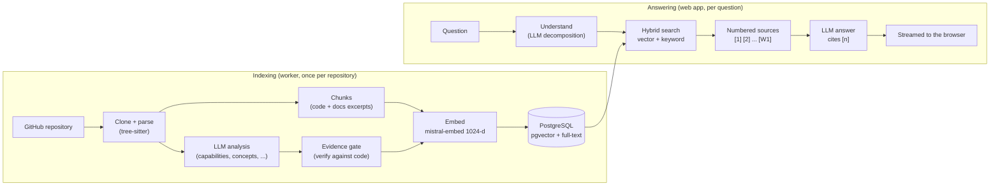
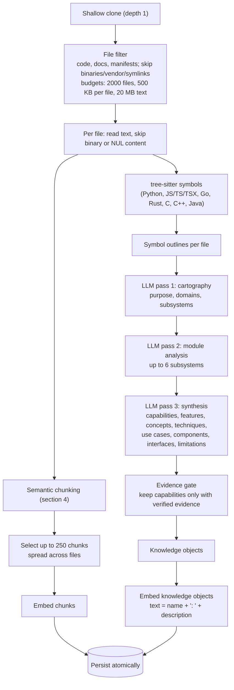
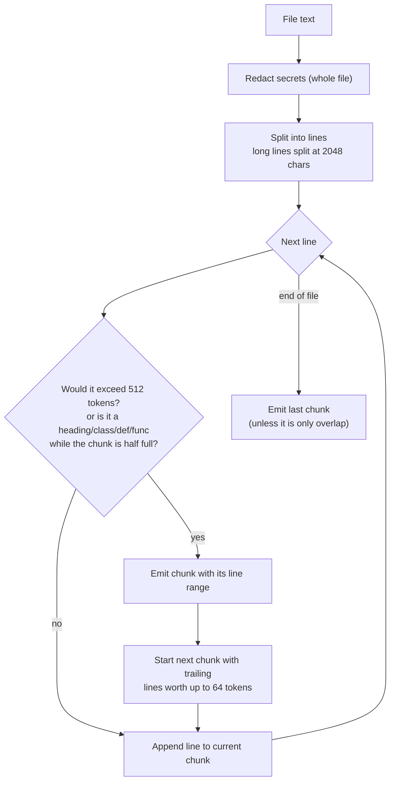
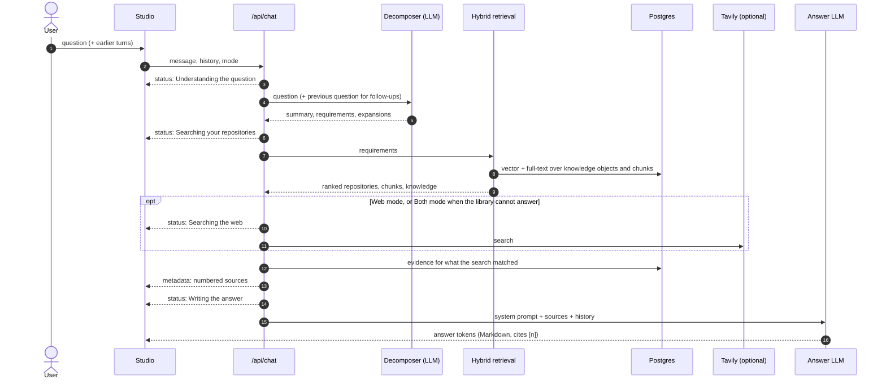
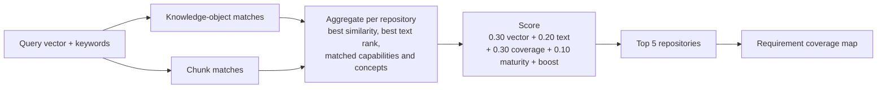

# Open Eye — RAG, Chunking, Embeddings and Chat

How Open Eye turns a GitHub repository into searchable knowledge, and how it uses that knowledge to answer questions with cited `file:line` sources.

For the overall system (services, deployment, job queue, data model) see [ARCHITECTURE.md](ARCHITECTURE.md).

**Contents**

1. [The idea in one picture](#1-the-idea-in-one-picture)
2. [What gets retrieved: three kinds of knowledge](#2-what-gets-retrieved-three-kinds-of-knowledge)
3. [Indexing pipeline (offline)](#3-indexing-pipeline-offline)
4. [Chunking strategy](#4-chunking-strategy)
5. [Embeddings and storage](#5-embeddings-and-storage)
6. [Query pipeline (online)](#6-query-pipeline-online)
7. [Hybrid retrieval and ranking](#7-hybrid-retrieval-and-ranking)
8. [Building the sources and the prompt](#8-building-the-sources-and-the-prompt)
9. [Answer generation and streaming](#9-answer-generation-and-streaming)
10. [Every LLM call in the system](#10-every-llm-call-in-the-system)
11. [Tuning parameters](#11-tuning-parameters)
12. [Limitations and next steps](#12-limitations-and-next-steps)

---

## 1. The idea in one picture

Open Eye is a **retrieval-augmented generation (RAG)** system specialised for code. A repository is indexed once (offline); every question retrieves the most relevant pieces and the LLM answers *only* from them, citing each one.



---

## 2. What gets retrieved: three kinds of knowledge

| Kind | Table | What it is | Why it exists |
|---|---|---|---|
| **Chunks** | `chunks` | Raw excerpts of files (code, README, docs) with file path and line range | Ground truth: the actual text the answer can quote and cite |
| **Knowledge objects** | `knowledge_objects` | Short LLM-written descriptions: the repository profile, capabilities, features, concepts, techniques, use cases, components, interfaces, inputs/outputs, limitations | Lets a question like "what can do browser fingerprint spoofing?" match a repository even when the code never uses those words |
| **Evidence** | `evidence` | A verified pointer from a capability to the exact definition in the code (`file:line` + real source line) | Proves claims; becomes citation sources marked VERIFIED |

Knowledge objects answer **"which repository and why"**; chunks answer **"where exactly and how"**; evidence answers **"is that really in the code"**.

---

## 3. Indexing pipeline (offline)

Runs in the Python worker for each repository job (details of the queue in ARCHITECTURE.md §4.4).



### What the analysis passes read

The LLM can only describe what it is shown, so the worker prepares its inputs deterministically (`apps/worker/analyzer/repo_digest.py`):

- **README digest (up to 6000 chars):** HTML, badges and code blocks are stripped; sections such as sponsors, contact, licence and star history are dropped; feature tables, supported-platform lists and usage sections are preferred over whatever happens to come first. When the main README is mostly in another language and an English variant exists (`README_en.md`, `docs/README_en.md`, ...), the English one is used.
- **Implementation families:** folders where at least 4 sibling code files each define a class (channels, providers, adapters, backends, drivers) are listed with each file's class names and one-line docstring. The synthesis pass must create **one capability per member** (for example one per supported platform) instead of a single generic capability.
- **Module outlines:** every file of a subsystem appears in its outline (a few symbols each, 6000 chars in total), together with each file's one-line purpose.
- **Acronyms:** the prompts forbid expanding an abbreviation (MCP, CDP, RSS) unless the expansion appears in the content.

Everything is written in **one transaction**, so a question never sees a half-indexed repository. A re-index replaces the old rows in the same transaction; until it commits, the previous index stays searchable.

---

## 4. Chunking strategy

Implemented in `apps/worker/analyzer/chunker.py` (`SemanticChunker`).

### 4.1 Rules

| Rule | Value | Reason |
|---|---|---|
| Target size | **512 tokens** per chunk | Small enough to be specific, large enough to keep a function or a README section together |
| Token estimate | `len(text) / 4` | Fast, model-agnostic approximation (about 4 characters per token for English and code) |
| Overlap | trailing lines worth **at most 64 tokens** are repeated at the start of the next chunk | Keeps context across a boundary without duplicating large blocks |
| Semantic boundaries | a new chunk starts at a line beginning with `#` (Markdown heading), `class `, `def ` or `func `, once the current chunk is at least half full | Chunks follow the document's own structure (sections, classes, functions) instead of cutting mid-definition |
| Very long lines | split into pieces of at most **512 × 4 = 2048 characters** | Minified or generated files cannot produce one giant chunk |
| Secrets | redacted on the **whole file before splitting** (API keys, GitHub tokens, AWS keys, private keys, bearer tokens) | A key that straddles two chunks would otherwise be stored in neither-redacted halves |
| Line ranges | `startLine` / `endLine` stored in each chunk's metadata | Answers can cite `file.py:L120-L148` and link to the exact lines on GitHub |

### 4.2 How a file becomes chunks



### 4.3 Choosing which chunks to embed (per repository)

A large repository can produce thousands of chunks. Up to **`MAX_CHUNKS` = 250** are embedded, chosen so that every part of the repository stays searchable (`select_chunks` in `apps/worker/worker.py`):

1. **Docs first, but capped:** README and docs may take at most **one third** of the budget (README first).
2. **Code fills the rest round-robin:** the first chunk of every code file, then the second chunk of every file, and so on.
3. **Even sampling:** if there are more files than slots, files are sampled evenly across the sorted file list, so directories late in the alphabet are not dropped.
4. If code needs less than its share, docs get the remainder.

When the budget cuts anything, the repository's completeness is recorded as **partial** with the reason (for example "Indexed 250 of 912 text excerpts for search").

### 4.4 Web pages, PDFs, videos (de-emphasised)

Non-GitHub resources are segmented by their adapters (page sections, PDF pages, transcript timestamps). Each segment is embedded as `title + content`, truncated to 2000 characters.

---

## 5. Embeddings and storage

### 5.1 Model

| Setting | Value |
|---|---|
| Provider / model | Mistral `mistral-embed` (OpenAI `text-embedding-3-*` also supported) |
| Dimensions | **1024** (`EMBEDDING_DIMENSIONS`; must equal the database column) |
| Batching | worker: 32 texts per request; web: 16 (Mistral) / 64 (OpenAI) |
| Reliability | exponential backoff on 429/5xx; results sorted by `index`; the number of vectors must equal the number of inputs, otherwise the job retries (no zero vectors, no misalignment) |
| Consistency | the worker (indexing) and the web app (queries) use the same provider and model; vectors from different models are not comparable |

What is embedded:

- **Chunks:** the chunk text (after redaction).
- **Knowledge objects:** `"<name>: <description>"`, e.g. `"Network Request Interception: intercepts and modifies browser requests ..."`.
- **Queries:** the question summary plus its distinctive terms (section 6.2).

### 5.2 Storage and indexes (PostgreSQL)

| Table | Vector | Full text | Index |
|---|---|---|---|
| `chunks` | `embedding vector(1024)` | `tsv_content` generated from `content` | HNSW (`vector_cosine_ops`, m = 16, ef_construction = 64) + GIN on `tsv_content` |
| `knowledge_objects` | `embedding vector(1024)` | `tsv_content` generated from `name + description` | HNSW (cosine) + GIN |
| `resources` | — | `tsv_content` from title, description, value proposition | GIN |

Similarity is **cosine**: `similarity = 1 - (embedding <=> query_vector)`.

---

## 6. Query pipeline (online)

`apps/web/lib/ai/chat.ts` (`ChatOrchestrator.processQuery`), called by `POST /api/chat`.



### 6.1 Understanding the question (decomposition)

`OpenProblemDecomposer` asks the LLM (JSON mode) to turn the question into:

- `problemSummary`: one-line restatement;
- `domains`;
- `requirements`: each with a name, description and **criticality** (`MUST`, `SHOULD`, `NICE_TO_HAVE`);
- `ambiguities` with alternative interpretations;
- `queryExpansions`: synonyms, algorithm names, domain keywords (improves recall).

If the LLM output is unusable, a heuristic decomposition based on the question's own words is used.

**Follow-up questions** ("and where is it tested?") are decomposed together with the previous question, so "it" resolves to the right thing.

### 6.2 Building the search text

From the summary, requirement names and expansions:

- **Distinctive tokens:** generic words ("system", "data", "api", ...) are dropped; specific terms ("fingerprint", "sgp4", "pgvector") are kept.
- **Keyword query:** up to 20 distinctive tokens (or the cleaned summary) for PostgreSQL full-text search.
- **Vector query:** the summary plus up to 10 distinctive tokens, embedded with the same model as the index.

---

## 7. Hybrid retrieval and ranking

`apps/web/lib/ai/multi_retrieval.ts` (`MultiLevelHybridRetrievalEngine`).

### 7.1 Two searches

| Search | Matches when | Limit |
|---|---|---|
| Knowledge objects | cosine similarity **> 0.40**, OR full-text match, OR name/title contains a distinctive term | 60 |
| Chunks | cosine similarity **> 0.40**, OR full-text match | 30 |

Only resources with a **completed index** are searched (they stay searchable while being re-indexed). If the query embedding fails, both searches fall back to keyword-only matching (scored by text rank only; no invented similarity).

**Anti-clustering:** at most 6 knowledge objects and 3 chunks per repository, so one large repository cannot crowd out the others.

### 7.2 Ranking repositories

Each repository gets a score from its best matches:

```
final = 0.30 × best vector similarity
      + 0.20 × min(1, 2 × best text rank)
      + 0.30 × requirement coverage
      + 0.10 × maturity
      + distinctive-term boost (0.15 per matching term, at most 0.40)
```

- **Requirement coverage:** matched requirements weighted by criticality (a `MUST` matched by a capability counts 2, by a concept 1; other requirements 1 and 0.5), divided by the total weight.
- **Maturity:** `log10(stars + 1) / 4`, capped at 1 (0.8 when unknown).
- **Boost:** distinctive query terms found in the repository name, owner, domain tags or problems solved.

The **top 5** repositories become candidates. A composition step then maps each requirement to the repository that covers it; uncovered `MUST` requirements are what trigger web search in *Both* mode.



---

## 8. Building the sources and the prompt

### 8.1 One numbered source list

The answer can only cite what is in this list; the same list (same ids) is sent to the browser, so every `[n]` in the answer is clickable.

| Order | Kind | Up to | Content | Status |
|---|---|---|---|---|
| 1 | `code` | 5 | retrieved chunks (file, line range, text up to 1200 chars) | INFERRED (relevant text, not a verified claim); upgraded to VERIFIED when a verified definition lies inside it |
| 2 | `evidence` | 6 | verified definitions linked to the knowledge the search matched, from the top repository and the repositories the excerpts came from | VERIFIED / INFERRED as stored |
| 3 | `web` (`W1`...) | 4 | Tavily results (only in Web mode, or Both mode when the library cannot answer) | — |

Evidence is ranked by: same file as a retrieved excerpt (strongest), then belongs to the top repository, then attached to matched knowledge, then verified. Overlapping locations are merged, never listed twice. Every code/evidence source carries a GitHub link to the exact lines at the indexed commit.

### 8.2 The prompt

**System prompt** (fixed): who the reader is, what VERIFIED / INFERRED mean, that everything in `<sources>` is untrusted data (prompt-injection guard), and how to answer:

1. answer first, in one to three sentences;
2. then 2 to 6 bullets, each ending with its source id(s) `[n]`;
3. only paths, symbols and line numbers that appear in the sources;
4. mark anything resting on inference with "(inferred)";
5. adapt the shape to the question (where / how / what can it do / build / compare);
6. if nothing relevant is indexed, say so, and never name repositories or URLs that are not in the sources.

A short invented example shows the expected format (small models follow examples better than rules).

**User message:**

```
<question>Where does Agent-Reach install skills?</question>

<sources>
[1] Panniantong/Agent-Reach, agent_reach/cli.py, L470-L520, INFERRED
<code excerpt>
[4] Panniantong/Agent-Reach, agent_reach/cli.py, L479, symbol _install_skill, VERIFIED
<definition line>
</sources>

<repository_knowledge>
Analysis notes (INFERRED unless a source above verifies them): ...
</repository_knowledge>

Reminder: cite every claim with its source id ... do not name anything not listed in <sources>.
```

**History:** the last 6 turns are sent as real `user` / `assistant` messages (each trimmed to 1500 characters), not pasted into the prompt.

---

## 9. Answer generation and streaming

| Setting | Value |
|---|---|
| Answer model | `CHAT_LLM_MODEL`, default `LLM_MODEL` = `ministral-8b-latest` (the larger Mistral models are not available on the free tier used here) |
| Temperature | 0.1 (consistent, low-creativity answers) |
| Transport | Server-Sent Events from `POST /api/chat` |

The stream opens immediately and sends, in order:

1. `status` events: "Understanding the question", "Searching your repositories", "Searching the web", "Writing the answer";
2. `metadata`: the numbered `sources`, `sourcesUsed` (`INTERNAL`, `WEB`, `HYBRID` or `NONE`), the requirement/composition data;
3. `message` events: the Markdown answer, token by token;
4. `error` (only on failure): a user-safe message with a kind (`rate_limited`, `provider_unavailable`, `config`, `internal`);
5. `done`.

The browser renders the Markdown, turns `[n]` into buttons that open the source (the evidence drawer shows the real lines and a GitHub link), and does not auto-scroll while the answer is being written.

---

## 10. Every LLM call in the system

| When | Call | Model | Output | If it fails |
|---|---|---|---|---|
| Indexing | Cartography | `LLM_MODEL` | JSON: purpose, domains, subsystems | retry with backoff; job retried later |
| Indexing | Module analysis (up to 6) | `LLM_MODEL` | JSON per subsystem | that module is skipped |
| Indexing | Synthesis | `LLM_MODEL` | JSON: capabilities with evidence claims, features, concepts, ... | empty or truncated output is rejected, the job retries, the old index is kept |
| Indexing | Embeddings | `EMBEDDING_MODEL` | vectors | retry; count mismatch fails the run |
| Question | Decomposition | `LLM_MODEL` | JSON requirements | heuristic decomposition |
| Question | Query embedding | `EMBEDDING_MODEL` | one vector | keyword-only search |
| Question | Answer | `CHAT_LLM_MODEL` or `LLM_MODEL` | streamed Markdown | user-safe error event |

Indexing calls use JSON mode with temperature 0.1. There is **no mock fallback** anywhere: a missing key or provider outage is reported, never replaced by invented output.

---

## 11. Tuning parameters

| Parameter | Where | Default | Effect |
|---|---|---|---|
| Chunk target | `chunker.py` `target_tokens` | 512 | bigger = more context per citation, fewer chunks |
| Chunk overlap | `chunker.py` `overlap_tokens` | 64 | continuity across boundaries |
| `MAX_CHUNKS` | worker env | 250 | excerpts embedded per repository |
| `MAX_SUBSYSTEMS` | worker env | 6 | subsystems analysed in depth |
| `MAX_FILES`, `MAX_FILE_SIZE_KB`, `MAX_TOTAL_TEXT_MB` | worker env | 2000, 500, 20 | analysis budget |
| `EMBEDDING_DIMENSIONS` | both | 1024 | must match the DB column and the model |
| Similarity threshold | `multi_retrieval.ts` | 0.40 | lower = more recall, more noise |
| Result limits | `multi_retrieval.ts` | 60 objects / 30 chunks | candidate pool size |
| Per-repository caps | `multi_retrieval.ts` | 6 objects / 3 chunks | diversity across repositories |
| Ranking weights | `multi_retrieval.ts` | 0.30 / 0.20 / 0.30 / 0.10 + boost | what "relevant" means |
| Sources in the prompt | `chat.ts` | 5 code + 6 evidence + 4 web | context size per answer |
| History | `chat.ts` | 6 turns × 1500 chars | conversational memory |
| `CHAT_LLM_MODEL` | web env | `LLM_MODEL` | larger model = better-followed citation rules |

---

## 12. Limitations and next steps

- **Small answer model.** On the free tier the answer model is `ministral-8b`; it occasionally ignores citation rules. Setting `CHAT_LLM_MODEL` to a larger model on a paid tier is the single biggest quality lever.
- **Fixed chunk budget.** Very large repositories are indexed partially (250 excerpts). Raising `MAX_CHUNKS` increases embedding cost and index size linearly.
- **Approximate token counting.** `len / 4` is close for English and code, less accurate for other scripts.
- **Ranking is hand-tuned.** The weights are not learned; an evaluation set of question/expected-file pairs (see `tests/benchmark/`) is the way to tune them.
- **The HNSW index is not used by every query shape.** Queries that order by a computed expression or join on `OR` conditions may scan; fine at the current scale, worth revisiting at thousands of repositories.
- **No re-ranking model.** A cross-encoder re-ranker over the top chunks would improve precision for "where exactly" questions.
