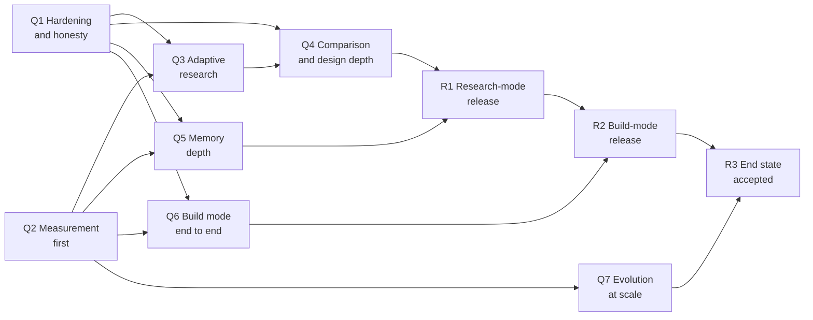

# Open Eye: Delivery Roadmap

**Status:** v1.0 draft, 2026-10-22. Derived from PRODUCT_DEFINITION.md v2.0.

This is artifact I. It takes Open Eye from the system built in phases P0–P6 to the end state in [PRODUCT_DEFINITION.md](PRODUCT_DEFINITION.md). The architecture is [SYSTEM_DESIGN.md](SYSTEM_DESIGN.md); its section 15 lists the gaps this roadmap closes. A phase is finished only when its completion conditions are demonstrated.

**Notation.**
- **[D§n]** cites the product definition; **[S§n]** cites the system design.
- Completion conditions name [ACCEPTANCE.md](ACCEPTANCE.md) items, whose ids follow the definition's sections (ACC-5.6-01 is about D§5.6). **ACC-x-\*** means every item whose id begins with ACC-x, subsections included.
- Thresholds such as "at target" mean the values set in [EVALUATION_PLAN.md](EVALUATION_PLAN.md).
- Q1–Q7 are delivery phases, not calendar quarters.
- Sizes are **estimates**: S (up to 2 weeks), M (2–4 weeks), L (4–8 weeks) of focused engineering. Human labelling and expert review run on their own clock. Calendar dates follow Q2, once throughput has been measured.

---

## 1. Where we are

All of P0–P6 is merged to `main`, but not yet deployed to Railway. Measurements use draft labels by one labeller and the free-tier ministral-8b model, so they are provisional.

| Phase | Delivered | Measured state |
|---|---|---|
| P0 Measure | Suite v1 (15 briefs), harness with record and replay, cost ledger, configuration registry, baselines | B0 recall@10 0.063; B1 first default 0.111 |
| P1 Core platform | Per-mission task graph, understanding as a task, optional GitHub sign-in and workspaces, enforced budgets, graded claims | Constraint change re-runs only dependents (tested); budget stop and resume (tested) |
| P2 Discovery and verification | Connector contract, gateway and registry; deps.dev, OSV, npm, crates.io, Stack Exchange, Tavily, arXiv, docs; E3 evidence; partial analysis of large repositories | Integrated default recall@10 0.341 (0.305–0.365), shortlist precision 0.255; no gain claimed over 0.295, the difference being within noise |
| P3 Complete blueprint | Staged blueprint, six classes (v1 taxonomy), inventory, architecture, guide, roadmap, uncertainty, executive; challenge and deepen | Classification accuracy not yet measured |
| P4 Memory | Semantic, episodic and procedural memory; revalidation by commit; recall before research | Research avoided not yet measured on paired briefs |
| P5 Controlled evolution | Feedback, gated L1 tuner, L2 proposals, weakness mining, monitoring and rollback | One promotion, one rejection; the L1 pass promoted nothing; the 3-run gate passed a no-op |
| P6 Build mode | Sandbox (Docker locally, E2B adapter), opt-in E1 checks for npm and PyPI, bounded coding loop, pull request after approval | Not run end to end on a real build; E2B not run against the live service |

## 2. Phases to the end state

In words: Q1 and Q2 start together. Research work (Q3, Q4, Q5) follows and leads to the research-mode release. Build mode (Q6) and evolution (Q7) are built in parallel, but build mode is released only after research mode.

| Phase | Goal in one line | Depends on | Size (estimate) |
|---|---|---|---|
| Q1 Hardening and honesty | Safe to expose, and never overstates a result | — | M |
| Q2 Measurement first | Numbers that can be trusted before research behaviour changes | — (audit view after Q1's classes) | L |
| Q3 Adaptive research | An explicit, adaptive research plan over a full tool registry | Q1, Q2 | L |
| Q4 Comparison and design depth | The complete 16-section report, export, and UC2 | Q1; Q3 for commercial costs | L |
| Q5 Memory depth | Memory that is safe to reuse across a team | Q1, Q2 | M |
| Q6 Build mode end to end | Real, diagnosed builds in a hosted sandbox | Q1, Q2; release gated by R1 | L |
| Q7 Evolution at scale | L2 and L3 changes promoted on held-out evidence | Q1, Q2 | M |

### Q1 Hardening and honesty

**Goal:** the public deployment is safe to expose, governed by the right people, and never reports more than the evidence supports [D§4, D§11].

**In scope:**
- Sign-in enforced on public deployments: the web app refuses to serve without sign-in configured, unless it runs on a local host. Shared single-workspace mode is local only. Briefs in the shared workspace move to the operator workspace [D§11, D§14.9].
- Governance: only maintainers of the operator workspace change global configuration. Only project maintainers can opt a project into execution [D§14.9, D§14.10].
- An `evaluate` task computes the five mission statuses and the stopping condition from recorded data. `awaiting_approval` builds become "Needs review" [D§4, S§4.3].
- The 16-section report structure. Each section not yet produced says so and why. Sections 1–3, 5, 6, 9, 10, 12, 13 and 16 are filled [D§6.2].
- Migration to the v2 requirement classes for the classifier, stored blueprints and the suite labels [D§5.6, D§14.8, S§7.2].
- An append-only audit log (approvals, opt-ins, deliveries, sandbox runs, injection detections, configuration changes) and a per-mission audit view [D§11].
- The scraper renders with a standard headless browser. The stealth fetcher and protected-domain routing go, and challenge pages are reported as blocked [D§2.4, D§14.6, D§14.14].
- Pause, resume and stop, with partial results kept and labelled [D§3.3].
- Wall-clock and compute limits per mission beside the existing call and token limits, and a marker-credential scan of every output [D§11].
- `/` opens on "What do you want to build?" [D§3.1].
- Railway deployment of P1–P6: migrations 009–014 run before the web deploy, the worker is deployed, and the sandbox key is set or execution is shown as unavailable.

**Out of scope:** new sources, comparison content, memory changes, any change to ranking or prompts.

**Deliverables:** sign-in enforcement and governance rules; `evaluate` task; report skeleton; class migration; audit log and view; revised scraper; mission controls; production deployment with a smoke-test record.

**Completion conditions:**
- Met: ACC-4-01, 4-02, 5.6-01, 5.6-02, 5.9-01, 3.3-04, 7-02, 7-04, 7-05, 8-04, 11-01, 11-03, 11-05, 11-06, 11-07; the sixteen-section structure of ACC-6.2-01.
- On the public deployment, every API route except health and sign-in answers 401 without a session (automated test).
- Rule tests cover each of the five statuses and four build statuses on recorded fixtures. No fixture yields a status better than its data.
- Every stored blueprint carries v2 classes. Rows that could not be mapped are re-classified, not guessed.
- No scraper code path uses the stealth fetcher (test).
- After the deploy: the health check passes, a suite brief runs end to end in production, and replay metrics stay within the noise band of `cfg-66b9cecdb37a`.

**Risks:** v1 class-2 rows that are hard to split (mitigation: re-run the classify stage on recorded inputs); existing anonymous data losing its owner (mitigation: assign it to the operator workspace in the migration); sites that rendered before now report as blocked (accepted: that is the requirement).

**Size:** M (estimate).

### Q2 Measurement first

**Goal:** measurements that can justify a promotion or a claim, before research behaviour changes [D§10.2, D§12].

**In scope:**
- Two people label every suite brief independently. Disagreements are resolved and recorded, agreement is reported, and briefs with low agreement are rewritten [D§12].
- New cases: at least one adversarial case of each kind D§12 lists; build tasks with acceptance tests; paired related briefs for memory; every observed failure as a regression case.
- A held-out set of at least 5 briefs, frozen and never used to design or tune, growing to a quarter of the suite [D§14.12].
- The gate: at least five runs per side, noise pooled from unchanged versions, a held-out pass for L2 and L3 [D§10.2].
- A manual-research baseline: engineers research a sample of briefs in a time box, scored on the same metrics [D§1, D§12].
- Audit views for evidence correctness and grade honesty; classification accuracy and requirement coverage metrics.
- Priced models in the ledger; the default budget set from measured cost [D§14.3].
- Snapshots in object storage; a five-brief replay subset in CI on pipeline pull requests [D§11].
- Baselines B0, B1 and the manual baseline re-recorded on the new labels.

**Out of scope:** any change to discovery, ranking or prompts, except fixing bugs that make measurement wrong.

**Deliverables:** suite v2 with labels marked independent; held-out manifest; revised gate; manual baseline report; audit views; priced ledger; CI job; new BASELINE and DECISIONS entries.

**Completion conditions:**
- Met: ACC-12-02, 12-03, 12-04, 12-06, 12-07, 10.2-02. The audits behind ACC-5.6-03, 6.1-03 and 6.1-04 run and are reported; passing them is not required yet.
- Inter-annotator agreement reported for every brief.
- Two replays of the same version agree within the pooled noise band.
- Cost per brief is reported in money, and the default budget cites the run that set it.
- A replay on a second machine reproduces the first.

**Risks:** labelling time (the largest risk to the schedule; mitigation: label known solutions per requirement, not whole rankings); the manual baseline is costly (mitigation: a sample of briefs, with the time box stated); new labels may lower every number (accepted: the old ones were provisional).

**Size:** L (estimate), most of it human labelling time.

### Q3 Adaptive research

**Goal:** research driven by an explicit plan that adapts to findings, over a tool registry the planner selects from [D§5.2, D§5.3, D§8].

**In scope:**
- A `plan` task and plan artifact: questions ordered by information gain, implementation impact, uncertainty reduced and cost, with the evidence each decision needs. Approval above the default budget [D§5.2].
- Re-planning rounds with diminishing-returns stopping. Every change is recorded with its reason and shown in workspace A.
- Workflow profiles, so narrow briefs get the simplest workflow [D§5].
- Reversals: late evidence sends work back to the right task, and the report lists each reversal [D§5].
- A contract for every task type: objective, inputs, output schema, evidence, budget, completion condition, failure policy [D§5.10].
- GitHub search moved behind the gateway. New connectors for GitHub code and issue search [D§5.3].
- Following dependents (deps.dev) and alternatives as independent discovery strategies [D§5.3].
- Commercial-service discovery, always shown beside the best open alternative and its cost [D§14.13].
- Full tool-registry descriptions, with reliability observed from the ledger and the planner selecting tools per question. The indexer, scraper and sandbox are registered too [D§8].
- Workspace B events labelled actual, planned or example; open questions listed [D§3.2].
- The stronger-model routing experiment, as the first L2 change through the Q2 gate.

**Out of scope:** comparison weights and new report sections (Q4); structured crawling, unless the plan shows docs recall is the bottleneck.

**Deliverables:** plan task; re-planning; profiles; three new connectors; registry v2; workspace B labels; an experiment record in DECISIONS.

**Completion conditions:**
- Met: ACC-5.0-\*, 5.2-\*, 5.3-\*, 5.10-\*, 8-01, 8-02, 8-03, 8-05, 7-01, 3.2-01, 3.2-02.
- ACC-12-01 (the discovery thresholds) is met on the held-out set with final labels. Each step towards it beats the Q2 baseline beyond pooled noise, with no guard regression and cost within tolerance.
- Adding a connector touches only its own module and its registry entry (shown by adding one).
- No planned or example event is ever shown as done (test).

**Risks:** GitHub code search rate limits (mitigation: cache, authenticated tokens, the plan limits code search to high-value questions); information gain is hard to estimate (mitigation: a value-per-cost score first, tuned as L2); vendor pages with restrictive terms (mitigation: official APIs and pricing pages only, within site terms).

**Size:** L (estimate).

### Q4 Comparison and design depth

**Goal:** a complete, honest 16-section report with a machine-readable form, and support for extending an existing system [D§5.5, D§5.7, D§6.2, UC2].

**In scope:**
- A compare stage with brief-specific criteria and weights, scores citing claims, written trade-offs and rejected candidates [D§5.5].
- The remaining sections: 4 comparison, 7 integration map, 8 dependencies and compatibility, 11 acceptance criteria and test plan, 15 costs and complexity. Section 14 also lists what was not searched and why [D§6.2].
- A versioned export schema and endpoint; blueprint versions stored; changes listed across all sections [D§6.2].
- UC2 intake: a repository given with the brief is indexed and inspected first. Its components feed classification. Reference links are fetched by worker tasks, and the web app's in-process ingestion is retired [D§2.2, D§3.1].
- The remaining brief inputs and specification fields: deadline, performance targets, existing assets, exclusions [D§3.1, D§5.1].
- Excluding a source re-runs only what depends on it [D§3.3].
- Inspection depth: duplicate and fork detection; E1 beyond npm and PyPI (at least one more ecosystem, and repositories through their own test suites); the hosted sandbox proven for E1 checks [D§5.4, D§11]. These move here from build mode because the research-mode release requires them (ACC-5.4-03, 11-02).

**Out of scope:** build-mode changes; memory changes.

**Deliverables:** compare stage; five new or completed sections; export schema and endpoint; UC2 intake; blueprint versioning; wider E1 and a sandbox decision record.

**Completion conditions:**
- Met: ACC-3.1-01, 3.2-03 to 3.2-05, 3.3-01 to 3.3-03, 3.3-05, 5.1-\*, 5.4-\*, 5.5-01, 5.6-03, 5.7-\*, 6.1-\*, 6.2-\*, 7-03, 11-02, 11-04, 11-08 (research part); the UC2 and UC3 rows of ACCEPTANCE.md section 13.
- On the held-out set, classification accuracy, evidence correctness and grade honesty are at target.
- Expert rubric review of five blueprints at target.
- The export validates against its schema for every suite brief.
- No report section is empty without a reason.

**Risks:** longer generation truncates (mitigation: one stage per section with validators and fallbacks); expert reviewers' availability (mitigation: book reviews when Q2 ends); E2B fails isolation or cost needs (mitigation: the sandbox interface lets the provider change).

**Size:** L (estimate).

### Q5 Memory depth

**Goal:** memory a team can reuse safely, knowing what still applies and who can see it [D§9, UC5, UC6].

**In scope:**
- Applicability context on claims, experiences and procedures, checked before reuse [D§9.2].
- An admission policy with an L1 threshold [D§9.2].
- Team workspaces with invitations. Sharing controls as in D§14.11, with project details removed when a record is shared [D§9.1].
- Decision-affecting memory reads written to the audit log [D§9.2].
- Revalidation beyond GitHub: registry versions and docs page hashes.
- Workspace F lists the findings that failed revalidation in each mission.
- An embedding-retrieval experiment, kept only if it raises research avoided [D§13].

**Out of scope:** changes to the evolution gate.

**Deliverables:** applicability checks; admission policy; team sharing; memory audit entries; wider revalidation; the experiment record.

**Completion conditions:**
- Met: ACC-9-\*, 4-04, 3.2-06, 5.9-02; the UC5 and UC6 rows of ACCEPTANCE.md section 13.
- On paired briefs, research avoided is at target with no loss of recall.
- No stale finding is shown as current in an audit sample.
- A test shows that one workspace's private content is never readable from another.
- A correction reaches every project that relied on the record (test).

**Risks:** sharing leaks private detail (mitigation: share copies with details removed, and test the boundary); admission discards useful records (mitigation: start permissive, then tune on research avoided).

**Size:** M (estimate).

### R1 Research-mode release

The research-mode release [D§14.2] needs Q1–Q5 complete and every item in the "Research mode" row of the ACCEPTANCE.md release mapping Met. Evolution beyond L1 is not required for it. No claim of superiority over manual research is made unless ACC-12-06 supports it [D§12].

### Q6 Build mode end to end

**Goal:** real builds on benchmark tasks, in a hosted sandbox, with failures diagnosed by cause [D§5.8, D§6.3].

**In scope:**
- A diagnose step that assigns one of the five causes, with its evidence, to every failed iteration. A wrong assumption refutes the claim and sends work back to research or design [D§5.8, S§4.4].
- Builds of every suite build task, scored by their acceptance tests.
- The hosted sandbox measured for builds: cold start, egress control, time and cost per build. Another provider is used if it fails these [D§11].
- Delivery through a GitHub App with per-repository installation; the build updates the report with the claims raised to E1 or refuted [D§6.3].

**Out of scope:** pushing to default branches (never); builds outside the sandbox (never).

**Deliverables:** diagnosis step; build results on the suite; build measurements of the sandbox; GitHub App delivery; updated build report.

**Completion conditions:**
- Met: ACC-4-03, 5.8-\*, 6.3-01, 11-08 (build part); the UC4 row of ACCEPTANCE.md section 13.
- Integration success on the suite's build tasks at target.
- Every failed iteration has a recorded cause.
- The audit log shows no third-party code executed outside the sandbox, and no push to a default branch.

**Risks:** E2B cannot switch network off after installation (mitigation: record it in the test report; choose a provider that can if the evidence needs it); the build tasks prove too easy or too hard (mitigation: calibrate on the first measurement, then freeze).

**Size:** L (estimate). Engineering can start once Q2 has the build tasks.

### R2 Build-mode release

Q6 complete, R1 released, and the "Build mode" row of the ACCEPTANCE.md release mapping Met. As decision 2 requires, classification accuracy (ACC-5.6-03) and evidence correctness (ACC-6.1-03) must each pass two consecutive audits.

### Q7 Evolution at scale

**Goal:** prompts, strategies and workflow improve through changes promoted on held-out evidence, reversibly [D§10].

**In scope:**
- Every proposal states the failure it addresses, the expected benefit and the result that would reject it, before it runs [D§10.2].
- L2 and L3 promotions require a held-out pass; L3 changes get a staged rollout on a share of new missions [D§10.1, D§14.12].
- Live monitoring and rollback extended to L2 and L3 versions.
- Observed failures added to the suite as regression cases automatically, pending a person's label.
- L4 proposals opened as draft pull requests for humans, never applied.

**Out of scope:** any self-applied change to code, permissions or security boundaries [D§2.4].

**Deliverables:** proposal template enforcement; held-out gate; staged rollout; extended monitor; regression-case intake.

**Completion conditions:**
- Met: ACC-10-\*, which completes the "Evolution L2–L4" row of the ACCEPTANCE.md release mapping.
- At least one L2 and one L3 change promoted on held-out evidence, and one rejected with its evidence kept.
- A staged rollout and a simulated regression with automatic rollback, both demonstrated.
- The regression rate after promotions is measured and reported.

**Risks:** too few live missions for monitoring to have power (mitigation: the minimum verdict count stays; replay evidence decides until live volume exists); overfitting the visible suite (mitigation: the held-out set never informs design).

**Size:** M (estimate). It can start when Q2 ends and run beside Q3–Q6.

### R3 End state

Every item in ACCEPTANCE.md is demonstrated, and the product definition's Appendix A has no open gap.

## 3. Order and parallel work

| Track | Sequence | Notes |
|---|---|---|
| Platform | Q1 | Start at once. It is short and unblocks Q3–Q7. |
| Measurement | Q2 | Start at once, beside Q1. Labelling is human time. The audit view waits for Q1's v2 classes. |
| Research | Q3, then Q4 | Q4's export, UC2 intake and report sections can start after Q1. Its comparison and cost sections need Q3's commercial discovery. |
| Memory | Q5 | After Q1 and Q2; can run beside Q3 and Q4. |
| Build | Q6 | After Q2's build tasks; runs beside the research track, released only after R1. |
| Evolution | Q7 | After Q2; runs beside everything else. |

**Rules for every phase:**
- No phase claims an improvement that the Q2 gate has not accepted.
- Work that moves none of a phase's completion conditions waits [D§13].
- Each phase ends with DECISIONS entries for what was measured, and an update to SYSTEM_DESIGN section 15.

## 4. Risks to the roadmap

| Risk | Effect | Mitigation |
|---|---|---|
| Labelling and expert review take longer than engineering | Q2, Q4 and R1 slip | Start labelling on day one; book reviewers early; keep the engineering tracks parallel |
| Independent labels show the system is weaker than the draft numbers | Q3 targets move | Targets are set relative to the Q2 baseline, not to draft numbers |
| A stronger model is unaffordable | Look-alike traps persist | Measure it as an L2 change; route only the stages where the benchmark shows it matters |
| The hosted sandbox fails isolation or cost needs | R1 and R2 slip | Prove E2B in Q4, before builds depend on it; keep the sandbox interface so the provider can change |
| Scope growth | The original objective slips [D§13] | Completion conditions name ACCEPTANCE.md items; anything else waits |
