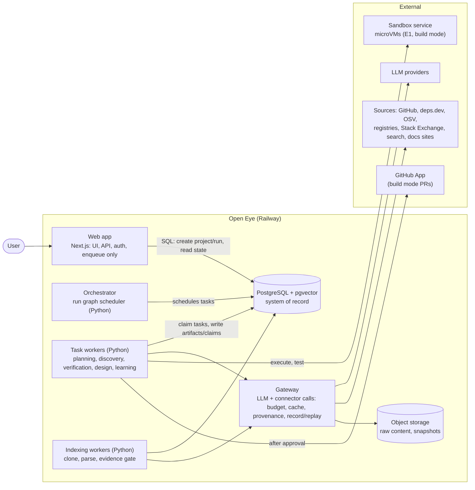
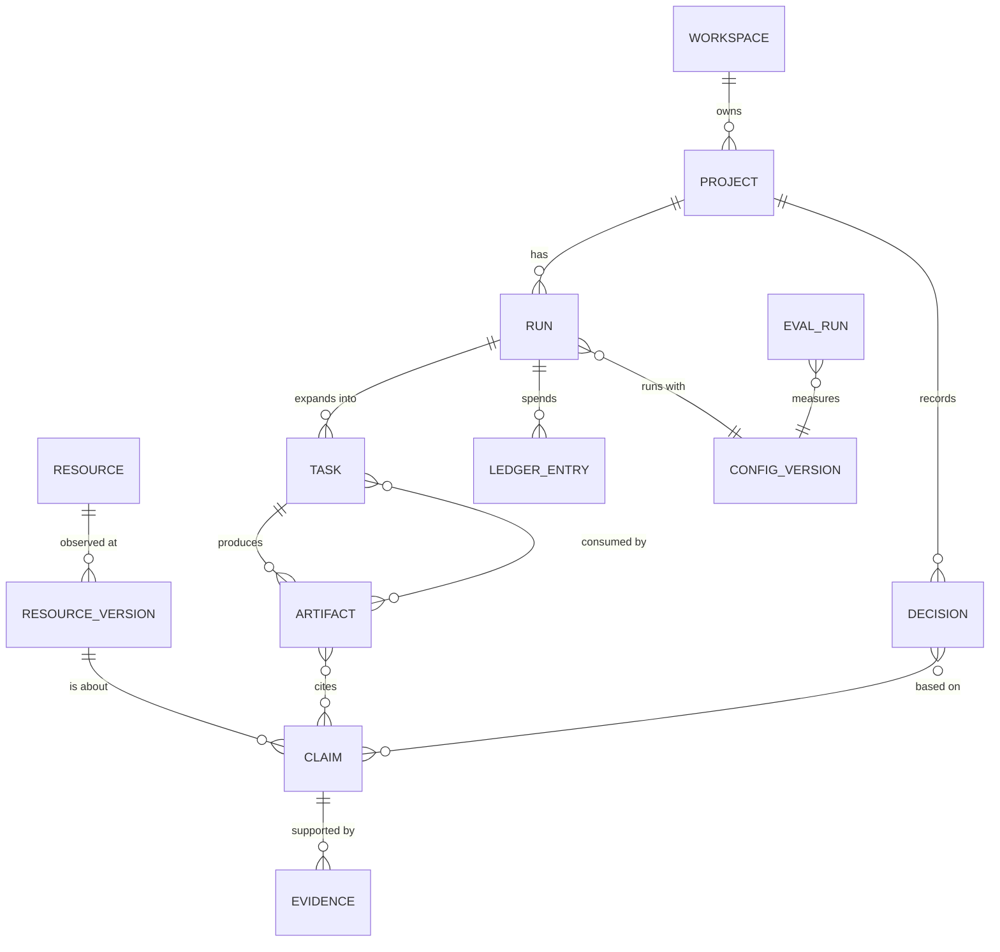
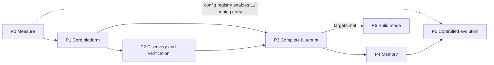

# Open Eye: System Design

**Status:** v0.1, derived from [PRODUCT_DEFINITION.md](PRODUCT_DEFINITION.md) v1.0 (approved with defaults). Each decision here cites the section of the definition it serves, written as **[D§n]**. A design element that cannot cite a requirement does not belong in this document.

Contents:
1. [Requirements that shape the architecture](#1-requirements-that-shape-the-architecture)
2. [Architecture overview](#2-architecture-overview)
3. [Core data model](#3-core-data-model)
4. [Orchestration: the run graph](#4-orchestration-the-run-graph)
5. [Discovery and extraction layer](#5-discovery-and-extraction-layer)
6. [Verification and evidence grading](#6-verification-and-evidence-grading)
7. [Blueprint generation](#7-blueprint-generation)
8. [Memory](#8-memory)
9. [Controlled evolution](#9-controlled-evolution)
10. [Evaluation plan](#10-evaluation-plan)
11. [Safety, budgets and security](#11-safety-budgets-and-security)
12. [Technology choices](#12-technology-choices)
13. [Implementation phases](#13-implementation-phases)
14. [Risks to this plan](#14-risks-to-this-plan)
15. [What changes in the current code](#15-what-changes-in-the-current-code)

---

## 1. Requirements that shape the architecture

Most of the definition can be met by many designs. These requirements cannot, and they decide the structure.

| # | Requirement | From | Consequence for the design |
|---|---|---|---|
| A1 | Runs take minutes to hours, survive deploys and crashes, and pause for human input | D§4.1, D§6.4, D§7.1 | Durable, resumable execution with an explicit "waiting for a person" state. No work may live only in a web request or process memory. |
| A2 | Changing a constraint re-runs only what depends on it | D§4.1 step 6, D§4.3 | Every intermediate result is a versioned artifact with known inputs. Recomputation follows dependencies, like a build system. |
| A3 | Every claim carries an evidence grade, traceable to a source location | D§5.1, D§5.9 | Claims and evidence are first-class records, not text inside reports. Blueprints reference claim ids. |
| A4 | Budgets, retry limits and delegation limits are enforced, not advisory | D§7.2 | Every external call goes through one gateway that meters cost and refuses calls over budget. |
| A5 | Improvement must be shown on a fixed benchmark, reproducibly | D§9, D§10 | All tunable behaviour is versioned configuration. External responses can be recorded and replayed, so two configurations are compared on identical inputs. |
| A6 | Sources and tools are interchangeable | D§3 "not a crawler" | Discovery tools sit behind one connector contract and a registry. The orchestrator never calls a tool directly. |
| A7 | Third-party code runs only in isolation; build mode is gated | D§7.1, D§11 | A separate sandbox service, reachable only through an interface. The application hosts never execute third-party code. |
| A8 | Team workspaces with per-project privacy | D§12.1 | Authentication and a workspace id on every record. Memory is scoped (section 8.2). |
| A9 | Memory with freshness and audit | D§8 | Structured memory tables with provenance, plus a semantic index over them, never the other way round. |

## 2. Architecture overview



The rule that holds today stays: **the database is the only contract between processes.** The web app writes requests and reads state. Workers claim tasks. Nothing calls another process directly. (A1, A2)

| Component | Responsibility | Defined by |
|---|---|---|
| Web app | Workspace UI, project and run API, authentication, live status, approvals, evidence panel. It never runs pipeline work. | D§4.2, A1, A8 |
| Orchestrator | Expands a run into a task graph, schedules ready tasks, invalidates dependents on change, enforces stopping conditions and budgets | D§6.1, D§6.4, A2 |
| Task workers | Execute one task type each (the roles in D§6.2), as bounded steps | D§6.2 |
| Indexing workers | The existing repository pipeline (clone, analysis passes, evidence gate), scheduled as tasks; a separate pool so long indexing does not starve research | D§6.2 repository intelligence |
| Gateway | The single exit for LLM and connector calls: metering, budget refusal, caching, untrusted-content tagging, provenance, record/replay | A4, A5, A6, D§7.3 |
| PostgreSQL + pgvector | Projects, runs, tasks, artifacts, claims, evidence, memory, configuration versions, evaluation results | A3, A9 |
| Object storage | Raw fetched content, repository snapshots, benchmark recordings, all content-addressed | A5, D§8.2 provenance |
| Sandbox service | Ephemeral isolated environments for executing third-party code and build mode | A7 |

## 3. Core data model



| Entity | Purpose | Key fields |
|---|---|---|
| **Workspace, Project** | Tenancy and the user's long-lived project | workspace_id, members, licence policy, budgets, constraints |
| **Run** | One execution of the loop for a project (research or build) | mode, status, stop_reason, config_version, budget_limits, budget_used |
| **Task** | One unit of work in the run graph | type (role), inputs_fingerprint, depends_on, status (`pending`, `ready`, `running`, `awaiting_input`, `done`, `failed`, `stale`), attempts, lock, budget_reservation |
| **Artifact** | A versioned output of a task: requirement set, research plan, candidate set, comparison, architecture, blueprint section | kind, version, content (JSON), produced_by_task, input artifact versions |
| **Resource / ResourceVersion** | Something in the world (repository, package, API, doc page) and the exact state observed | canonical id (e.g. `github:owner/repo`, `pypi:name`), commit, release or content hash, observed_at |
| **Claim** | One factual statement about a resource version | statement, kind (capability, licence, version, compatibility, maintenance, limitation…), **grade E1–E5**, confidence, scope, revalidate_after |
| **Evidence** | Why a claim holds | method (executed, code-located, doc-quoted, claimed, inferred), locator (file+lines+commit / URL+section / test run id), excerpt, retrieved_at, source_id |
| **Decision** | A recorded choice (reuse X for requirement R, reject Y) | reason, claims relied on, alternatives, superseded_by |
| **Ledger entry** | Metered spend | run, task, provider, operation, units, cost, cached? |
| **Config version** | Every tunable: model routing, prompts, weights, thresholds, strategies | version, parent, level (L1–L4), content, status (candidate, promoted, retired) |
| **Eval run** | A benchmark execution | suite version, config version, mode (replay or live), metrics, per-case results |

**Mapping to what exists:**
- `resources` and `repositories` become Resource.
- `evidence` and the capability `knowledge_objects` become Claims graded E2, with their Evidence.
- README assessments become Claims graded E4.
- `briefs`, `brief_candidates` and `brief_blueprints` become Project, Run and Artifacts.

## 4. Orchestration: the run graph

### 4.1 How it works
- **A run is a graph of typed tasks** (D§6.1). The orchestrator starts from the brief and adds tasks as earlier artifacts appear. For example, the research plan artifact determines which discovery tasks exist.
- **Claiming and recovery:** tasks are claimed with `FOR UPDATE SKIP LOCKED`, the same proven pattern as the three queues today (`ingestion_jobs`, `briefs`, `brief_blueprints`). Those three queues become task types in a single `tasks` table, so there is one implementation of claiming, retry and stale-lock recovery.
- **Incremental recomputation (A2):** a task's `inputs_fingerprint` is a hash of its input artifact versions plus its config version. When an input changes (a new constraint, a revalidated claim, a user challenge), the orchestrator marks every task downstream of it `stale`. Stale tasks re-run only if their fingerprint actually changes. Unaffected artifacts are reused.
- **Human in the loop (D§4.1, D§7.1):** a task that needs a person (clarifying questions, plan approval over budget, build authorisation) ends in `awaiting_input` with a structured question. The UI shows it, the user's answer becomes an artifact, and dependents become ready.
- **Budgets (A4):** before a task starts, the orchestrator reserves its estimated budget. The gateway meters actual spend and refuses calls past the run's limits. A refused reservation stops the run with `stop_reason = budget`.
- **Stopping (D§6.4):** the orchestrator evaluates the four stopping conditions after each task. "Diminishing returns" is concrete: the last *k* research tasks changed no Decision and raised no claim's grade.
- **Bounds (D§6.3):** a maximum graph depth, maximum tasks per run, maximum attempts per task, and no task may spawn a task of its own type for the same input.

### 4.2 Inside a task
Most tasks are a fixed sequence of steps: fetch, extract, validate, write. Tasks that need iterative tool use (deep investigation of one repository, build mode coding) run a **bounded agent loop**. That loop has a fixed tool list, a step limit and a budget reservation, and its output is validated against the task's artifact schema before it is accepted. The loop is one task, so it is durable, metered and resumable like any other.

### 4.3 Why not LangGraph or Temporal at the run level
See the decision record in section 12. In short:
- **LangGraph:** its checkpointed state graph handles human-in-the-loop well. But one state blob per run does not give dependency-precise recomputation (A2), or relational claims and evidence that evaluation and memory must query (A3, A9).
- **Temporal:** gives excellent durability, but needs a cluster to operate, and recomputation would still be ours to build.
- **What we already have:** the Postgres task pattern already runs in production here, and it meets A1–A5 with no new infrastructure. Agent frameworks remain an option *inside* tasks (section 4.2), where their strengths apply.

## 5. Discovery and extraction layer

### 5.1 Connector contract (A6)

Every source implements the same contract and is registered with its declared properties. The orchestrator and task workers call connectors only through the gateway.

```text
Connector
  id, source_type (code_host | package_registry | vuln_db | qa_forum | search | docs_site | papers)
  access_basis (official_api | public_page | rendered_public_page)
  declared limits: requests/min, cost per call, terms notes, robots policy
  search(query, filters) -> [Candidate { resource_ref, title, url, snippet, signals, provenance }]
  fetch(resource_ref | url) -> Document { content_ref, content_hash, retrieved_at, url, licence_hint, access_basis }
```

**The gateway around every call** handles:
- the cache, keyed by request hash with a TTL per connector;
- budget metering;
- the robots and terms policy;
- marking content as untrusted;
- provenance;
- the record/replay switch used by evaluation (A5).

### 5.2 Connectors, in order of preference (D§7.3: APIs first)

| Source | Access | What it contributes | Phase |
|---|---|---|---|
| GitHub REST and GraphQL | Official API | Repository search (with READMEs, as tuned in the prototype), metadata, releases, issues, topics, licence | Now / P1 |
| GitHub code search | Official API (authenticated) | Finding implementations by symbol or API name | P2 |
| deps.dev | Official API | Packages across npm, PyPI, Maven, Go, Cargo and NuGet: versions, licences, dependencies, advisories, OpenSSF Scorecard, linked source repositories | P2 |
| OSV.dev | Official API | Known vulnerabilities per package version | P2 |
| npm registry, crates.io | Official API | Package search where the registry offers it. PyPI has no search API, so Python packages are found through GitHub and search, then resolved through deps.dev. | P2 |
| Stack Exchange | Official API | Integration problems and gotchas for candidate packages | P2 |
| Search provider (Tavily today) | Official API | Official docs, articles, comparable products | P2 |
| arXiv / Semantic Scholar | Official API | Research papers, when the brief needs algorithms | P2 |
| Official documentation sites | Public pages | E3 evidence: documented capabilities, configuration, versions | P2 |

The Stack Exchange, PyPI, npm, arXiv and Hacker News clients, de-duplication identifiers and token-bucket limiter in the BridgeAI repository are ported into this contract rather than rewritten.

### 5.3 Crawling and rendering

| Need | Tool | Rule |
|---|---|---|
| Clean content from a single page | Firecrawl (in use), with a native fetch fallback behind the SSRF guard | Per page |
| Crawling a documentation site in scope | **Scrapy** | Allowed-domain list, sitemap first, robots middleware on, AutoThrottle, depth and page caps from the budget, HTTP cache |
| A permitted page that needs JavaScript or interaction | **Playwright** (headless Chromium or Firefox), through scrapy-playwright for crawls | Only pages that permit automated access |
| Pages that refuse plain HTTP clients or need a real browser to render | **Scrapling + Camoufox** (worker scraper service, `apps/worker/scraper`; adopted 2026-10-21 by product decision, superseding the earlier rejection) | Guardrails: SSRF checks on the requested and the final URL; login walls are reported as `AUTH_REQUIRED` and never indexed or worked around; no CAPTCHA solving; crawls stay on the starting site and respect robots.txt; the service is loopback-only unless a shared secret is set |

### 5.4 Research strategy (D§3, D§6.4)

The planning task produces a research plan artifact: questions, then source types, then queries, each with an expected value and a cost. Discovery tasks run in order of value per cost. The research planner itself is a strategy, so it is versioned configuration (L2). Strategy memory (section 8) supplies the starting priors for a class of brief.

## 6. Verification and evidence grading

| Grade | Produced by | Mechanism |
|---|---|---|
| E1 Executed | Testing task in the sandbox (P6; per-project opt-in, D§12.4) | Install the package or repo at a pinned version, run a generated check against the claim, attach the test run |
| E2 Verified in code | Indexing workers (the existing evidence gate) | The claim resolves to a real definition or verbatim quote at file, lines and commit. Anything else is rejected, never stored as a placeholder. |
| E3 Officially documented | Docs extraction task | Quote located in the project's own docs, release notes or API reference at a URL and section; the docs domain is linked to the resource by its metadata |
| E4 Claimed | README, blog and forum assessment | Recorded with its source and never shown as verified |
| E5 Inferred | Evaluation and design tasks | Recorded as reasoning, with the claims it was inferred from |

**Rules:**
- A claim's displayed grade is the highest one its evidence supports.
- Raising a grade requires new evidence produced by that grade's mechanism.
- Licence comes from GitHub plus deps.dev and is graded E3. When they conflict, the claim becomes a conflicting-evidence item.
- Vulnerabilities come from OSV, and maintenance from releases, commits and Scorecard. Both are graded and versioned like any other claim.

**Large repositories:** the prototype skipped CesiumJS-scale repositories because they exceed the size limit. Instead, repositories over the limit get a partial analysis: a sparse checkout of the directories the research plan needs. They are marked as partial in the inventory, so the major frameworks are not missing from it.

## 7. Blueprint generation

The blueprint is a set of artifacts produced by separate tasks, each validated, not one long LLM call (D§5). Each section can then be regenerated alone when its inputs change (A2).

| Step | Input | Output artifact | Validation |
|---|---|---|---|
| Classify | Requirements, claims per candidate | Build-vs-reuse class per requirement (D§5.4), with reasons | Classes 1–3 must cite E1–E3 claims; otherwise downgraded to 6 or "investigate further" |
| Inventory | Candidates, claims, licence policy | Inventory entries with actions (D§5.3) | Every capability listed is a cited claim; licence matches the policy or is flagged |
| Architecture | Classification, inventory, constraints | Components, flows, interfaces, trade-offs (D§5.5) | Each reused component maps to an inventory entry with action reuse or adapt |
| Integration guide | Architecture, E2/E3 claims about interfaces and configuration | Ordered steps (D§5.6) | Every step cites a claim or is marked as unexecuted |
| Roadmap | Classes 3–6, architecture | Tasks with acceptance criteria and tests (D§5.7) | Every non-reused requirement has at least one task; estimates are labelled |
| Uncertainty report | All of the above | D§5.9 | Generated mostly from data: conflicts, stale claims, E4/E5 dependencies, waiting decisions |
| Executive recommendation | All of the above | D§5.2 | Written last; may only summarise the artifacts above |

The blueprint stage already built (validated citations, unsupported reuse downgraded to build, data-derived risks) is the seed of the classify, inventory and uncertainty steps.

## 8. Memory

### 8.1 Storage

| Memory (D§8.1) | Stored as | Scope |
|---|---|---|
| Project | Project, Run, Artifact, Decision tables | Project, inside the workspace |
| Technical knowledge | Resource, ResourceVersion, Claim and Evidence tables | **Global** for claims about public sources (they are facts about public code), with workspace-private notes |
| Experience | `experiences`: outcome, context (resources and versions involved), measured result, linked test runs | Workspace |
| Source reliability | `source_stats`: per source and source type, claims later verified or refuted, staleness | Global |
| Strategy | `strategy_records`: brief class, config version, measured metrics | Global (no project content) |
| Evolution history | `config_versions` plus `eval_runs`, with decisions and reasons | Global |

The semantic index (pgvector) covers claims, experiences and decisions so they can be found by meaning, but the records themselves stay structured.

### 8.2 Behaviour
- **Revalidation is cheap:** for a GitHub resource, compare the stored commit or release with the current one (one API call). An unchanged source keeps its claims current. A changed source marks its E2 and E3 claims for re-check; the evidence gate re-resolves the locators, which usually takes no LLM call.
- **Cross-project reuse:** a new project's discovery tasks first query technical memory for resources matching its requirements. Reused claims enter the blueprint tagged with their original verification date, and are revalidated before a decision depends on them.
- **Deduplication:** a claim is identified by resource, kind and normalised statement. A repeat finding adds evidence to the existing claim instead of creating a new one.
- **Correction:** a user correction creates a refuting evidence item. Affected claims are downgraded, and the artifacts that cited them are marked `stale` (A2), so dependent projects see the change.

## 9. Controlled evolution

- **Everything tunable is configuration:** model routing per task type, prompts, ranking weights, thresholds, query strategies and research priors all live in `config_versions` with levels L1–L3 (D§9.1). Code reads configuration and never hard-codes these values. (Today they are constants in `ranking.py`, `runner.py` and the prompt strings.)
- **Proposals:** the learning task mines finished runs and evaluation failures for recurring weaknesses, and proposes a candidate configuration with the change and the reason.
- **Gate:**
  - the candidate runs on the replay benchmark (section 10.3) at least three times;
  - it must beat the promoted baseline on its target metric by more than the run-to-run noise;
  - it must not regress any guard metric beyond tolerance: evidence correctness, grade honesty, cost, latency.
  - L1 changes that pass are promoted automatically. L2 and L3 changes wait for maintainer approval (D§12.7).
- **Monitoring and rollback:** live runs record their config version. If live metrics for a promoted version fall below the previous version's band, it is rolled back automatically and the event is logged.
- **L4 (code):** never self-applied. A proposal at this level becomes an issue or a draft pull request for humans.

## 10. Evaluation plan

### 10.1 The suite (D§10.2)
- **Suite v1: 15 briefs in 5 domains.**
  - The domains: geospatial and visualisation; developer tooling; data pipelines; LLM applications; web backends with authentication.
  - At least 30% sit outside the team's own expertise.
  - The satellite-tracker brief is case 1.
- **Labels per brief:**
  - requirements;
  - for each requirement, the known solutions, rated *essential* or *acceptable*;
  - the expected build-vs-reuse class;
  - **traps**: repositories that look relevant but must be rejected (abandoned, unlicensed, look-alike, too large to be the right base).
- **Labelling protocol:** two people label each brief independently, disagreements are resolved and recorded, and inter-annotator agreement is reported. Briefs whose agreement is too low to be a reliable ground truth are rewritten.
- **Storage:** versioned in the repository under `eval/suite-v1/`. Cases are added over time; none are removed. Every production failure becomes a regression case.
- **Build-mode tasks (P6):** 10 small integration tasks with acceptance tests.

### 10.2 Baselines, recorded before any change (D§10.1)
- **B0, plain search:** for each brief, the GitHub repository search top 10 for the brief's title terms, plus the search-provider top 10. Scored with the same metrics.
- **B1, the current prototype:** commit `b411ce7` plus the blueprint stage, on the same cases.

### 10.3 Reproducibility
- **Record:** the first live run of a suite version records every gateway response (GitHub, registries, pages, READMEs) into a content-addressed snapshot.
- **Replay:** replay mode serves the snapshot, so configuration A and configuration B see the same external world. LLM calls are not replayed: they run live at low temperature, three times per configuration, and results are reported as mean and spread.
- **Live runs:** a monthly live run measures drift (new repositories, changed rankings) and refreshes the snapshot as a new suite version.

### 10.4 Metrics and how each is computed

| Metric | Computation | Initial target (to confirm once baselines exist) |
|---|---|---|
| Discovery recall@10 | Labelled essential solutions found in the top 10, divided by all labelled essential solutions | B0 + 20 points |
| Shortlist precision | Shortlisted candidates labelled essential or acceptable, divided by all shortlisted | ≥ 0.8 |
| Trap rejection | Trap repositories not recommended for reuse or adapt | ≥ 0.9 |
| Classification accuracy | Requirements whose class matches the label (6 classes) | ≥ 0.75 |
| Requirement coverage | Requirements with a class and a reason | 1.0 |
| Evidence correctness | Human audit of 50 sampled E1/E2 claims per suite run | ≥ 0.95 |
| Grade honesty | Human audit of 50 random claims: share shown above their real grade | ≤ 0.02 |
| Memory effectiveness | On paired related briefs: research calls avoided, and the share of reused claims that fail revalidation | Measured from P4 |
| Integration success (P6) | Build tasks whose acceptance tests pass | Measured from P6 |
| Cost and latency | From the ledger, per brief and per stage | Must not regress beyond 10% without a matching quality gain |

The audit views (a claim, its evidence, correct or incorrect) are part of the product's learning record (D§4.2). Audits are product features, not side scripts.

### 10.5 Cadence
- **On every pipeline pull request:** a five-brief replay subset in CI.
- **Weekly:** the full suite in replay.
- **Monthly:** the full suite live.
- **Results:** stored in `eval_runs` and shown in the learning record.

## 11. Safety, budgets and security

| Concern | Mechanism | From |
|---|---|---|
| Budgets | Per-project limits; reservation per task; gateway refuses calls past limits; live budget display | D§7.2 |
| Untrusted content | Gateway tags all fetched text. Prompts carry it only inside untrusted-content blocks (as today). Validators accept only schema-conforming output. Detected embedded instructions are logged. | D§7.3, D§11 |
| SSRF and fetch safety | The existing guard (scheme, DNS-resolved private ranges, redirect re-checks, size caps) moves into the gateway for every connector | D§11 |
| Repository inspection | Clones as today: shallow, hooks off, symlinks as files, size caps, deleted after use. No code from cloned repositories is executed on application hosts. | A7 |
| Code execution | Only in the sandbox service. No secrets inside it, egress allowlist, CPU, memory and time caps, destroyed after use. | A7, D§12.4 |
| Secrets | Provider keys stay in the platform's secret store and are used only by the gateway, never placed in prompts, artifacts, logs or memory. Users' own credentials, if ever needed, are scoped per source and require approval. | D§11 |
| Authentication and tenancy | Sign-in, workspaces, roles (member, maintainer); every query is scoped by workspace | A8 |
| Build-mode actions | A GitHub App with per-repository installation and minimal permissions; a branch and pull request only after explicit approval | D§5.8, D§7.1 |
| Licences | Policy per project (default: copyleft allowed and flagged, D§12.5), applied in the inventory and roadmap | D§11 |

## 12. Technology choices

Each choice names the requirement it serves, what was considered, and when it would be revisited.

| Area | Choice | Why | Alternatives considered | Revisit when |
|---|---|---|---|---|
| Web app | **Next.js (keep)** | Already in production; the UI, API routes and streaming exist | — | — |
| Pipeline language | **Python for all pipeline work** | The indexer, evidence gate and discovery are Python. Web/PDF ingestion and decomposition currently run in-process in the web app, where a deploy kills them (A1), so they move to workers. | Split TS/Python (today) | — |
| System of record | **PostgreSQL + pgvector (keep)** | Relational claims, evidence and tasks, plus semantic search, in one transactional store (A3, A9) | Separate vector database | Vector volume or query latency exceeds what pgvector serves on one instance |
| Raw content and snapshots | **S3-compatible object storage** | Content-addressed recordings for replay and provenance (A5) | Postgres large objects | — |
| Run orchestration | **Own run graph on Postgres** (generalising today's three queues) | Meets durability, waiting for a person, dependency-precise recomputation, budgets and relational audit (A1–A5) with no new infrastructure | **LangGraph** (fits agent loops and human-in-the-loop, but state is one blob per run, with no dependency-precise invalidation or relational evidence); **Temporal** (strongest durability, but a cluster to run, and recomputation still ours) | The scheduler becomes a bottleneck, or we need cross-service workflows; then Temporal |
| Agent loops inside tasks | **Thin, bounded tool loop over the provider interface** | Few tasks need it; it must be metered and schema-validated like everything else | LangGraph for that loop; vendor agent SDKs | A task's loop needs branching or sub-agents; LangGraph is the first candidate there |
| LLMs | **Provider-agnostic interface (keep), routing by task tier, decided by the benchmark.** Initial defaults: the most capable model (Claude Opus 5.5) for planning, classification, architecture and the blueprint; a fast model (Claude Haiku 5.5) for high-volume extraction and assessment. OpenAI and Mistral stay supported. | The prototype's failures came from the free-tier small model (invalid or truncated JSON). The planning and design tasks need the strongest structured reasoning. Model choice is L2 configuration, so the evaluation decides, not preference. | Single model for everything | Every benchmark run; routing is configuration |
| Structured output | **Schema-constrained output where the provider supports it, plus validators** | Several bugs came from free-form JSON (bare arrays, truncation) | Prompt-only JSON (today) | — |
| Embeddings | **Keep mistral-embed (1024-d) until the benchmark justifies a change** | Changing model means re-embedding everything; only worth doing for a measured retrieval gain | OpenAI text-embedding-3 at 1024 dimensions | A retrieval change wins on the suite |
| Search provider | **Tavily (keep), behind the connector contract** | Already integrated and cached | Exa, Brave, Serper | Recall on docs and articles is the weak metric |
| Single-page extraction | **Firecrawl (keep), with native fetch fallback** | Already integrated | — | — |
| Site crawling | **Scrapy** | Mature support for robots, AutoThrottle, caching, sitemaps and per-domain limits | Firecrawl crawl (per-page cost) | — |
| Rendering | **Scrapling with Camoufox** for extraction (with the guardrails in section 5.3); **Playwright** for UI testing | One browser-rendering path for extraction, behind the scraper service | Selenium | A site's terms or the guardrails cannot be met |
| Package, licence and vulnerability data | **deps.dev + OSV.dev** | Official, free, cross-ecosystem; licences, dependencies, advisories, Scorecard | libraries.io (key, rate limits), scraping registries (prohibited) | — |
| Sandbox | **Managed microVM sandbox service behind a Sandbox interface; E2B and Modal Sandboxes shortlisted, chosen by a P6 spike** (cold start, egress control, cost) | Application hosts must never run third-party code (A7), and Railway containers cannot host nested isolation | Self-hosted Firecracker (operational cost) | — |
| Build-mode delivery | **GitHub App** | Per-repository permissions, auditable pull requests | Personal access tokens (too broad) | — |
| Authentication | **Auth.js with GitHub sign-in** | The users are developers; their GitHub identity is useful later for the GitHub App | Clerk, Supabase Auth | — |
| Observability | **Run and task timeline in the database, plus the ledger and LLM call log; OpenTelemetry traces** | "Record tool calls and outputs" is a product requirement (D§9.2), not just ops | A hosted LLM-observability product (e.g. Langfuse) | Debugging prompt behaviour needs more than the call log |
| Hosting | **Railway (keep): web, orchestrator, two worker pools, Postgres**; sandbox external | Upload-based deploys already work; separate pools keep indexing from starving research | — | Cost or isolation needs exceed it |

## 13. Implementation phases

Research mode comes first (D§12.2). Each phase ends only when its exit criteria are met on the evaluation suite, and no phase starts features of a later one.



| Phase | Scope | Exit criteria | Size |
|---|---|---|---|
| **P0 Measure** | Land the blueprint stage after checking it against the definition. Write eval suite v1 (15 labelled briefs, labelling protocol). Build the harness with record/replay. Record LLM calls and costs in the ledger. Move the hard-coded weights and prompts into a config registry. Record baselines B0 and B1. | A reproducible baseline report: B0 and B1 on all metrics that need no new features, run twice with matching results within the noise band | M |
| **P1 Core platform** | Authentication and workspaces. A single run-graph orchestrator replacing the three queues and the web app's in-process jobs. Decomposition moves into workers. Understanding check (acceptance criteria, at most three questions, assumptions, waiting for a person). Budgets enforced through the gateway. Claim and evidence model with grades (migrate existing evidence to E2 and README assessments to E4). Live status view. | A constraint change re-runs only its dependents (tested); a run stops cleanly on budget; every blueprint statement references a claim; suite metrics no worse than B1 | L |
| **P2 Discovery and verification** | Connector gateway and contract. Connectors: deps.dev, OSV, npm, crates, Stack Exchange, search for docs, arXiv, GitHub code search. Scrapy docs crawling and Playwright rendering. E3 from official docs. Licence, vulnerability and maintenance claims. Partial analysis of large repositories. Value-per-cost research planner and diminishing-returns stopping. | Recall@10 at least B0 + 20 points; trap rejection ≥ 0.9; evidence correctness ≥ 0.95 | L |
| **P3 Complete blueprint** | Six-class classification, inventory with all four actions, architecture, integration guide, roadmap with acceptance criteria, uncertainty report, executive recommendation. Iterate without restarting: challenge a decision, deepen one requirement, change a constraint. | Classification accuracy ≥ 0.75; coverage 1.0; grade honesty ≤ 0.02; expert rubric review of 5 blueprints | L |
| **P4 Memory** | Memory tables and scopes, revalidation by commit or release, cross-project reuse, source reliability updates, audit and correction UI | On paired briefs: research calls reduced with no loss in recall; zero stale claims shown as current in the audit | M |
| **P5 Controlled evolution** | Feedback capture (marking candidates and decisions right or wrong), weakness mining, L1 auto-tuning under the gate, L2 proposals with maintainer approval, evolution history, automatic rollback, learning record UI | At least one promoted and one rejected change, each with benchmark evidence; a simulated live regression triggers rollback | M |
| **P6 Build mode** *(starts only when P3 targets are met)* | Sandbox spike and choice. E1 execution checks (per-project opt-in). Implementation task with a bounded coding loop in the sandbox. Test reports. GitHub App pull-request delivery after approval. | Integration success measured on 10 build tasks against a target set after the first measurement; no code executed outside the sandbox (audited) | L |

**Sizes** are relative (S, M, L) and are estimates, per D§5.7. Calendar estimates come after P0, when there is measured throughput to base them on.

## 14. Risks to this plan

| Risk | Effect | Mitigation |
|---|---|---|
| Labelling effort for the suite is underestimated | P0 slips, so everything slips | Start with 15 briefs; label known solutions per requirement rather than whole rankings; reuse the satellite brief work |
| LLM cost of the strongest model at volume | Budgets hit early | Tier routing; cache; the benchmark decides where the strong model is needed |
| GitHub API limits (search: 30 requests per minute per token) | Slow discovery, especially for concurrent users | Response cache in the gateway; GitHub code search and deps.dev to cut query counts; one installation token per workspace once the GitHub App exists |
| Replay snapshots drift from the live world | Benchmark wins that do not hold live | Monthly live runs; promotion also requires a non-negative live delta |
| Expected-information-gain planning is hard to get right | Over- or under-researching | Start with a simple value-per-cost score and diminishing-returns stopping; it is L2 configuration and is tuned by the benchmark |
| Scope creep inside phases | The definition warns about it | Exit criteria are metric-based; anything that does not move a phase's metrics waits |

## 15. What changes in the current code

| Today | Becomes | Phase |
|---|---|---|
| Three queues (`ingestion_jobs`, `briefs`, `brief_blueprints`) with copied claim logic | One `tasks` table and scheduler | P1 |
| Web app runs web/PDF/YouTube ingestion and decomposition in-process | Worker tasks; the web app only enqueues | P1 |
| No authentication | Auth.js, workspaces, roles | P1 |
| `evidence` + capability `knowledge_objects` | Claims (E2) with Evidence | P1 |
| README assessments in `brief_candidates.assessment_json` | Claims (E4) | P1 |
| Ranking weights, thresholds and prompts as constants | `config_versions` (L1/L2) | P0 |
| `provider_usage` written only by Tavily and Firecrawl | Gateway ledger for every LLM and connector call | P0–P1 |
| `tests/benchmark` (schema and heuristic checks on fixed resources) | Kept as unit-level checks; `eval/` adds the outcome-level suite | P0 |
| GitHub-only discovery in `apps/worker/discovery/` | The first connector behind the contract | P2 |
| Blueprint stage (uncommitted) | Seed of P3's classify, inventory and uncertainty steps; landed in P0 | P0 |
