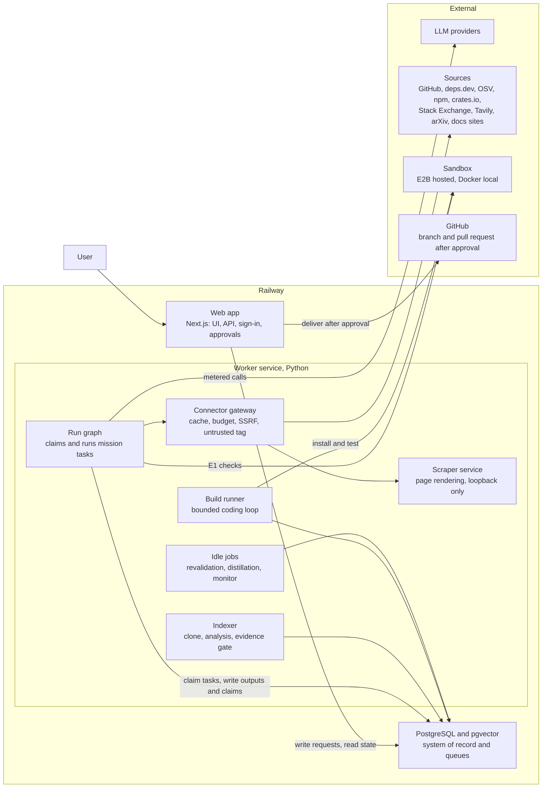
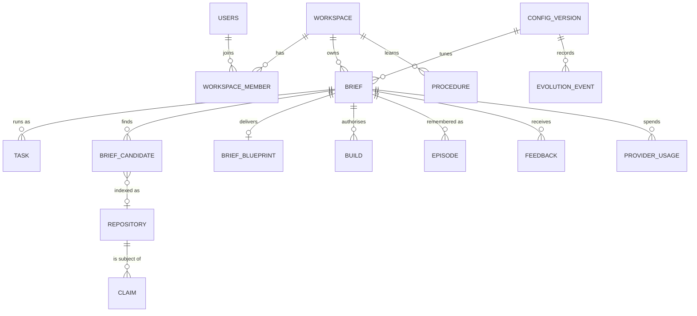
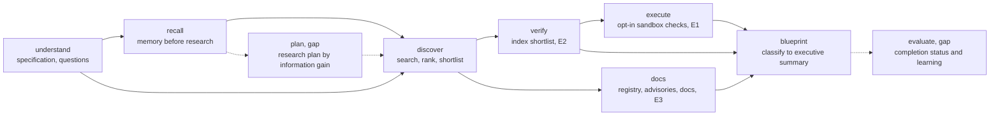

# Open Eye: System Design

**Status:** v1.0 draft, 2026-10-22. Derived from PRODUCT_DEFINITION.md v2.0.

This is artifact B, the end-state architecture. It describes the system as built after phases P0–P6 and what remains to reach the end state. Each design element cites the requirement it serves in [PRODUCT_DEFINITION.md](PRODUCT_DEFINITION.md), written **[D§n]** (decisions as **[D§14.n]**). An element that cannot cite a requirement does not belong here [D§13]. Delivery order is in [ROADMAP.md](ROADMAP.md); the checklist is in [ACCEPTANCE.md](ACCEPTANCE.md).

Each table marks what exists as **built**, and what does not yet exist as **gap** (section 15).

Contents:
1. [Requirements that shape the architecture](#1-requirements-that-shape-the-architecture)
2. [Architecture overview](#2-architecture-overview)
3. [Core data model](#3-core-data-model)
4. [Orchestration: the run graph](#4-orchestration-the-run-graph)
5. [Discovery and extraction layer](#5-discovery-and-extraction-layer)
6. [Verification and evidence grading](#6-verification-and-evidence-grading)
7. [Blueprint and report](#7-blueprint-and-report)
8. [Memory](#8-memory)
9. [Controlled evolution](#9-controlled-evolution)
10. [Evaluation](#10-evaluation)
11. [Safety, budgets and security](#11-safety-budgets-and-security)
12. [Technology choices](#12-technology-choices)
13. [Delivery](#13-delivery)
14. [Risks to this design](#14-risks-to-this-design)
15. [Gaps between the built system and this design](#15-gaps-between-the-built-system-and-this-design)

---

## 1. Requirements that shape the architecture

Most of the definition can be met by many designs. These requirements cannot, and they decide the structure.

| # | Requirement | From | Consequence for the design |
|---|---|---|---|
| A1 | Missions take minutes to hours, survive deploys and crashes, and pause for a person | D§3.3 interruptible, D§5.1, D§7 | Durable, resumable tasks with an explicit "waiting for a person" state. No work lives only in a web request or in process memory. |
| A2 | Changing a constraint re-runs only what depends on it; later evidence can send work back | D§3.3 incremental, D§5 | Every task output has known inputs and a fingerprint. Recomputation follows dependencies, like a build system. |
| A3 | Every claim carries a grade and resolves to a source location | D§6.1, D§3.3 inspectable | Claims and evidence are records, not text inside reports. The report cites claim and source ids. |
| A4 | Budgets, retries and delegation depth are enforced, not advisory | D§11 bounded, D§7 | Every LLM and source call is authorised against the mission budget before it leaves the process. |
| A5 | Improvement is shown on a fixed benchmark, reproducibly | D§10.2, D§12 | All tunable behaviour is versioned configuration. External responses are recorded and replayed. |
| A6 | Tools are described in a registry, selected by the planner, and replaceable | D§8, D§2.4 | Sources sit behind one connector contract and a registry. Tasks never open sockets themselves. |
| A7 | Third-party code runs only in isolation, and only when authorised | D§5.4, D§7, D§11, D§14.4 | A sandbox reached through one interface. Application hosts never execute third-party code. |
| A8 | Team workspaces, per-project privacy, maintainers who govern | D§9.1, D§11, D§14.1, D§14.9–11 | Sign-in, a workspace id on every private record, roles, and scoped memory. |
| A9 | Memory with provenance, freshness, correction and audit | D§9.2 | Structured memory tables with provenance; any semantic index sits over them, never the other way round. |
| A10 | One completion status per mission, never better than the evidence | D§4, D§11 honest | The status is computed from recorded data by rules, not written by a model. |
| A11 | Every mission is auditable and reproducible | D§11, D§9.2 | An append-only audit log plus an execution record: inputs, configuration version, tool calls, outputs. |

## 2. Architecture overview

In words: the web app and the worker never call each other and share only the database; the worker meters every LLM and source call against the mission budget and runs third-party code only in the sandbox.

The rule that has held since P0 stays: **the database is the only contract between processes** (A1, A2). The web app writes requests and reads state. Workers claim work with `FOR UPDATE SKIP LOCKED`.

| Component | Responsibility | State | Serves |
|---|---|---|---|
| Web app (`apps/web`) | Workspaces A–F, API, sign-in, approvals, evidence drawer. Never runs mission work. | Built; still runs non-GitHub resource ingestion in-process (gap) | D§3.2, A1, A8 |
| Run graph (`apps/worker/orchestrator`) | Creates a mission's tasks, claims ready ones, fingerprints inputs, invalidates dependents, enforces budgets | Built | D§5, A1, A2, A4 |
| Indexer (`apps/worker/worker.py`, `analyzer/`) | Clone, analysis passes, evidence gate (E2); partial analysis of large repositories | Built | D§5.4, D§6.1 |
| Connector gateway and registry (`apps/worker/connectors`) | The single exit for source calls: cache, budget, SSRF check, pacing, untrusted tagging, provenance | Built; GitHub search uses its own metered client outside it (gap) | D§8, A4, A6 |
| Scraper service (`apps/worker/scraper`) | Renders permitted pages that need a browser | Built; uses a stealth browser that conflicts with D§2.4 (gap) | D§8 layer 4 |
| Sandbox (`apps/worker/sandbox`) | Ephemeral isolated environments for E1 checks and builds | Built; E2B adapter not yet run against the live service (gap) | A7 |
| Build runner (`apps/worker/builder`) | Authorised builds, separate from the run graph | Built | D§5.8, D§6.3 |
| Idle jobs | Memory revalidation and distillation; evolution monitor and rollback | Built | D§9.2, D§10.2 |
| PostgreSQL with pgvector | Missions, tasks, claims, memory, configuration versions, ledger, evolution history | Built | A3, A9 |
| Object storage | Replay snapshots and execution records, content-addressed | Gap: snapshots live on the recording machine only | A5, A11 |

### 2.1 Workspaces, routes and APIs

The six workspaces of D§3.2, as they exist today and what each still lacks.

| Workspace | Route today | APIs | Missing for D§3.2 |
|---|---|---|---|
| **A. Mission** | `/briefs`, `/briefs/[id]` (run, understanding, requirements) | `POST /api/briefs`; `GET`, `PATCH` (constraints, answers, budget), `DELETE /api/briefs/[id]`; `POST .../discover`, `.../deepen` | The active research plan and its changes; decisions log; pause, resume and stop; completion status and stopping condition |
| **B. Live research** | Run panel and "How the search ran" on `/briefs/[id]` | `GET /api/briefs/[id]` (polled) | Events labelled actual, planned or example; open questions; sources as they are discovered |
| **C. Solution comparison** | "Best starting points", "Other candidates", evidence drawer | `GET /api/briefs/[id]`, `POST /api/feedback` | The criteria and weights used; trade-offs in words |
| **D. Architecture** | "Recommended architecture" with the architecture graph | `POST /api/briefs/[id]/challenge` | Integration order and interfaces as a map (report section 7) |
| **E. Deliverable** | Blueprint sections and the Build panel | `.../build`, `.../build/[buildId]`, `.../deliver` | The 16-section report, the completion status, a machine-readable export |
| **F. Memory and evolution** | `/memory`, `/evolution`, `/evaluation` | `/api/memory/*`, `/api/claims/[id]/refute` and `confirm`, `/api/evolution/*` | Findings that failed revalidation per mission; team sharing controls |

**The root route** opens on the Studio (chat over the indexed library), with `/resources`, `/repositories/[id]` and `/capabilities` beside it. D§3.1 requires the product to open on "What do you want to build?". In the end state `/` opens on the brief form. Repository pages remain only as the source-location view behind evidence [D§3.3 inspectable]; the chat surface answers no workspace question and is retired or folded into evidence drill-down [D§3.2, D§2.4].

## 3. Core data model

In words: a brief is a mission inside a workspace; its tasks, candidates, blueprint and builds hang off it, while claims are about resources and are shared when those resources are public.

| Entity | Table (migration) | Purpose | End-state change |
|---|---|---|---|
| Workspace, member, user | `workspaces`, `workspace_members`, `users` (009) | Tenancy; roles member and maintainer [D§14.1] | Team workspaces with invitations; an operator workspace that governs global configuration [D§14.9] |
| Mission | `briefs` (006, 009, 011) | Brief, constraints, answers, budget, challenges, focus requirements, run status | `completion_status`, `stopping_condition`, `workflow_profile` [D§4, D§5] |
| Task | `tasks` (009) | One row per task type per mission: status, `depends_on`, `inputs_fingerprint`, output, attempts, lock | Task contract fields per type [D§5.10] |
| Candidate | `brief_candidates` (006, 010, 012) | Ranked candidates with signals, sources that found them, README assessment, provenance | Comparison scores per brief-specific criterion [D§5.5] |
| Blueprint | `brief_blueprints` (007) | The staged blueprint and its change list | One row per version, with a schema version for the export [D§6.2] |
| Resource | `resources`, `repositories` (001, 005) | Indexed repositories and other sources; analysis scope in `ingestion_jobs.scope_json` | None |
| Claim | `claims` (009, 012) | Statement, kind, grade E1–E5, subject and subject version, scope, status, evidence list, `revalidate_after` | Applicability context [D§9.2] |
| Memory | `episodes`, `experiences`, `procedures`, `strategy_records`, `source_stats`, `revalidation_checks` (012) | Episodic, procedural and source-reliability memory | Sharing flags [D§14.11]; admission scores [D§9.2] |
| Configuration | `config_versions` (008, 013) | Content-hashed tuning, level, status, evidence | Held-out evidence and rollout stage [D§10.2, D§14.12] |
| Evolution | `feedback`, `label_proposals`, `evolution_proposals`, `evolution_events` (013) | Verdicts, proposals, decisions, rollbacks | Rejection criterion on every proposal [D§10.2 step 4] |
| Build | `builds` (014) | Scope, status, change set, diff, test report | Failure cause per iteration [D§5.8] |
| Ledger | `provider_usage` (005, 008) | Every metered LLM and source call, per mission and task | Prices for every model, so cost is reported [D§12, D§14.3] |
| Cache | `connector_cache` (010) | Source responses by request hash, with TTL | None |
| Audit log | Gap | Approvals, consequential actions, decision-affecting memory reads, injection detections, sandbox runs | New append-only table [D§11, D§9.2] |

## 4. Orchestration: the run graph

### 4.1 Tasks

In words: seven task types run today in dependency order; the end state adds an explicit plan task before discovery and an evaluate task after the blueprint.

| Task | Consumes | Produces | Serves |
|---|---|---|---|
| `understand` | Brief, constraints, answers | Requirements (MUST, SHOULD, NICE-TO-HAVE), acceptance criteria, assumptions, at most three questions with a blocking flag | D§5.1 |
| `recall` | Requirements, memory | Remembered candidates with current claims, similar past episodes, active procedures, requirements not to search again | D§5.2, D§9 |
| `discover` | Requirements, constraints, recall | Ranked candidates and a shortlist from GitHub and the registries | D§5.3 |
| `verify` | Shortlist | Shortlisted repositories queued into the indexer; waits until they finish or a maximum wait passes | D§5.4 |
| `docs` | Shortlist, requirements | deps.dev licence and Scorecard, OSV advisories, official-docs quotes (E3), Stack Exchange issues (E4) | D§5.4, D§11 supply chain |
| `execute` | Verified claims, opt-in | Claims raised to E1 or refuted by a sandboxed smoke test; skipped without opt-in | D§5.4, D§14.4 |
| `blueprint` | All of the above, challenges, licence policy | The staged blueprint (section 7) | D§5.5–5.7, D§6.2 |

**Mechanics (built):**
- **Statuses:** `pending`, `running`, `waiting` (re-claimed after `not_before`), `awaiting_input`, `done`, `failed`, `stale`, `cancelled`.
- **Fingerprints (A2):** each task hashes what its result depends on: inputs, constraints that shape it, tuning version, prompt version. An input change marks the task and everything downstream `stale`; a stale task whose fingerprint is unchanged is marked done without running. The execution opt-in affects only `execute`.
- **People (A1):** an unanswered blocking question ends `understand` in `awaiting_input`. Non-blocking questions do not hold research back [D§5.1].
- **Budgets (A4):** each mission has limits (default 60 LLM calls, 400,000 tokens, 250 GitHub requests, 300 source requests). The ledger authorises every call; a refusal fails the task with `stop_reason = budget`, and raising the budget resumes from that task.
- **Bounds [D§11]:** retry limit per task, lock timeout with heartbeat, maximum verification wait.
- **Separate queues:** repository indexing (`ingestion_jobs`) is shared across missions, and builds (`builds`) must never start from research [D§7]. Both keep their own queues with the same claiming rules.

### 4.2 Adaptive workflow (gap)

- **Simplest workflow [D§5]:** `understand` also chooses a workflow profile (for example narrow, standard, extended). The profile sets which tasks are created and their budgets, so a library question does not get the full pipeline.
- **Research plan [D§5.2]:** a `plan` task writes the plan artifact: questions, solution categories, source types, evidence each decision needs, expected cost. Questions are ordered by information gain, implementation impact, uncertainty reduced and cost. Above the default budget, the plan waits for approval.
- **Re-planning [D§5.2]:** discovery runs in rounds. After each round the plan is re-scored; it stops on diminishing returns [D§7 stopping]. Each plan change is recorded with its reason and shown in workspace A.
- **Reversals [D§5]:** a verified licence conflict, a failing integration test, a changed constraint or a failed revalidation invalidates the affected task, and the report records the reversal.
- **Controls [D§3.3]:** pause sets a flag the claim query respects; resume clears it; stop cancels pending tasks and keeps partial results, labelled partial. Excluding a source invalidates only the tasks whose outputs used it.
- **Task contracts [D§5.10]:** each task type is registered with objective, inputs, output schema, evidence required, budget share, completion condition and failure policy. The handler output is validated against the schema before it is accepted.

### 4.3 Mission completion status (gap)

Today `briefs.status` summarises the run (QUEUED, RUNNING, AWAITING_INPUT, COMPLETED, STOPPED, FAILED). The five statuses of D§4 are computed by an `evaluate` task from recorded data, never by a model (A10):

| Status [D§4] | Rule over recorded data | Usual stopping condition [D§7] |
|---|---|---|
| Complete | Blueprint done; every requirement has a class in 1–5 with its evidence; every acceptance criterion has a covering task or test | Acceptance criteria met |
| Complete with gaps | Blueprint done; at least one class 6 requirement, each with "resolve by" | Diminishing returns |
| Partial | A task failed on budget or time; the report covers what was reached | Budget or time limit |
| Blocked | A blocking question is unanswered, an approval is pending, or a required source is unavailable | Decision needs the user |
| Failed | No usable blueprint was produced | Stated failure reason |

Every status except Failed produces the full report, with unreached sections marked as such [D§6.2]. Build statuses map from `builds.status`: `succeeded` → Succeeded, `awaiting_approval` → **Needs review**, `failed` → Failed, `delivered` → Delivered [D§4].

### 4.4 Builds

A build is authorised by a maintainer for selected roadmap tasks [D§7, D§5.8]. The runner claims it, then repeats: the model writes files; a fresh sandbox installs dependencies with network, loses its network, and runs the tests; failures go back to the model. It stops when all tests pass, after the iteration limit, or when the budget or sandbox time is used up. It stores the change set, a diff and a test report (passed, failed, untested, needs a human) [D§6.3]. Delivery is a separate, approved request that opens a branch and a draft pull request [D§6.3, D§7].

**Failure diagnosis (gap) [D§5.8]:** after each failed run a diagnose step assigns one of the five causes, with the evidence for it:

| Cause | Evidence used | Action |
|---|---|---|
| 1. Implementation wrong | Assertion failures in new code | Fix within the iteration budget |
| 2. Dependency incompatible | Resolver or import errors, version constraints | Pin or replace within budget; record the incompatibility as a claim |
| 3. Environment at fault | Sandbox errors, timeouts, missing tools | Retry or adjust the environment; never edit tests to pass |
| 4. Test inadequate | Test contradicts the acceptance criteria | Change the test only with the reason in the test report |
| 5. Assumption wrong | Behaviour contradicts a claim or assumption the blueprint relied on | Stop the build; refute the claim; mark `blueprint` stale, so research or design re-runs |

The cause of each iteration is stored on the build and as an episodic experience [D§5.9].

### 4.5 Why our own run graph

Our own Postgres task graph meets A1–A5 with no new infrastructure, and gives dependency-precise invalidation and relational claims, which a per-run state blob (LangGraph) does not. Temporal remains the candidate if the scheduler becomes a bottleneck. The decision record belongs in [TECHNOLOGY_DECISIONS.md](TECHNOLOGY_DECISIONS.md) [D§8 tool adoption].

## 5. Discovery and extraction layer

### 5.1 Connector contract and gateway (built)

Every source implements one contract (`connectors/base.py`): `search(query, filters)` returns candidates with provenance; `fetch(ref)` returns a document with content hash and access basis. Source types: code host, package registry, vulnerability database, Q&A forum, search, docs site, papers. Access bases: official API, public page, rendered public page. A source without credentials or reachability raises "unavailable", and callers record that and go on [D§7 failure].

The gateway around every call [D§8 efficiency, D§11]:
- caches by request hash (credentials removed), with a TTL per connector, in `connector_cache`;
- authorises the call against the mission budget and records it in the ledger;
- runs the SSRF check on every non-official host and every redirect;
- paces live requests per connector;
- marks every response untrusted, and logs instruction-like text [D§11 untrusted content];
- takes an injectable HTTP client, so the evaluation harness can record and replay (A5).

### 5.2 Tool registry (partly built)

`connectors/registry.py` lists each connector with its source type, access basis, official hosts, cache TTL, pacing and terms note. D§8 requires more, so each entry gains: capabilities, input and output contracts, permissions needed, cost per call, rate limits, observed reliability (success rate and latency from the ledger), failure modes, and when to use and not use it. The planner then selects tools per question from the registry instead of fixed code paths, and adding or removing a tool is a registry change [D§8]. GitHub, the indexer, the scraper and the sandbox are registered too, so the registry describes every discovery and execution tool.

### 5.3 Sources

| Source | Access | Contributes | State |
|---|---|---|---|
| GitHub repository search | Official API | Repositories, READMEs, metadata, licence, last push | Built, own metered client (to move behind the gateway) |
| GitHub code and issue search | Official API, authenticated | Implementations by symbol or API name; known problems | Gap [D§5.3] |
| npm, crates.io | Official API | Package search, resolved to source repositories | Built (off in the harness by default) |
| deps.dev | Official API | Licences, dependencies, Scorecard, published packages | Built; dependents not yet followed (gap) [D§5.3] |
| OSV.dev | Official API | Advisories per package version | Built |
| Stack Exchange | Official API | Integration problems and gotchas | Built |
| Tavily | Official API | Docs, articles, comparable products | Built |
| arXiv | Official API | Papers when the brief needs algorithms | Built |
| Official docs sites | Public pages, robots honoured | E3 quotes by URL and section | Built |
| Commercial services and APIs | Search plus vendor docs and pricing pages | Candidates beside the best open alternative and its cost | Gap [D§5.3, D§14.13] |
| Alternatives | Search, registry metadata, "alternative to" queries | Independent discovery strategies when the first finds too little | Gap [D§5.3] |

PyPI has no search API, so Python packages are found through GitHub and search, then resolved through deps.dev.

### 5.4 Layered retrieval and rendering

| Layer [D§8] | Component | State |
|---|---|---|
| 1. Search indexes and structured APIs | Connectors above | Built |
| 2. Direct repository and docs retrieval | Indexer (shallow clone; sparse checkout for large repositories); docs connector | Built |
| 3. Structured crawling of permitted sites | A crawler with allowed domains, sitemap first, robots, throttling, page caps from the budget | Gap; the tool is chosen in TECHNOLOGY_DECISIONS.md |
| 4. Browser rendering of permitted pages | Scraper service | Built, but must change (below) |
| 5. Targeted deeper investigation | `deepen` re-runs discovery with extra queries for one requirement; re-planning rounds (4.2) | Partly built |

**The scraper conflicts with the definition; resolving it is decision 14, still open [D§2.4, D§8 access, D§14.6, D§14.14].** It uses Scrapling's stealth fetcher with Camoufox, a browser built to evade fingerprinting. It routes a list of "protected" domains straight to it and retries pages that answered with a challenge. D§2.4 rules out fingerprint evasion, and D§14.6 allows a browser only to render permitted pages. In the end state, rendering uses a standard headless browser that identifies itself. A challenge page, a 403 or a sign-in wall is reported as blocked, and the protected-domain routing is removed. The SSRF checks and the `AUTH_REQUIRED` handling stay.

### 5.5 Research plan

The research plan (4.2) is versioned L2 configuration, and active procedures from memory supply its starting priors [D§9, D§10.1]. Today the discovery planner writes queries per requirement and kind of tool, skips requirements memory covers, and stops on diminishing returns. It has no explicit plan artifact or information-gain ordering (gap) [D§5.2].

## 6. Verification and evidence grading

| Grade [D§6.1] | Produced by | Mechanism | State |
|---|---|---|---|
| E1 Executed | `execute` task, sandbox | A generated smoke test of one E2 capability claim against the pinned published package; exit 0 raises the claim, anything else adds refuting or inconclusive evidence | Built for npm and PyPI packages only |
| E2 Verified in code | Indexer evidence gate | The claim resolves to a definition or verbatim quote at file, lines and commit; anything else is rejected | Built |
| E3 Officially documented | `docs` task; platform API facts | A quote from the project's own docs (linked from its metadata) by URL and section; licence, Scorecard and advisories from deps.dev and OSV | Built |
| E4 Claimed | README assessment, Stack Exchange | Stored with its source, never shown as verified | Built |
| E5 Inferred | Blueprint stages | Recorded as reasoning with the claims it rests on | Built |

**Rules [D§6.1]:**
- A claim shows the highest grade its evidence supports. Raising a grade needs new evidence from that grade's mechanism.
- A repeat finding adds evidence to the existing claim (identity: subject, kind, normalised statement, scope).
- Licence, maintenance, vulnerabilities and version compatibility are graded claims like any other. A licence conflict between sources becomes a conflicting-evidence item.
- Recommendations, assumptions and estimates are labelled as such and never graded.

**Large repositories [D§5.4]:** repositories over the size limit get a partial analysis of the directories the requirements need, marked partial in the inventory (built).

**Duplicates and forks [D§5.4]:** today detection is basic (name and fork flag). The end state uses the fork parent, shared commit history and the package each repository publishes to merge duplicates before ranking (gap).

## 7. Blueprint and report

### 7.1 Stages (built)

The blueprint task runs separate, validated stages, each one LLM call with a deterministic validator and a deterministic fallback. The numbered sources are the only citable evidence [D§6.2 section 13].

| Stage | Output | Validation | Serves |
|---|---|---|---|
| Classify | One class per requirement, with reason and sources | Classes 1–4 must cite E1–E3 sources from the named candidate about that requirement; otherwise class 6 | D§5.6 |
| Inventory | Every candidate: capabilities, reusable modules, licence against policy, maintenance, action (reuse, adapt, investigate, reject) | Every capability is a cited claim; licence checked against the policy [D§14.5] | D§6.2 section 3 |
| Compare | Gap: brief-specific criteria and weights, scores, written trade-offs | Weights sum to one; every score cites claims | D§5.5 |
| Architecture | Components (reused, adapted, new), flows, interfaces, operations, rejected alternatives | Each reused component maps to an inventory entry with action reuse or adapt | D§5.7 |
| Guide | Ordered installation and integration steps | Each step cites a claim, and is marked executed or not | D§6.2 section 9 |
| Roadmap | Tasks with dependencies, acceptance criteria, tests, risks, estimates | Every requirement in class 2 or higher has a task; estimates labelled | D§5.7 |
| Uncertainty | Conflicts, stale claims, weak evidence, decisions for a person | Generated from data | D§6.2 section 14 |
| Executive | Strategy, building blocks, top three risks, decisions needing a human | Written last; may only summarise the stages above | D§6.2 section 1 |

Challenges and the licence policy re-run only this task; "deepen" re-runs discovery and everything after it [D§3.3]. The blueprint lists what changed since the previous version [D§6.2 iteration].

### 7.2 Requirement classes, v2 (gap) [D§5.6, D§14.8]

The built classifier uses the v1 taxonomy. Migration to v2:

| v1 class | v2 class |
|---|---|
| 1 Available and verified | 1 Available and verified; stricter: needs E1 or E2 from that candidate |
| 2 Needs configuration or integration | 2 Needs configuration, or 3 Needs integration: split by whether the named work is settings or glue code; ambiguous rows are re-classified |
| 3 Needs modification | 4 Partly available, needs modification |
| 4 Partially solved | 4 Partly available, needs modification, with the uncovered part named |
| 5 Missing | 5 Not covered, must be built, with the searches recorded |
| 6 Unresolved | 6 Unresolved, with "resolve by" |

Stored blueprints are migrated by re-running the classify stage on their recorded inputs. The evaluation labels move with them.

### 7.3 The 16-section report (partly built) [D§6.2]

| # | Section | Produced from | State |
|---|---|---|---|
| 1 | Executive recommendation | Executive stage | Built |
| 2 | Requirements and assumptions | `understand`, user corrections | Built |
| 3 | Existing solutions and source inventory | Inventory stage, with version or commit | Built |
| 4 | Comparison of the strongest candidates | Compare stage | Gap |
| 5 | Build-versus-reuse analysis | Classify stage, v2 classes | Built (v1 classes) |
| 6 | Recommended architecture | Architecture stage | Built |
| 7 | Component integration map | Architecture interfaces plus guide order | Gap |
| 8 | Dependencies, versions and compatibility | deps.dev and OSV claims, E1 results | Partly built (not a section) |
| 9 | Installation and configuration guidance | Guide stage; variable names only | Built |
| 10 | Implementation roadmap | Roadmap stage | Built |
| 11 | Acceptance criteria and test plan | `understand` criteria plus roadmap tests | Gap as a section |
| 12 | Security, licensing and operational risks | Advisories, licence checks, maintenance claims, architecture risks | Built as "Risks" |
| 13 | Evidence and source citations | Numbered sources with grades | Built |
| 14 | Unresolved questions and uncertainty | Uncertainty stage, plus what was not searched and why | Partly built |
| 15 | Expected costs and complexity | Estimates plus ledger-priced operating costs and commercial pricing claims | Gap |
| 16 | Completion status and next actions | `evaluate` task (4.3) | Gap |

A section with nothing to report says so and why. The report also states which findings came from memory, their verification dates, and whether this mission revalidated them [D§9.2 explicit reuse].

### 7.4 Machine-readable export (gap) [D§6.2]

`GET /api/briefs/[id]/export` returns one versioned JSON document: requirements, classifications with claim ids and grades, inventory, architecture (components, interfaces, flows), roadmap tasks, completion status and stopping condition. It follows a published schema with a version number. The web view and the export render the same stored blueprint, so they cannot disagree.

### 7.5 Build-mode deliverable [D§6.3]

A branch and draft pull request (never a push to a default branch), adapters, configuration, tests, the test report, and an updated report showing which claims execution raised to E1 and which it refuted. Built, apart from the updated report (gap).

## 8. Memory

### 8.1 Layers [D§9.1]

| Layer | Stored as | Scope | State |
|---|---|---|---|
| Project | `briefs`, `tasks`, `brief_candidates`, `brief_blueprints` | The project's workspace | Built |
| Technical knowledge | `claims` | Global for public resources; workspace for private ones | Built |
| Episodic | `episodes` (one per finished, stopped or failed run, plus correction events), `experiences` (build outcomes) | Workspace | Built |
| Procedural | `procedures` (candidate, active, retired), fed by `strategy_records` | Workspace, or global when learned from public evaluations | Built |
| Source and evidence | Evidence on each claim, `source_stats` (90-day decaying reliability), `revalidation_checks` | Follows the finding | Built |
| Team and organisation | Gap: findings shared across a team's projects by maintainer decision | Authorised members | Gap |
| Evolution | `config_versions`, `evolution_proposals`, `evolution_events` | Maintainers; visible to users | Built |

### 8.2 Behaviour (built)

- **Recall first [D§5.2]:** `recall` runs before discovery. Remembered candidates join with provenance "memory". A requirement the workspace researched within seven days, with at least three remembered candidates, is not searched again, and the metrics count the searches avoided.
- **Revalidation [D§9.2 freshness]:** an idle job compares a repository's stored commit with GitHub's (one call, two when something was pushed). Unchanged keeps claims current; changed marks code claims `needs_revalidation` and queues a re-index. A claim that is not current is shown as "last verified on …".
- **Merging [D§9.2]:** identity is subject, kind, normalised statement and scope; repeats add evidence.
- **Correction [D§9.2]:** refuting a claim downgrades it, adds an event episode, and marks dependent blueprints stale, so every project that relied on it sees the change.
- **Procedures [D§10.1 L0]:** proposed only when at least three distinct briefs succeeded with one and none contradicts it; a maintainer activates it; it retires itself when it fails at least half of four or more uses.

### 8.3 End-state additions (gap)

- **Applicability [D§9.2]:** claims, experiences and procedures carry their context (language, framework version, environment). Before reuse, `recall` checks the context against the mission's constraints and drops mismatches with the reason.
- **Admission by utility [D§9.2]:** each candidate record gets an admission score from grade, provenance and expected reuse (how often its subject recurs). Records below the threshold are not stored; the threshold is L1 configuration.
- **Team sharing [D§9.1, D§14.11]:** findings about public resources are shared. Episodes, procedures and private project content stay in the workspace unless a maintainer shares them, which copies them to team scope with the project details removed.
- **Retrieval [D§9.2]:** claims are found by full-text search today. Embedding retrieval over claims, episodes and decisions is added only if it measurably raises research avoided on paired briefs (section 10). The records stay structured.
- **Audit [D§9.2]:** every memory read that changes a decision (a skipped search, a reused claim, an applied procedure) is written to the audit log with the mission and record ids.

## 9. Controlled evolution

| Level [D§10.1] | Mechanism | State |
|---|---|---|
| L0 Memory | Admission, revalidation, procedure activation (section 8) | Built |
| L1 Configuration | Offline re-ranking of stored runs under candidate tunings (`evolution/tune.py`); paired gate; automatic promotion; logged and reversible | Built; first full pass promoted nothing |
| L2 Prompts and strategies | `evolution/propose.py`: candidate replay runs, unpaired gate, pending proposal, maintainer approval on `/evolution` | Built; one promotion so far (`category-queries-fresh`) |
| L3 Workflow | As L2, plus a staged rollout | Gap: no staged rollout |
| L4 Code, permissions, security | Recorded as a proposal for humans; never applied | Built |

**The gate [D§10.2 steps 5–6] (built):** a candidate is compared with the promoted baseline on at least three runs each. The primary metric is recall@10, then shortlist precision. The noise band is half the baseline's run range, with a floor of 0.005. Guards: shortlist precision or recall@10 (whichever is not the target), shortlist recall, trap rejection among surfaced traps, and cost and latency within 10%. Paired evidence (offline L1) must win in every run. Unpaired evidence (L2, L3) must beat the mean by more than the band, with its worst run above the baseline mean.

**Changes the gate needs (gap):**
- **More runs and pooled noise [D§10.2 step 5]:** the three-run unpaired gate accepted a change that did nothing (+0.046 recall@10 inside LLM variation). The minimum rises to five runs per side, and noise is estimated from the pooled runs of unchanged versions.
- **Held-out set [D§10.2, D§14.12]:** a quarter of the benchmark is held out, never used to design or tune. Every L2 and L3 promotion must also pass on it.
- **Rejection criterion [D§10.2 step 4]:** every proposal states the failure it addresses, the expected benefit, and the result that would reject it, before it is run.
- **Staged rollout [D§10.1 L3]:** an approved L3 change first serves a share of new missions, and is promoted fully only if live feedback does not regress.
- **Governance [D§14.9]:** only maintainers of the operator workspace may promote, approve or roll back global configuration. Today any maintainer can, and without sign-in every visitor is a maintainer.

**Monitoring and rollback [D§10.2 step 7] (built):** feedback verdicts carry the tuning version. When the promoted version's negative share exceeds its predecessor's by a margin, on enough verdicts, and a one-sided two-proportion test says it is unlikely to be chance, the predecessor is promoted again and the event is logged.

**Weakness mining [D§10.2 step 3] (built):** recurring findings in evaluation runs (essential not retrieved, ranked low, trap shortlisted, zero-recall brief) become draft candidates for a person to benchmark.

## 10. Evaluation

The full plan is [EVALUATION_PLAN.md](EVALUATION_PLAN.md). This section records what the architecture provides for it.

**Suite v1 [D§12]:** 15 briefs in five domains, with requirements, essential and acceptable solutions, expected classes and traps. The labels are a draft by one AI labeller, checked against GitHub, not yet labelled independently. Absolute numbers are provisional; comparisons on the same labels are meaningful.

**Measured so far** (ministral-8b, free tier; `eval/results/suite-v1`):

| System | Recall@10 | Shortlist precision |
|---|---|---|
| B0 plain search, B0s sorted by stars | 0.063 | 0.033 |
| B1 first default (`cfg-02b30c8854db`) | 0.111 (0.104–0.116) | 0.091 |
| Integrated default after P2–P6 (`cfg-66b9cecdb37a`) | 0.341 (0.305–0.365) | 0.255 (0.243–0.276) |

**Reproducibility [A5] (built):** record, replay and fill modes serve GitHub and search responses from a content-addressed snapshot. LLM calls always run live. Snapshots hold no credentials. They are not committed, so a replay is reproducible only on the recording machine until they move to object storage (gap).

**What the suite still needs (gap) [D§12]:** independent labels by two people with agreement reported; the adversarial cases D§12 lists; build tasks with acceptance tests; the held-out set [D§14.12]; every observed failure as a regression case; and a manual-research baseline, without which no superiority claim is made [D§1, D§12].

| Area [D§12] | Metric | State |
|---|---|---|
| Discovery | Recall@10, recall of all kept, shortlist precision, shortlist recall, trap rejection, lift over B0 | Built |
| Evidence | Evidence correctness and grade honesty by human audit of sampled claims | Gap: no audit view |
| Decisions | Classification accuracy against expected classes; requirement coverage; expert review of integration plans | Gap |
| Execution | Build tasks whose acceptance tests pass | Gap: no build tasks |
| Efficiency | Calls, tokens, time per brief; cost when the model is priced | Built; cost not priced |
| Memory | Research avoided and stale-memory errors on paired briefs | Gap |
| Evolution | Regressions after promotion; improvement against the fixed baseline | Built (history), held-out gap |

**Cadence (gap):** a five-brief replay subset on every pull request that touches the pipeline; the full suite in replay weekly; live monthly to measure drift. No CI runs today.

## 11. Safety, budgets and security

| Concern | Mechanism | State | From |
|---|---|---|---|
| Budgets | Per-mission limits; ledger authorisation before each call; retry limits; maximum waits | Built; default set by hand, not from measured cost | D§11, D§14.3 |
| Isolation | Clones are shallow, hooks off, size-capped, deleted after use; third-party code runs only in the sandbox: no secrets, CPU, memory and process caps, network only to install, destroyed after use | Built; E2B cannot switch network off after install, which is recorded | D§11, A7 |
| Execution opt-in | Per project, set by a project maintainer only | Gap: any member can set `allowExecution` | D§14.4, D§14.10 |
| Secrets | Provider keys only in the platform's secret store, used by the gateway and providers; never in prompts, reports, logs or memory | Built | D§11 |
| Supply chain | Licence, advisories and Scorecard for every shortlisted candidate | Built | D§11 |
| Untrusted content | Gateway tags all fetched text; prompts carry it only in untrusted blocks; schema validation; instruction-like text logged | Built; logged to stdout, not the audit log | D§11 |
| Access to sites | robots honoured; SSRF checks; login walls reported as blocked; no CAPTCHA solving; no fingerprint evasion | Gap: stealth browser in the scraper (5.4) | D§2.4, D§8, D§14.6 |
| Sign-in | GitHub sign-in; every request scoped to its workspace; a public deployment refuses to start or serve without sign-in configured | Gap: sign-in is optional, and without it every visitor shares one workspace as maintainer | D§11, A8 |
| Approvals | Build start and delivery need a maintainer's explicit approval; spending above budget needs the user | Built | D§7 |
| Build delivery | A GitHub App with per-repository installation and minimal permissions | Gap: a single token (`GITHUB_BUILD_TOKEN`) | D§7, D§11 |
| Audit and reproducibility | Append-only audit log per mission; execution record from tasks, fingerprints, configuration version and ledger; audit view in workspace A | Partly built: the pieces exist, the log and view do not | D§11, A11 |
| Honesty | Statuses computed from data (4.3); unavailable sources reported per candidate; nothing filled in for a failed source | Built for sources; statuses gap | D§11, D§4 |

## 12. Technology choices

Each choice names the requirement it serves. The full record, with evidence and rejected options, is [TECHNOLOGY_DECISIONS.md](TECHNOLOGY_DECISIONS.md) [D§8 tool adoption].

| Area | Choice | Why | Revisit when |
|---|---|---|---|
| Web app | Next.js | In production; UI, API routes and polling exist | — |
| Mission work | Python workers | Indexer, evidence gate, discovery and blueprint are Python; work in workers survives deploys (A1) | — |
| System of record | PostgreSQL with pgvector | Relational claims, tasks and memory in one transactional store (A3, A9) | Vector volume or latency exceeds one instance |
| Orchestration | Own task graph on Postgres | Section 4.5 | The scheduler becomes a bottleneck; then Temporal |
| LLMs | Provider-agnostic interface; routing by tuning keys (`models.discovery`, `models.blueprint`) | Model choice is L2 configuration, decided by the benchmark [D§10.1]. All measurements so far used ministral-8b on the free tier | A paid key allows the planned stronger-model experiment |
| Structured output | Schema validation with deterministic fallbacks; schema-constrained output where supported | Free-form JSON caused several measured failures | — |
| Embeddings | mistral-embed (1024 dimensions) for indexed chunks | Changing model means re-embedding everything | A retrieval change wins on the suite |
| Package data | deps.dev and OSV.dev | Official, free, cross-ecosystem | — |
| Search | Tavily behind the connector contract | Integrated and cached | Docs and article recall is the weak metric |
| Rendering | A standard headless browser behind the scraper service | Permitted pages only [D§14.6]; replaces the stealth browser | — |
| Crawling | To be decided (Scrapy is the candidate) | Layer 3 needs robots, throttling and caps | When layer 3 is built |
| Sandbox | E2B on Railway; Docker locally | Railway containers cannot host nested isolation (A7) | E2B cold start, egress control or cost fails the build-mode targets |
| Build delivery | A GitHub App | Per-repository permissions, auditable pull requests | — |
| Sign-in | Auth.js with GitHub | Users are developers; identity reused by the GitHub App | — |
| Hosting | Railway: web, worker, Postgres; upload deploys; migrations before each web deploy | Works today; worker uploaded from a staging directory so the web config never applies to it | Cost or isolation exceeds it, or a second worker pool is needed |

## 13. Delivery

Phases, dependencies, completion conditions and release points are in [ROADMAP.md](ROADMAP.md).

**What P0–P6 delivered.** P0 built the evaluation harness with record and replay, the cost ledger, the configuration registry and the B0 and B1 baselines. P1 replaced the brief and blueprint queues with the per-mission task graph, moved brief understanding into the worker, added optional GitHub sign-in with workspaces, enforced budgets and graded claims. P2 added the connector contract, gateway and registry, seven connectors plus official docs, the docs task with E3 evidence, and partial analysis of large repositories. P3 delivered the staged blueprint with six classes (v1 taxonomy), challenge and deepen. P4 added semantic, episodic and procedural memory with revalidation and the recall task. P5 added feedback, gated L1 tuning, L2 proposals, monitoring and rollback. P6 added the sandbox, opt-in E1 checks and build mode with delivery after approval. The integrated default reaches recall@10 0.341 against 0.063 for plain search, on draft labels.

## 14. Risks to this design

| Risk | Effect | Mitigation |
|---|---|---|
| Draft labels by one labeller | Every metric, and every promotion, rests on uncertain ground truth | Independent labelling before further promotions (ROADMAP Q2) |
| LLM run-to-run noise larger than real effects | The gate promotes changes that did nothing | Five runs per side, pooled noise, held-out confirmation |
| Free-tier small model | Look-alike traps accepted; truncated JSON | Validators and fallbacks now; stronger-model routing as an L2 experiment |
| GitHub limits (code search is stricter than repository search) | Slow discovery for concurrent missions | Gateway cache; registry and deps.dev to cut queries; per-installation tokens once the GitHub App exists |
| Replay snapshots drift from the live web | Benchmark wins that do not hold live | Monthly live runs; promotion also needs a non-negative live result |
| Information-gain planning is hard to get right | Over- or under-research | Start with a simple value-per-cost score and diminishing-returns stopping; tune it as L2 configuration |
| Hosted sandbox unproven | E1 checks and builds cannot run on Railway | Run the E2B adapter against the live service in Q4; keep Docker for local and CI |
| Scope growth inside phases | The original objective slips [D§13] | Completion conditions are tied to ACCEPTANCE.md items and metrics |

## 15. Gaps between the built system and this design

| Area | Built today | This design requires | From | Phase |
|---|---|---|---|---|
| Sign-in | Optional; without OAuth every visitor shares one workspace as maintainer | Enforced on public deployments; refuse to serve without it | D§11, A8 | Q1 |
| Completion status | Run statuses | Five mission statuses and build "Needs review", computed by rules (4.3) | D§4 | Q1 |
| Report | Nine of sixteen sections built, two partial | All sixteen, each with "nothing to report, because…" when empty | D§6.2 | Q1–Q4 |
| Requirement classes | v1 taxonomy | v2 classes and migration of stored blueprints and labels (7.2) | D§5.6, D§14.8 | Q1 |
| Audit log | Ledger, evolution events, revalidation checks | One append-only audit log and a view per mission | D§11, D§9.2 | Q1 |
| Scraper | Stealth browser, protected-domain routing | Standard headless rendering; challenges reported as blocked | D§2.4, D§14.6 | Q1 |
| Governance | Any maintainer governs; anyone may opt into execution | Operator-workspace maintainers govern; project maintainers opt in | D§14.9, D§14.10 | Q1 |
| Mission controls | Change constraints, answers, budget | Pause, resume, stop with partial results kept (Q1); exclude a source (Q4) | D§3.3 | Q1, Q4 |
| Entry point | Studio chat at `/` | Brief form at `/`; library pages only as evidence views | D§3.1, D§3.2 | Q1 |
| Deployment | P1–P6 merged, not deployed | Railway deploy with migrations 009–014 and an E2B key | D§11 | Q1 |
| Benchmark | 15 briefs, draft labels, no held-out split, no build or adversarial cases | Independent labels, adversarial and build cases, held-out set, manual baseline | D§12, D§14.12 | Q2 |
| Gate | Three runs, unpaired band | Five runs, pooled noise, held-out pass | D§10.2 | Q2 |
| Reproducibility | Snapshots on the recording machine; no CI | Object storage for snapshots; replay subset in CI | D§11, A5 | Q2 |
| Cost | Models unpriced; default budget by hand | Priced ledger; default budget from measured cost | D§12, D§14.3 | Q2 |
| Research plan | Queries per requirement; diminishing-returns stop | Plan artifact by information gain; re-planning rounds; workflow profiles | D§5, D§5.2 | Q3 |
| Discovery breadth | GitHub repository search, registries, search, papers, docs | GitHub code and issue search; dependents and alternatives; commercial services | D§5.3, D§14.13 | Q3 |
| Tool registry | Connector list with declared properties | Full D§8 descriptions; planner selects; GitHub, indexer, scraper and sandbox registered | D§8 | Q3 |
| Live research | Run step and search metrics | Events labelled actual, planned, example; open questions | D§3.2 B | Q3 |
| Comparison | Ranking scores; inventory actions | Brief-specific criteria, weights, written trade-offs | D§5.5 | Q4 |
| Design depth | Architecture, guide, roadmap | Integration map, test plan, cost section, export | D§6.2 | Q4 |
| Existing systems (UC2) and brief inputs | No repository, links, deadline, performance, existing-asset or exclusion fields | Repository and reference-link intake as worker tasks; the missing fields; web in-process ingestion retired | D§2.2, D§3.1, D§5.1 | Q4 |
| Inspection depth | E1 for npm and PyPI; basic fork detection; E2B never run live | E1 in more ecosystems and through repositories' own tests; fork and duplicate merging; hosted sandbox proven | D§5.4, D§11 | Q4 |
| Memory | Three memory types, revalidation, recall | Applicability, admission, team sharing, decision-affecting reads audited, embedding retrieval if it wins | D§9 | Q5 |
| Build mode | Bounded loop, test report, token-based delivery | Five-cause diagnosis; real builds on benchmark tasks; sandbox measured for builds; GitHub App | D§5.8, D§6.3 | Q6 |
| Evolution | L1 tuner, L2 proposals, rollback | L2 and L3 promotions on held-out evidence; staged rollout; rejection criterion per proposal | D§10 | Q7 |
